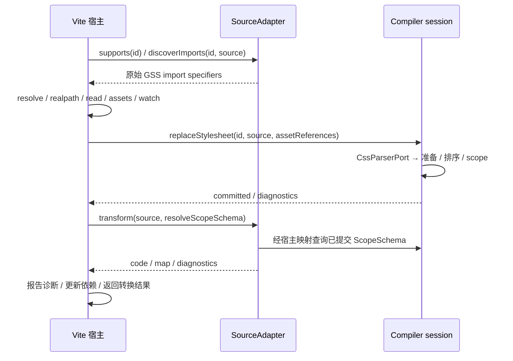

# 核心工作流与架构方向

> 状态：目标与现状映射；owner 已要求开始推进。会话职责和排序器语义高度已拆分，同规则 longhand 已有有界准入；同属性 rank 与输出位置已分离，完整安全 shorthand 展开仍未完成。当前运行行为以 [STATUS](STATUS.md) 和代码为准；进度与下一步见 [NEXT-STAGE](NEXT-STAGE.md)。

## 产品目标与现有边界

GSS 以 CSS 为输入，生成可组合的 scope 引用、原子 CSS 与必要的关系 marker。框架源码 Adapter 负责静态引用转换，构建工具负责文件、依赖、资源和交付；Compiler 不依赖 React 或构建工具。同模块 scope 组合支持既定的所有权／结构语义；跨模块同节点优先级尚不支持。原生 importance、specificity、layer、条件和浏览器匹配仍生效，不承诺任意 CSS 都能原子化。

## 核心工作流：当前实现

1. **宿主与 Adapter**：Vite 调用 Adapter 判断源码、发现 `.gss` import；宿主解析路径、读取源码和资源并编译依赖，再提供 scope schema。React Adapter 对可证明的引用做有限 lowering，返回代码、map 和诊断；动态／未知路径、alias 与跨文件能力有既定边界。
2. **解析与准入**：PostCSS 解析并展开 nesting，保留原始来源，按 selector 分支构造路径、状态和关系。Compiler 验证支持范围、资源、声明、条件与兼容性；当前未知 effect 可整模块 preserved，其他不安全输入拒绝，失败保留 last-known-good。
3. **语义与规划**：绑定 scope target／source／observation，按属性 effect 确定竞争与存活声明；后代、结构、伪元素和 `:has()` 等路径分别规划，并为可证明的语义关系和模块内组合生成排序信息。普通 ownership 路径不必对应 DOM 祖先；需要状态／结构关系时生成 selector，实际匹配由浏览器负责。
4. **marker 与 atom**：scope 导出包含 class 字符串。`gss-a` 表示声明；`gss-s`／`gss-t`／`gss-c` 表示关系来源、目标和中间节点；`gss-hs`／`gss-ho` 用于 `:has()` 的 subject／observed。marker 放入对应 scope，浏览器同时匹配 class、状态及 DOM 关系。复杂 `:has(list)` 保留原生 specificity 和分支身份。
5. **复用与提交**：相同输出身份可在 finalize 汇总；模块内连续相同 pure occurrence 仅在既有证明条件下复用，不能跨竞争者或丢失 scope membership／来源。完整贡献及资源冲突检查成功后 session 才替换旧版本；失败不污染旧结果。
6. **宿主交付**：Vite 开发期跟踪最新异步任务、资源与 CSS 更新；生产期按最终可达 static／lazy 图中的快照汇总 CSS、map、manifest 和资源。aggregate CSS URL 与已交付的 SSR 接入范围见 [STATUS](STATUS.md)。

现状入口：[compiler-session](../compiler/src/application/compiler-session.ts)、[module-contribution](../compiler/src/application/module-contribution.ts)、[finalize-snapshot](../compiler/src/application/finalize-snapshot.ts)、[CSS parser](../compiler/src/infrastructure/postcss-stylesheet-parser.ts)、[React Adapter](../adapters/react/src/index.ts)、[Vite](../integrations/vite/src/index.ts)。

### Scope 输出的职责边界

[scope-exports.ts](../compiler/src/application/scope-exports.ts) 负责按路径汇集贡献规划阶段已经决定的 atom／marker class、形成 scope schema，并生成模块导出及声明类型。它不判断 selector 匹配、决定 marker 触发、剪枝声明、规划排序或选择 fallback；这些决定继续由各自 planner／贡献准备负责。原子化和整模块 preserved 两条路径共用同一输出实现，但两者赋予 scope 的 marker 不因此变成相同语义。

该边界保留既有行为：路径节点与目标按原插入顺序建立，schema 中同一节点的 class 按现有规则排序并去重，代码输出的字段按既有规则排序；selector-list、状态来源和 `:has()` 观察目标的 membership 由调用方按原规则添加。`__proto__`、保留字及生成变量名冲突需要保持可用的自有属性和合法导出；空路径仍是内部不变量错误。移动实现不改变 atom／marker 名称、identity、rank／orderSlot、资源、source map、诊断或 preserved 内容。

此切片只将 scope 输出从 `module-contribution.ts` 提取为内部模块，尚未统一不同关系 planner 的证明，也不提供新的框架适配接口。后续 selector 节点迁移及验证见 [当前计划](NEXT-STAGE.md)。

### 全局资源规划的职责边界

后续身份核对（2026-10-31）：通用 readable-name 编码和 opaque asset identity 都保留原 Unicode 序列，不进行 NFC 归一化；资源仍保留既有 ASCII 转义的 typed-parts 序列化格式。已修正 `asset-values.ts` 中声称通用编码器会归一化的过时注释，没有删除转义或改变 class／资源身份。`readable-name` 和 `stylesheet-assets` 的既有 Unicode 区分回归包含在 `9216360` 的完整 verify 中；本次仅注释／文档修正，无新运行行为。

[resource-planning.ts](../compiler/src/application/resource-planning.ts) 负责 keyframes 引用歧义检查与名称重写，以及 `@property`、`@font-face`、`@keyframes` 的资源身份、CSS、兼容性转换、asset 绑定和来源位置规划。贡献准备仍决定处理顺序、诊断与 preserved 路径；[compiler-session.ts](../compiler/src/application/compiler-session.ts) 仍在提交前调用资源冲突检查，失败保留已有贡献。快照汇总只消费已提交的规划结果，不重新解释资源语义。

身份和来源不能只按输出 CSS 简化：相同 `@font-face` 签名或 `@property` 名字可能对应不同定义，必须保留冲突检查；asset 的身份与最终 URL 分离，兼容转换不能丢失原资源引用；keyframes 同名但不同模块需要各自生成名称。animation shorthand 的关键字／timeline 名称歧义继续沿用现有拒绝行为，frame／descriptor 只有唯一名称时保留对应位置。重构不改变上述决策、顺序、marker、排序或 fallback。资源冲突检查已与资源规划位于同一内部模块，会话仍在提交前调用；资源准入及剩余贡献流程没有整体统一，验证范围见 [当前计划](NEXT-STAGE.md)。

### 关系 selector 与局部 marker 渲染边界

[selector-rendering.ts](../compiler/src/application/selector-rendering.ts) 根据已规划的关系渲染组合符、属性条件、状态后缀和原生 selector 片段，并在原生片段引用局部 class 时通过 scope 树登记对应 marker。调用者仍决定何时需要 source／target／subject／observed marker、关系语义和 specificity；该模块不作 DOM 匹配或规划排序。

例如 `:global(.outside)` 内的 class 保持全局语义，不能登记为局部 scope；嵌套的功能性 pseudo 内局部 class 则需要改写并登记，否则 selector 会引用不可触发的 marker。属性值继续通过 selector parser 序列化，转义和引号不能靠字符串拼接替代。`:has()` 的 native specificity 与分支 witness 仍由现有调用路径决定，组合符空白、state `self` 和原始顺序保持现状；整模块 preserved 的 selector 改写仍是独立路径。本次仅移动共用渲染逻辑，不更改语法准入、marker 身份、fallback 或 atom 顺序；各关系 planner 的统一模型仍未完成。验证见 [当前计划](NEXT-STAGE.md)。

### 规则形态判断与上下文准入

[rule-classification.ts](../compiler/src/domain/rule-classification.ts) 集中贡献准备中使用的 ownership、当前／祖先状态、属性、结构关系、pseudo 和 observation 形态判断。它们是可重叠的谓词，不是互斥枚举，也不单独决定语法准入、planner 路由或 DOM 关系。各调用方继续保留自己的上下文条件。

普通 ownership 的共享形态要求全部关系为 descendant，且无状态、属性、observation 或 pseudo；这一形态本身不检查 external target／condition。逻辑／物理冲突验证的本地准入还必须排除两种 external 上下文，不能因为共享函数而误放宽 `GSS1206`。安全 shorthand 展开的其他条件、已证明的结构优先级、marker 规划和 fallback 均不由该判断单独决定。原有 predicate 条件和调用顺序保持不变；已移除 selector 规划投影，不同 planner 的证明仍独立。验证范围见 [当前计划](NEXT-STAGE.md)。

规则形态判断及 background 特例准入现直接遍历节点条件，节点顺序仍是 authored path 顺序；形态判断保留原先可重叠的语义，不能将节点模型当作额外的 DOM 或能力证明。逻辑／物理冲突检查仍单独排除 external，分组键按节点编码状态、属性、observation 和 pseudo；它与旧四组数组键的上下文相等关系一致，不能仅按节点名称合并，未扩大准入。

### 条件与 layer 上下文边界

[condition-context.ts](../compiler/src/application/condition-context.ts) 集中贡献准备中的未注册条件／layer 诊断、按 layer 与条件分组及现有条件身份编码。规则和 keyframes 的条件／layer 均参与诊断；诊断顺序及 warning 级别保持原样，未注册不等同于拒绝提交。条件按原有顺序编码，空条件为 `base`；分组不证明不同表达式互斥或逻辑等价，也不能跨 layer、条件边界合并 atom。

该模块不负责条件求值、浏览器匹配、semantic height、最终输出排序或 fallback；那些职责仍由各自 planner 和浏览器处理。现有键格式、wrapper 顺序与冲突边界未变，复杂条件推理和通用归一化不属于本切片。验证见 [当前计划](NEXT-STAGE.md)。

### Parser 内部 selector 片段

PostCSS parser 将每个局部 class 的名称、状态、属性、observation 和 pseudo 保存在同一个只读 `ParsedSelectorNode` 中；`CssParserPort` 直接返回节点数组及节点间关系。状态、属性、observation、pseudo 四组平行数组及规则上的 ownership `path` 字段均已移除，贡献准备直接使用 parser 结果，不再经过 `projectForPlanning`。

**2026-10-30 owner 决策：只读 nodes + 派生函数，先不加 WeakMap 缓存。** [getOwnershipPath](../compiler/src/domain/ownership-path.ts) 按需从节点提取名称，返回只读路径值；节点是唯一名称来源。一次操作内可用局部变量复用结果，但不将其重新存入规则。函数没有隐藏状态，不依赖数组身份；不采用 getter，避免对象展开将 getter 求值成独立字段；WeakMap 只能识别对象身份，不能感知原地修改，也没有当前性能证据要求缓存。

例如 `.root:hover .item` 的名称投影为 `['root', 'item']`，不能用它替代 hover 条件或证明 DOM 后代。名称改变应构造新的只读节点输入，再派生路径；原节点的派生结果仍保留原名称。只读是 TypeScript 约束，不增加运行时冻结或响应式机制。parser 的构建片段仍可变，返回后的节点与数组不得修改。

Parser 与规划共用 `ParsedStyleRule` 节点规则结构，删除过渡的 `ParsedSourceRule` 同义别名；selector-list 的分支独立且共享的声明数组／对象保持共享，来源、sourceOrdinal 和条件／layer 保留。删除准备阶段的投影不改变公共 Adapter 或输出身份。`targetPath`／`sourcePath` 是规划绑定结果，仍独立保存：`.root .item` 的 ownership 目标可以包含额外中间 scope，不能用 authored 名称投影替换实际绑定。occurrence 按路径内容识别，不依赖派生数组对象相同。

需要 authored 节点数量、来源位置及 specificity 时直接读取节点；需要 ownership 匹配、marker 身份或名称切片时调用派生函数。关系 planner 的专用证明和绑定尚未整体统一；这次移除重复表示不合并 descendant、结构和 observation 语义。

分支身份、源码跨度、嵌套展开、selector-list 声明共享与诊断不得因此变化。普通完整路径继续去重／排序状态；既有 external target／condition 的提前返回保留原始状态顺序和重复项，不能在行为保持式重构中悄然归一化。外部目标对应的末尾 descendant 关系仍按旧规则去除。此切片不扩大 selector 准入、不改变 marker、排序或 fallback；验证见 [当前计划](NEXT-STAGE.md)。

### 关系规划编排边界

[plan-module-relations.ts](../compiler/src/domain/plan-module-relations.ts) 集中贡献准备中的关系 planner 编排：先按既有形态选择 ownership、descendant、结构及 observation 规则，再依次运行适用的 descendant、结构、pseudo 规划；第一个歧义仍返回原 `GSS1205`，并且先于兼容转换／preserved fallback 判定。各 planner 继续分别负责其语义证明，不能把这些规则视为互斥分类或假定 ownership 就是 DOM 祖先。

只有出现既有条件或结构关系时才提前运行 descendant 规划；纯 ownership 路径仍按原流程在需要排序候选时调用，不应为了合并流程而改变它的时机或支持范围。声明路径、selector 分支、observation 和 candidate／存活 instance 的区别也保留：排序候选不能直接以剪枝后的输出实例替代。 排序候选收集也归此模块：依次保留 descendant candidates、结构 instances、pseudo candidates、同节点／external 规则和逐 observation 的 `:has()` 绑定；纯 ownership 的候选仍在 compatibility／preserved 判定后按需生成。`supportsCurrentBackgroundRanks` 特例、语义高度、`atomRank`／`orderSlot`、marker 和 fallback 均未改变；规则绑定及 planner 内部模型仍未整体统一。验证见 [当前计划](NEXT-STAGE.md)。

通用 ownership 路径匹配位于 [ownership-path.ts](../compiler/src/domain/ownership-path.ts)：规则路径和目标末节点必须相同，前缀按顺序匹配子序列，因此 `.root .item` 的 ownership 可以与包含额外中间 scope 的目标组合。它不证明真实 DOM 祖先；结构组合符、条件来源和运行时 witness 仍由各自 planner 证明。声明胜出、关系规划、语义高度、background 准入与逻辑／物理冲突校验共同使用此函数，不再让通用规划依赖特定属性的准入模块。声明胜出和冲突校验此前单独匹配完整子序列并要求末节点相同；末节点相同时，完整子序列可将最后一次匹配放在目标末尾，与匹配前缀子序列等价，包括重复名称和空路径。匹配边界、声明胜出、冲突准入与排序未变；验证见 [当前计划](NEXT-STAGE.md)。

### 当前节点 background 排序准入

`planDescendantConditions` 对已保留、同一 layer／条件及 specificity 下可同时生效且无法证明蕴含、互斥或存在更强交集的不同声明，通常返回 `GSS1205`。仅当冲突 effect 是 `background-color` 且 `supportsCurrentBackgroundRanks` 通过时，才允许现有模块排序处理这种冲突；这不是所有属性或所有状态均可按源码顺序处理的证明。检查所有潜在竞争规则的原始声明，而非仅检查剪枝后的胜出者，以免遗漏后续仍可能生效的竞争。

该准入只允许相关背景声明是 `background-color` longhand，未分层、无条件、无 external、结构关系、observation 或 pseudo-element；状态只能是目标节点单个 `hover`／`focus`，属性条件也只能在目标节点且每个节点最多一个。路径判断是 ownership 子序列，不推断 DOM 祖先。external target 可能落在任意 anchor 下，因此其背景 effect 要在整个模块检查；不竞争的 external 属性不应触发此屏障。普通 `background` shorthand、`:active`、祖先状态及其他属性冲突不能借此特例放行；例如两条 `color` 状态冲突仍可能报告 `GSS1205`。

在通过准入的路径中，关系规划仍先保留各 predicate 的胜出声明，再将剪枝前 candidates 提供给固定模块排序；原生 importance／specificity、语义高度、同属性 rank 和输出位置继续各司其职。没有触发冲突种子的既有可用输入不因为此检查而额外拒绝；已有 external selector 准入诊断也先于关系规划。此特例是保守准入规则，并非通用 CSS 覆盖证明；是否替代或扩展须先证明竞争闭包、marker 与复用等价，不能仅把属性名泛化。现有回归与验证范围见 [当前计划](NEXT-STAGE.md)。

### Adapter 与宿主接缝：已实现和未验证部分

当前公开的 [GssSourceAdapter](../compiler/src/application/source-adapter.ts) 是同步的三个操作：`supports(id)` 选择宿主交给适配器的源码；`discoverImports({id, source})` 返回原始 `.gss` import specifier，不读文件；宿主解析并成功编译这些依赖后，`transform` 通过原始 specifier 查询对应 `ScopeSchema`，返回代码、可选 v3 source map 和诊断。它是**框架源码适配接口**，与编译器内部将 CSS 转为 `ParsedStyleRule` 的 [CssParserPort](../compiler/src/application/css-parser-port.ts) 是两个不同接缝。

Vite 当前将 transform 的原始 `id` 与源码交给 adapter；对发现的 specifier 去重、解析到 GSS 虚拟模块、添加 watch、编译后建立 specifier→物理文件映射，再执行 transform、报告诊断和返回 map。找不到可解析的 GSS 依赖时宿主报错；transform 中未发现依赖则清理该源码的依赖记录。React adapter 用 Babel 处理 JS／TS／JSX／TSX，发现顶层静态 `.gss` import 并执行其有限静态 lowering；其 `supports` 按文件名后缀匹配，不能据此假设带查询参数的虚拟 id 会命中。具体语法、alias 和动态引用能力以实现和测试为准。

现有 Vite 测试用简单 `.view` 假 adapter 证明 schema 可在宿主与非 React adapter 间传递，并不是 Vue／Svelte 解析、模板绑定、插件顺序、虚拟子模块 id、HMR 或 source map 组合的验证。当前接口是同步 transform，依赖发现通过字符串 specifier；这些约束是否适合某个框架，需要按真实输入和宿主生命周期验证。owner 已确认将 `range?: GssSourceRange` 加入公开 `SourceAdapterDiagnostic`：它是相对于 `id` 所指源码的零起始 UTF-16 半开区间。React 可继续提供范围，Vite 在范围有效且属于当前源码时生成位置和代码框；缺失、无效或不属于当前源码的范围仍不生成定位。该可选类型扩展不改变运行时行为，不代表 Vue／Svelte 已接入；其他 adapter 协议扩展仍需结合具体需求决定。

#### 接口评估与最小调整方案（2026-11-01）

owner 本轮批准的是现有接口评估和新框架／非 Vite 宿主的纸面推演，不是新框架实施。以 `f7acf1a` 的实现为基线，结论是：当前职责分离可以保留，没有从所查调用链与既有测试中找到必须立即修改运行时的契约反例；接口的可替换性不等于所有输入阶段均可接入。



图中 schema 查询经宿主回调完成，adapter 不直接持有 session。无 GSS import 时，当前 Vite 宿主删除该源码的依赖记录并返回 `null`，不会调用 adapter.transform；因此它不是任意源码转换器。失败 replacement 不提交新贡献，宿主也不会将该次失败当作成功 transform；已提交 CSS／schema 与资源快照的 LKG 保留。后续 CSS 输出、生产 census、资源 URL、HMR 传播由宿主组织，不由源码 adapter 决定。

| 接缝／权威入口 | 当前契约与责任 | 反例及扩展边界 |
| --- | --- | --- |
| [SourceAdapter](../compiler/src/application/source-adapter.ts) | 同步发现与转换；输入为宿主当前阶段的源码，返回一份代码及可选 map | 不能直接返回 Promise、多个虚拟模块或额外 watch 文件；不为假想用例预加这些字段 |
| [React adapter](../adapters/react/src/index.ts) | Babel 识别静态 `.gss` import，再根据 schema 做有限引用 lowering；两步各自解析 | `.vue` 模板不是 JSX；`.tsx?query` 不匹配当前 supports。不能仅扩后缀就声称支持框架；不因重复解析启动缓存／性能工作 |
| [Vite 编排](../integrations/vite/src/index.ts) | 原始 specifier 用于 schema 查询；宿主解析别名、物理路径和依赖，成功编译后转换 | `./Card.gss` 与规范物理 id 不是同一种身份；adapter 不能自行 realpath 后改用另一 key 查询 |
| [虚拟 ID](../integrations/vite/src/virtual-id.ts) | 当前 GSS 虚拟模块对应绝对物理 `.gss` 文件；源码 id 原样传给 adapter | `Card.vue?type=script` 的查询和物理 importer、内联 style 的身份／生命周期没有通用协议，不能全局去 query 冒充解决 |
| 诊断与 [定位](../integrations/vite/src/diagnostics.ts) | range 是当前输入 id 的 UTF-16 半开区间；同 id 且边界有效才生成 loc/frame | 子块相对位置不能冒充完整 SFC 位置；其他文件仅有 id/range 不足以生成代码框。React 的 Babel parse 异常仍可抛出，不承诺所有错误均已结构化 |
| JS source map | React map 从输出映射到输入 source，并携带输入内容；Vite 返回给转换链组合 | 若前序预处理已改源码，该 map 不是直接映射磁盘原稿；诊断 range 也不会自动借 JS map 回溯。Compiler CSS map 是另一条输出链 |
| [CssParserPort](../compiler/src/application/css-parser-port.ts) | 内部 CSS 解析接缝，产出规则／资源／诊断；不解析框架文件 | 更换 Vue／Svelte adapter 不需要将框架 AST 放入 domain，也不需要更换 CSS parser；内部 port 不等于已公开 parser 注入配置 |

**新框架纸面推演（未实施／未验证）。** [Vue compiler-sfc 的官方说明](https://github.com/vuejs/core/blob/main/packages/compiler-sfc/README.md) 描述了 facade 与带 query 的 script／template／style 子模块。由此推断，若选择完整 SFC 阶段，应在框架转换前从 script 发现外部 `.gss`，用框架解析器建立 script binding 与 template 引用的联系，返回仍可被框架插件处理的 SFC；单文件、同步、外部 `.gss` 的窄场景可能不需要改公共接口，但模板绑定规则和插件先后必须实测。只改 script 中的引用并不能自动覆盖模板中的引用。

若选择框架生成的 JS 阶段，则必须适配实际虚拟 id、编译后 binding 和来源位置；原始引用可能已被改写，不能把 React lowering 当通用后端。当前 GSS Vite 插件使用 `enforce: 'pre'`，这不保证它拿到磁盘原稿或排在所有其他 pre 插件前。插件分组顺序参见 [Vite 官方说明](https://vite.dev/guide/api-plugin.html#plugin-ordering)；当前在线文档与仓库 workspace 的 Vite 7 并非同一版本基线，这里只作设计参考，不代表升级或新增验证。

[Svelte compiler 官方接口](https://svelte.dev/docs/svelte/svelte-compiler#preprocess) 的 preprocess 返回 Promise，Processed 还可携带 map 和额外依赖。由此推断，若要求 adapter 自行运行整条预处理链，当前同步接口及仅 GSS specifier 的依赖协议不足；若预处理由框架宿主完成，GSS adapter 只做选定阶段的同步改写，则未必需要改接口。两种路径须先确定作者体验与输入阶段，不能为预想中的 Svelte 支持把整个 Compiler 改为异步。

内联 `<style lang="gss">`／自定义块不在当前外部 `.gss` 契约内：即使框架能抽出文本，也还缺稳定模块身份、资源相对基准、schema 可见范围和增量失效规则。这是新能力决策，不作为现有 bug。

**非 Vite 宿主纸面推演。** Compiler session 和源码 adapter 可复用；新宿主仍需实现依赖解析、文件／资源读取、虚拟模块加载、异步更新的新旧任务协调、失败保留与恢复、CSS 输出、map 串联和自身 watch／build 生命周期。Vite 的 production census 与 HMR hooks 不能直接视作通用宿主实现。没有第二个实际宿主前，不提取覆盖所有 bundler 的公共引擎。

**后续最小顺序与决策触发点。**

1. 本轮完成调用链与隐含契约文档化，保持所有运行时代码、公共接口和已确认排序／fallback 不变；没有具体反例，不为接口形式统一而重构。
2. 若 owner 选择真实框架接入，先确认外部 `.gss` 或内联块、作者引用语法、输入阶段及宿主，再实现一个完整窄路径。优先评估完整 SFC、外部 `.gss` 的方案；这是建议，尚未选定产品范围。
3. 只有该路径证明同步、依赖或虚拟输出协议不足时，才提出对应公共接口调整及旧 React／Vite 调用方迁移。Promise 兼容、额外依赖、多个输出各自有独立触发条件，不打包成预设新架构；compiler 排序与 scope 语义不随框架变化。
4. 获准实施后，以当前 React/Vite 回归保护旧调用方；新路径验证绑定与动态引用边界、诊断位置／map、依赖修改→失败→恢复和构建输出。真实框架测试载体及范围随该目标确定，本轮不新建 demo 或验收矩阵。

本轮验证：既有 React 全部 **49** 项，以及 Vite `vite-plugin`／`diagnostic-location`／`dev-css` **51** 项通过，原始日志在 `artifacts/adapter-contract-review/react-tests.log` 与 `vite-tests.log`。首次错误 package filter 没有执行测试，记录保留在 `react.log`，不计入通过数。本轮只改文档，没有重跑全仓 verify、浏览器或外部框架验收，也没有把纸面推演计为支持证据。

### React 多构建工具接入方向（2026-11-01）

owner 已明确下一产品方向为 **React + 多类脚手架／构建工具，优先 Rsbuild、Rspack**。Vue／Svelte 暂不进入实施。以下保留最初方案及后续修正；owner 已确认 Rspack 核心 + Rsbuild 薄封装两个入口，不代表已经支持 Rsbuild／Rspack；现有 React 作者语法、外部 `.gss`、Compiler 排序和 fallback 契约继续保留。

**建议采用一套 Rspack 集成，同时供原生 Rspack 与 Rsbuild 使用。** Rsbuild 官方提供通过 `tools.rspack` 注册 Rspack 插件的方式，见 [配置 Rspack](https://rsbuild.rs/guide/configuration/rspack)。最初考虑仅提供 `integrations/rspack/` 与 Rsbuild 配置示例；后续默认 CSS／HTML 配置核对证明薄封装有明确责任，owner 已确认同时提供 `integrations/rsbuild/`，具体见下方生命周期设计。不为两个入口复制编译和 React lowering，也不提前创建通用 bundler 包。包名、插件导出和选项尚未定稿，须在实施设计中给出最小可用配置后确认。

```text
React JS/TS/JSX/TSX + 外部 .gss
          ↓
现有 React Adapter + Compiler session
          ↑
Vite 集成（既有）     Rspack 集成（拟新增）
                         ↑           ↑
                  原生 Rspack     Rsbuild 配置入口
```

| 能力 | 复用或新增位置 | 必须守住的约束 |
| --- | --- | --- |
| import 发现、scope 引用转换 | 复用 adapters/react | 在 JSX/TS 被 SWC 等转换之前执行；不依赖 Vite 的 pre 钩子语义 |
| `.gss` 编译、schema、排序、复用 | 复用 compiler | 不为宿主差异修改 atom 身份／rank／fallback；配置的 CSS compatibility target 必须明确映射 |
| 文件解析与依赖 | 新 Rspack loader/plugin 配合宿主 resolver | 原始 specifier 与规范物理身份分开；别名、资源依赖和 map 沿宿主管线传递 |
| session 生命周期 | 新 Rspack 集成内部 | 按 compiler／构建环境隔离，不用进程全局 session；增量、缓存命中和并发编译不能丢贡献或混入旧模块 |
| CSS／资源输出 | 使用 Rspack 产物和模块图能力组织 | 必须汇总当前可达贡献，不能按 loader 完成顺序决定最终 CSS；不能从 Vite hooks 直接复制 census |
| 开发更新 | 新宿主实现 | CSS-only、schema 改变、非法输入保留／恢复分别核对；不预先承诺 React state 始终保留 |
| Rsbuild 使用 | 初期直接注册同一插件 | 使用 Rsbuild 所携 Rspack 的兼容版本；不把某个脚手架通过外推为全部 Rspack 配置可用 |

[Rspack loader context](https://rspack.rs/api/loader-api/context) 提供异步回调、依赖登记、source map 返回等接缝；这只证明存在实现入口，不证明生命周期方案已正确。缓存可能跳过 loader，故不能仅靠 loader 的内存副作用收集 CSS；具体贡献重建／缓存协调方案是首个技术核对项。Rsbuild 的 `api.transform` 也可转换代码，但仅源码转换无法独自完成全局 CSS、资源和增量生命周期，故不另写一套 Rsbuild-only 编译器。该取舍基于 [Rsbuild 插件接口](https://rsbuild.rs/plugins/dev/core) 与当前 GSS 会话契约。

**建议交付顺序。**

1. **确定最小配置与生命周期方案。** 固定实际测试的 Rsbuild／Rspack／React／Node 版本；给出插件入口、loader 顺序、CSS 加载方式、compiler/session 与 compilation 的关系，以及缓存命中时如何恢复完整贡献。复用 Vite 的纯逻辑前先核对依赖，不先移动整个 Vite 实现。对公共配置和 CSS 使用方式的新增选择由 owner 确认。
2. **构建闭环。** 用同一最小 React 源码分别经原生 Rspack 和 Rsbuild 构建，验证现有字符串语法／scope schema、JS map 与诊断位置、CSS 与资源 URL、可达模块汇总；class 和 CSS 的预期来源于现有 compiler 契约及独立原生参考，不以 Vite 结果作为唯一 oracle。仅完成本步不能标记开发模式支持。
3. **开发闭环。** 验证初次加载、只改 CSS、scope mapping 修改、非法输入→恢复、资源修改，以及增量／缓存后与干净构建一致。优先利用宿主标准更新与诊断机制，不引入跨宿主 HMR 框架。保留失败证据和既有精确图像规则。
4. **交付两个消费入口。** 在仓库外以本地 tarball 验证 Rsbuild React 脚手架和原生 Rspack 配置，记录配置、确切版本、通过范围和限制；运行现有 React／Compiler／Vite 回归。已获准的新宿主需要最小集成测试，但不顺带扩大为 SSR、Module Federation、多环境或更多脚手架的矩阵。公开发布仍需单独授权。

本轮只更新方向与方案，未安装新依赖、添加集成包或执行新宿主测试。SSR／SSG、路由框架和其他 bundler 不因“等等”自动获得支持承诺；后续按真实需求扩展。

#### React 生态覆盖规划（2026-11-01 调研）

owner 进一步明确：先覆盖 React 生态及其主要构建工具解决方案，待这一阶段稳定后再进入 Vue 等其他 UI 框架。本轮是粗粒度调研规划，不实施新集成；上一节 Rspack 复用方案仍是建议，不把本轮方向确认写成公共接口已经批准。

**选型依据。** 这里按官方推荐、接入复用收益和项目现状排序，不声称给出了下载量／市场份额排名。[React 从零建站指南](https://react.dev/learn/build-a-react-app-from-scratch) 列出 Vite、Parcel、Rsbuild；[React 创建应用指南](https://react.dev/learn/creating-a-react-app) 则区分构建工具与应用框架。两层应分别验收：脚手架创建成功不等于宿主完整支持，bundler 通过也不等于 SSR／RSC 框架通过。

| 层级／建议顺序 | 对象 | GSS 当前状态与推进理由 |
| --- | --- | --- |
| 第一批，守住既有 | React + Vite / create-vite | 已有实现和有界外部证据。维护既有回归，明确实际 React 插件／版本，不能自动外推所有 Babel、SWC 或其他插件排列 |
| 第一批，新增重点 | React + Rsbuild，以及直接 Rspack | owner 点名优先；建议共用 Rspack 集成。Rsbuild 是用户主要接入示例，直接 Rspack 用来确认底层集成不依赖脚手架隐含配置 |
| 第二批，存量构建链 | React + webpack 5 | 在 Rspack 闭环后核对 loader／plugin 差异，再决定复用范围。Rspack 兼容多数 webpack loaders 不代表插件及缓存生命周期完全一致，必须独立验证 |
| 第二批，独立构建链 | React + Parcel | React 官方列出的选项，值得纳入覆盖评估；它有独立插件体系，需单独评估 transformer／打包输出职责，不能包装 Rspack 插件宣称兼容 |
| 应用层，先复用已有 | React Router Declarative / Framework | 现有 Vite 客户端路由与有限 SSR 证据保留；底层受影响时复验。其他宿主、模式和版本单列，不重复从零做已交付路径 |
| 应用层，下一候选 | TanStack Start | 官方提供 Vite／Rsbuild 路径，可在两条底层稳定后评估路由及 server/client 输出；不因 bundler 支持就承诺 Start 的 SSR 或 server components |
| 应用层，单独重点专项 | Next.js | 纳入 React 生态路线，先做可行性核对。webpack 与 Turbopack 路径分开，App Router 的服务端／客户端边界、CSS 加载及 RSC 不能用普通 SPA 结论代替 |
| 开发工具，后续消费验证 | Storybook React | 按具体 builder 接入，验证组件预览消费；优先复用已支持宿主，不先增加独立 GSS 编译实现 |

webpack 复用的依据与限制见 [Rspack 迁移说明](https://rspack.rs/guide/migration/webpack)；Parcel 的独立接缝见 [插件体系](https://parceljs.org/plugin-system/overview/)。[TanStack Start 官方说明](https://tanstack.com/start/latest/docs/framework/react/overview) 已列出 Vite／Rsbuild；[Next.js Turbopack 文档](https://nextjs.org/docs/app/api-reference/turbopack) 明确与 webpack 配置存在差异；[Storybook builder 接口](https://storybook.js.org/docs/builders/builder-api) 说明其构建器层。以上是选型资料，不是仓库已验证版本清单，实施时必须固定版本重新核对。

不将 CRA 作为新增首选入口：[React 已弃用其新项目创建用途](https://react.dev/blog/2025/02/14/sunsetting-create-react-app)。如有存量需求，单独评估其配置约束，不能将 webpack 通过等同于未 eject 的 CRA 可用。React Native／Expo 不属当前 Web CSS 目标；更多框架、SSR 部署平台及 Module Federation 不是自动新增任务。

**执行节奏。** 先完成上一节 Rsbuild／Rspack 的配置和生命周期设计，再依次打通 build、dev、外部消费；每个通过切片提交。第二批优先核对 webpack 复用成本，再做 Parcel 可行性评估。与此同时在进入上层框架实施前，先完成 Next.js 的阻塞点调查，避免最后才发现所需扩展机制不可用；调查不等于批准双后端、RSC 或新作者语法。React Router、TanStack Start、Next.js 的具体支持范围和必要验收在各专项开始前确定，不一次生成全部应用／浏览器组合矩阵。

**进入其他 UI 框架前的阶段门槛。** “React 没啥问题”指选定支持范围稳定，并非证明整个 React 生态无缺陷：

- 第一批 Vite、Rsbuild／Rspack 的 React 外部 `.gss` 路径完成开发及生产闭环，保留同一作者语法和已确认的排序／fallback。
- 选定版本下，JS／TS／JSX／TSX、别名与依赖、资源 URL、诊断／map、CSS-only 更新、schema 变化、非法输入恢复、增量／缓存与干净构建一致性有证据；Fast Refresh 的状态保留边界明确。
- 已声明支持的路由／SSR 路径有实际加载、导航和产物证据；不存在已知未解决的阻塞性契约错误。失败历史、版本范围及未验证组合如实记录。
- webpack、Parcel、Next.js 等重点候选都有明确结论：已支持、存在具体阻塞，或由 owner 接受暂缓。不能默默跳过后宣称“React 生态完成”，也不无限等待所有组合支持。
- 接入说明、最小配置、包消费与回归可重复；用户确认这一 React 阶段的剩余限制可接受后，再选择 Vue 等新 UI 框架。无需为了新 UI 框架提前修改 Compiler domain。

下一具体工作仍是 **Rsbuild／Rspack 最小配置与生命周期设计**。本规划未改变 CSS 语义、公共接口或 fallback，未产生新的运行验证。

#### Rsbuild／Rspack 最小配置与生命周期设计（2026-11-01）

本轮 owner 授权推进设计，保留 React 外部 `.gss` 使用方式、排序和 fallback。以下区分**拟定契约、实测接缝和未解决实现**；不是已交付宿主。新证据修正上一节“Rsbuild 初期仅给配置示例”的建议：倾向于增加轻量 Rsbuild 封装，读取其有效 CSS／HTML 配置，共用同一 Rspack 核心；owner 随后已确认采用这两个入口。

**最小消费配置草案。** 原 React 源码保持 `import styles from './Card.gss'` 和 `<div className={styles.card}>`，旧 `.self`、动态／未知引用及现有诊断边界不变。拟新增的包名与函数名如下，尚未实现或发布：

```ts
// rsbuild.config.ts：React 插件仍由应用配置，GSS 不替代它。
import { defineConfig } from '@rsbuild/core';
import { pluginReact } from '@rsbuild/plugin-react';
import { pluginGss } from '@gss-l/rsbuild';
import { react } from '@gss-l/react';
export default defineConfig({
  plugins: [pluginReact(), pluginGss({ adapter: react() })],
});
```

```ts
// rspack.config.ts：加入现有 React/SWC/HTML 配置的 plugins。
import { gss } from '@gss-l/rspack';
import { react } from '@gss-l/react';
// ...既有 Rspack 配置
// plugins: [ ...既有插件, gss({ adapter: react() }) ]
```

原生 Rspack 片段不是完整 React 配置；插件负责内部 GSS loader 注册，应用不手配 loader 顺序。默认 HTML 生成路径目标是自动加载汇总 CSS，不要求每个 React 文件新增 CSS import。无 HTML 的库构建／自定义 SSR 入口、既有 `virtual:gss.css?url` 在新宿主中的实现另列，首个 SPA 路径未完成前不承诺这些入口。公共选项首稿仅 `adapter`；projectRoot 取 compiler.context。无法从原生 Rspack 获取有效 CSS 处理阶段时，须提供具体错误与配置方案再讨论必要选项，不能默认猜 targets 或修改 fallback。Rsbuild 封装负责使用公开配置／hooks 传递宿主信息，不通过猜测插件 constructor/name 识别内部实例。

已确认职责与目标目录（尚未创建产品包）：`integrations/rspack/` 放插件、内部源码／GSS loader、构建快照及输出协调；`integrations/rsbuild/` 仅放配置／HTML／targets 对接。`adapters/react/` 和 Compiler 保持原职责。两个宿主封装共用 Rspack 实现，但不从 Vite 提前抽出公共宿主框架；若要提取无宿主依赖的资产处理，先做原行为对照。

**数据所有权与生命周期。**

| 对象 | 生命周期与数据 | 不允许的做法 |
| --- | --- | --- |
| 宿主状态 | 每个 compiler 独立，保存最后成功发布的普通数据快照及配置指纹 | 进程级共享 session；跨 build 保存 Rust-backed Module／Compilation 对象 |
| 本轮候选 | 每个 compilation 新建，保存原始输入快照、资源 bytes、诊断、规范路径和异步任务 | 边编译边覆盖已发布 CSS；失败任务混入下一轮 |
| 单模块准备 | loader 为 React schema／GSS moduleCode 准备同一输入的结果，可按本轮 canonical id 去重 | 依赖 loader 执行次数决定有哪些 CSS；并行最后完成者决定顺序 |
| 全局候选 session | 从本轮可达 GSS 输入按规范 id 确定性重放，集中检查全局资源冲突并 finalize | 仅增量追加旧 session，遗留不再引用的贡献；把局部编译成功当成整轮成功 |
| 已发布快照 | 本轮 GSS 校验及宿主产物成功后才更新；失败保留上一成功版 | 用旧 schema 伪装本轮非法源码转换成功，或发布新 JS 搭配旧 class mapping |

1. **初始化。** 按环境解析真实 CSS 处理阶段、root、public 资源和路径规则；禁止无意改变 `.gss` 的模块类型。通过 loader 的执行顺序确保 adapter 读到 JSX／TS 原始输入；与用户自定义 pre-loader 的关系需要定向验证，不能只写 `enforce: pre` 就认定完成。
2. **发现与局部转换。** 原始 specifier 经宿主 resolver 解析，统一 realpath 身份；读取源码／资源通过宿主文件系统。登记 watch 依赖并成功编译后提供 schema，adapter 仍同步。`.gss` loader 返回既有 moduleCode；不得将整个编译器搬入 loader 或引入 framework AST。
3. **确定本轮输入集合。** 从 entry 沿静态／动态边遍历模块图，采集实际可达 `.gss`；包含 lazy，排除 speculative load／断开的旧模块。初期目标延续 Vite 的可达图语义，不另加按 tree-shaking 使用标记删 CSS。缓存命中即使 loader 不运行，也可从图中找回依赖并读取输入。内存／持久缓存与优化后模块形式仍需实测，不依赖未承诺可序列化的自定义 buildInfo。
4. **全局汇总。** 为全部可达输入建立一致候选快照并重放到新 session；局部 moduleCode／schema 必须与汇总中的对应结果一致，变化中的文件导致的不一致应使本轮失败并重试下一轮，不能拼接两代内容。全局资源冲突仍按现有契约报错。CSS 排序交给 Compiler，不按 loader、chunk 或文件系统完成顺序排列。
5. **输出与提交。** 目标是一份 aggregate CSS 及正确引用的资源，hash 基于最终 bytes；产物、source map、HTML 和资源 URL 同代。不得在 bundler 完成 hash 后再字符串替换 JS／CSS。输出成功才替换已发布快照。旧 dev 资产何时释放须结合宿主 HMR 交付验证，不能照搬 Vite 的定时器。
6. **watch／失败／恢复。** 本轮不再引用某模块时，从候选集合消失；这与物理 `.gss` 文件删除不同，不扩大既有删除支持边界。非法更新通过宿主 error 传播，旧页面保留已发布样式；修复后即使恢复成旧 bytes 也要消除错误并完成更新。CSS-only、schema 变化及资源变化分别验证；不承诺所有 HMR 均保留 React state。

这是内部实现目标，不增加 Compiler session 公共事务／clone API。单模块准备与全局重放可能重复编译，先保证语义正确；本轮不做 profiling 或缓存优化。后续确有需要才能基于证据减少重复，不能为了省一次解析引入隐式跨 compilation 状态。

**探针与版本证据。** 本地隔离依赖位于 `artifacts/rspack-lifecycle-design/`，未修改 workspace package／lockfile。registry 查询并安装 Rspack **2.3.0**、Rsbuild **2.3.0**（依赖 Rspack `~2.3.0`）、plugin-react **2.1.1**；执行 Node **22.22.3**。这些是探针版本，不是最终 peer range 或向旧版本兼容的承诺。资料参见 [Compilation](https://rspack.rs/api/javascript-api/compilation)、[hooks](https://rspack.rs/api/plugin-api/compilation-hooks) 和 [JS 对象生命周期](https://rspack.rs/api/javascript-api/architecture)；实现时以安装版本类型与行为为准。

- `probe.mjs`／`probe.log`：原生 Rspack watch 三轮，第一轮两个 GSS 假模块，第二轮仅改入口仍有两个，第三轮移除 lazy 引用后只剩一个。第三轮 GSS loader 执行数为零，图仍识别剩余模块；在 finishModules 重建汇总 CSS 假模块，输出相应从两条降至一条。这里使用假模块与字面 CSS，不是 GSS／React 正式集成，也不是浏览器验证。
- `probe-initial.log`：首次断言错误地要求第二轮 loader 必须零执行，实际第二轮仍执行，第三轮才为零；保留原始失败。更正断言为实际要证明的第三轮缓存命中场景后再次通过，不声称已解释第二轮重建原因。
- `inspect.mjs`／`rsbuild-config.json`：实际 Rsbuild 默认配置包含 css-extract、css-loader、lightningcss-loader 的浏览器 targets 和自身 HTML 插件。`@rsbuild/core` 类型提供 modifyHTMLTags／modifyRspackConfig；这是轻量封装有实际责任的依据，不应盲把独立 HtmlRspackPlugin 的 hooks 当成 Rsbuild 默认 HTML hooks。
- `rsbuild-probe.mjs`：同一晚期 CSS 重建策略经过 Rsbuild 默认提取链时，原生进程异常退出 **134**，日志 `rsbuild-probe-panic.log` 包含 `should have event sender`。设置 `GSS_PROBE_SKIP_REBUILD=1` 只取消重建后，对照构建成功，见 `rsbuild-probe-control.log`；空 CSS 符合这个对照，不是功能通过。首次探针 JS 括号错误另保存在 `rsbuild-probe-syntax-error.log`。

**输出机制仍未定案。** 上述结果排除了“原生 Rspack 探针通过，就采用 finishModules + rebuildModule 贯通 Rsbuild”的直接结论。异常发生在这条接入组合，尚未定位上游内部根因，不宣布 Rspack 存在某个已确认通用 bug，也不通过禁用用户缓存或 CSS 提取绕过。

下一技术核对优先评估在 GSS 汇总后通过正式 asset／HTML hooks 输出 CSS，保留宿主等价的 CSS 处理阶段，并设计可随 HMR 发布的样式引用；若需要专用 runtime，应先证明同轮 hash／CSS-only 更新／失败保留成立，再决定是否引入。另一条候选是在正常模块构建阶段完成汇总 CSS，必须解决未完成图与异步依赖发现，不能先扫描磁盘猜所有输入。两条都不得改排序或 fallback，也不能静默绕过 Rsbuild 的 Lightning CSS／自定义后处理。此次不选一个尚未通过的机制冒充可实施定案。

**已确认的入口。** owner 已接受 `@gss-l/rspack` 核心 + `@gss-l/rsbuild` 轻量封装，React 源码完全沿用现有方式。无需再次询问是否提供薄封装；包尚未实现／发布。输出生命周期后续结果见下节，技术异常诊断由 agent 负责。

本轮设计与探针不算新宿主通过验收。未跑全仓 verify／浏览器；未变产品代码、React 作者语法、排序、fallback 或 Vite 路径。

#### CSS asset 输出与更新生命周期核对（2026-11-01）

**当前结论：asset + HTML hooks + Rspack runtime 的传递路径已有有限实测依据，可继续细化；不能直接作为完整集成发布。** 沿用上节隔离环境的 Rspack／Rsbuild 2.3.0、plugin-react 2.1.1、Node 22.22.3。未修改 workspace 依赖和产品代码。

本轮候选路径如下：

```text
本轮可达模块输入 → 汇总候选 CSS
  ├─ runtime 生成样式文件引用（参与本轮 JS／HMR 生成）
  └─ processAssets ADDITIONAL 输出带 contenthash 信息的 CSS asset
       → 宿主 CSS minimizer → real content hash 更新引用
       → HTML 正式 hook 注入 stylesheet link
开发更新 → 原生 HMR runtime 更新引用 → 新 link 加载成功后移除旧 link
```

这里使用 Rspack 的 [RuntimeModule 接口](https://rspack.rs/api/javascript-api/compilation) 与 Rsbuild 的 [HTML hooks](https://rsbuild.rs/plugins/dev/hooks)，没有晚期重建 CSS 模块，也没有在生成 hash 后手工替换 bundle 字符串。探针 runtime 只是传输机制验证，不是已选定的生产 runtime；HTML／runtime 共享标识去重、快速连续更新的竞态、加载失败回滚等还需完善。

**已确认的失败发布策略。** owner 明确接受：启用 GSS 的 Rsbuild／Rspack 开发构建中，**任何编译错误（包括非 GSS 的 JS／TS 错误）均不发布本轮新产物，保留上一成功版**。采用 Rspack 自带 `NoEmitOnErrorsPlugin` 的机制，不只拦 `shouldEmit`。此为新宿主的错误交付策略，不改变 CSS fallback、不将非法输入当成功，也不修改既有 Vite 行为。首次构建失败时没有成功版可保留，必须显示错误。错误仍传给宿主客户端／overlay，不能因为保留旧页面而隐藏诊断。

原生机制的必要性由对照得到：只在 shouldEmit 返回 false 时，失败构建后的浏览器仍持有上一成功 hash，但恢复产物的 HMR 链没有对应请求，下一次样式更新无法完成。替换为原生 NoEmitOnErrorsPlugin 后，两宿主恢复链通过。不要用 full reload 掩盖该对照，也不要把文件未输出误认为 HMR 状态已经保留。

| 本轮探针 | 观察与独立断言 | 尚未覆盖 |
| --- | --- | --- |
| `output-probe.mjs rspack` | Chromium 字面样式红→蓝→故意编译失败→恢复同一蓝色 bytes→红；失败保持蓝色，最后 boots=1 | React state／Fast Refresh、真正 GSS schema 变化及默认 dev-server WebSocket |
| `output-probe.mjs rsbuild` | 同一序列和断言通过，runtime 引用经原生 HMR 更新；无页面重启 | 同上；通过 `createCompiler().watch()` 和探针 HTTP 服务，手动调用 `module.hot.check(true)`，不是完整 Rsbuild dev server 验收 |
| `production-probe.mjs rspack` | 独立生产编译，显式 Lightning CSS minimizer；CSS bytes 确实被压缩，HTML 与 JS 引用最终 CSS 文件名 | 任意 CSS 值语义、map／资源 URL、复杂 publicPath |
| `production-probe.mjs rsbuild` | 使用 Rsbuild 默认生产 minimizer 与 modifyHTMLTags；同样通过压缩、最终文件名及两处引用断言 | 默认 CSS loader／PostCSS 不会因 emitAsset 自动执行；生产页面未作浏览器验收 |

原始通过日志为 `artifacts/rspack-lifecycle-design/output-rspack.log`、`output-rsbuild.log`、`production-rspack.log`、`production-rsbuild.log`；探针中 `.gss` loader 返回常量导出，CSS 来自字面源文本，不包含真正 Compiler／React Adapter。这是刻意隔离 CSS-only runtime 变化，不能据此宣称真实 GSS 已完成接入。浏览器使用现有 Playwright 的 Chromium，未改变仓库任何默认浏览器入口或扩为三引擎矩阵。

失败记录完整保留：`output-*-initial.log` 为首次超时；诊断日志 `output-rspack-diagnostic.log` 显示额外启动编译和 HMR 请求。探针最初直接消费 FIFO 回调，可能拿到启动时的额外 build；修正为按错误状态和候选 CSS 内容匹配本轮结果。随后 `output-*-shouldemit-only.log` 仍复现恢复链断裂，证明不能只归因于 harness。最终原生 NoEmitOnErrorsPlugin 路径通过。此前晚期 CSS rebuild 的 panic 记录也保留，没有宣布根因已修复。

**下一实施前必须完成的技术核对。**

1. **真实 CSS 处理阶段。** `emitAsset` 可以进入 minimizer，但不自动执行 css-loader／lightningcss-loader／PostCSS。Rsbuild [Lightning CSS 配置](https://rsbuild.rs/config/tools/lightningcss-loader) 区分 loader 与 minimizer。必须把实际阶段和 targets 传入 Compiler compatibility，并为 aggregate CSS 提供等价的最终处理；不能仅从 Browserslist 猜所有阶段，也不能无声跳过用户 PostCSS。现有 Compiler 的 compatibilityTransformer 是声明／资源级处理，不可冒充完整宿主 CSS 管线。自定义阶段无法可靠镜像时先明确具体限制与影响，涉及能力／fallback 选择再找 owner。
2. **真实模块闭环。** 替换假模块为现有 React Adapter + Compiler；核对本轮候选和局部 schema／moduleCode 一致、错误恢复、资源引用及 source map。loader 未运行时仍从图取得贡献。不能直接搬用探针中基于普通文件系统的读法作为支持虚拟文件系统的实现。
3. **传递与发布完善。** HTML 和 runtime 的 link 使用同一标识避免重复；新样式加载失败保留旧样式，连续更新不能让迟到回调删除较新版本；验证默认 dev server 的错误 overlay／恢复、schema 改变传播、publicPath、资源及旧产物生命周期。只在候选完整且宿主构建成功时更新已发布快照。

本次保持已确认的两个入口、React 使用方式、排序及 fallback。不运行全仓 verify 或既有浏览器全套，因为产品代码未变；上述局部 Chromium 探针是新增证据，不能混入历史完整验收计数。后续 CSS loader／targets／后处理对照见下节，当前无待 owner 决策。

#### CSS loader／targets／PostCSS 对照（2026-11-01）

接续上一节完成一轮有界处理阶段核对，仍使用隔离的 Rsbuild／Rspack 2.3.0 环境，不修改产品或 workspace 依赖。结论：**asset 输出本身不足以复用 CSS 管线；实际解析后的原生处理器可以复现本次普通 CSS 对照，值得继续验证内部接入方式。** 这不是已经确定新增独立 compiler 架构，也不是任意 loader 都能抽出运行的保证。

`css-stages-probe.mjs` 在开发模式关闭 minify，以同一字面 `.probe { appearance: none; color: red; }` 分别走普通 CSS import 与直接 emitAsset：

| 配置 | 普通 CSS 路径 | 直接 asset 负对照 |
| --- | --- | --- |
| 默认 | 实际经过 Lightning CSS loader | 保留未经 loader 处理的原文 |
| loader targets = Safari 9 | 生成 `-webkit-appearance: none` | 缺少此前缀，确认不是只差格式 |
| 自定义 PostCSS | 独立插件加上 `--stage-oracle: passed` | 缺少该声明，确认配置没有执行 |

这三组由 `css-stages.log` 保留配置与实际 loader 跟踪。不能用生产 minifier “碰巧补出相同前缀”掩盖开发模式缺失，也不能认为已输出 CSS asset 就自动运行 PostCSS。[Rsbuild 的 PostCSS 配置](https://rsbuild.rs/config/tools/postcss) 可包含函数、项目配置文件和插件对象；[Lightning CSS 配置](https://rsbuild.rs/config/tools/lightningcss-loader) 也区分 loader 与后续压缩阶段。

`css-processor-probe.mjs` 从 Rsbuild `initConfigs()` 返回的配置取得**这组普通 CSS 规则实际生成的** Lightning CSS／PostCSS loader 路径、选项和顺序，交给隔离的 Rspack 原生编译执行；没有手工改用另一版本的 JS Lightning CSS 或重建 PostCSS 插件列表。三组结果分别与普通 CSS 产物去掉首尾空白后逐字相等，见 `css-processor.log`。探针按已知规则选择处理器，不能把这种 fixture-specific 查找写成“任意用户规则解析器”。

`css-dependency-probe.mjs` 增加真实文件依赖：PostCSS 插件读取 `token.txt`、输出字面 token 并通过 dependency message 声明依赖。普通 CSS 和隔离处理器输出一致，且后者 `compilation.fileDependencies` 包含该文件，见 `css-dependency.log`。这只证明依赖信息可取得，**未验证主 compiler watch 自动收到该依赖**；未来若使用子处理步骤，必须把文件／目录／missing dependencies 和诊断传回主 compilation。

**实施约束与下一验证顺序。**

1. 复用最终解析出的配置，不只读用户配置原文；function、环境、配置文件与自定义 rule 可能改变实际处理。原生 Rspack 没有 Rsbuild 的配置约定，不能默认推断同一规则形状。GSS 内部生成的 CSS 也不应因用户 CSS Modules 命名规则被再次重命名 class。
2. 保留阶段顺序：PostCSS 等前处理 → 有效 Lightning CSS loader 阶段 → 后续 asset minimizer。从实际适用阶段映射 Compiler compatibility targets；JS target、Browserslist 原始文本和最终 CSS target 不是同一事实。minifier 的 include/exclude 与自定义选项也必须核对，不能简单读取一个默认值。
3. 下一项把处理步骤放进主构建候选生成阶段，验证同轮处理结果／hash、PostCSS 依赖修改触发主 watch、处理错误→保留→恢复、source map 串联及 warning/error 来源。先验证生命周期，不新增公共 hook、独立进程服务或通用 loader 执行框架。隔离编译只是探针载体，其额外编译成本没有被测量或认定为可接受性能。
4. 聚合 CSS 的输入身份和相对资源基准需要明确定义；filename-sensitive 插件、`@import`、URL 重写和额外依赖不能凭这四个输入外推兼容。不得通过剔除 PostCSS、跳过 targets、全局关闭缓存或改变 preserved fallback 来取得通过。若实际无法在现有契约内接入，再提出具体能力范围让 owner 决定。

本轮共三个阶段负对照、三个原生处理器输出对照和一个文件依赖对照通过；不把它们计入现有单元测试总数。没有新的浏览器、完整 verify 或正式 React 集成验收。上一节 CSS-only／HMR 及生产 hash 证据仍保留，不因本轮处理器对照就视为已与真实 GSS 串联。现有 React 用法、排序、fallback、两个入口及任何编译错误保留上一成功版的决策不变，当前无新增 owner 决策。

#### 主构建处理与真实 React 闭环（2026-11-02）

**已确认 source map 边界。** owner 接受首版最终 CSS map 沿用原生处理器保留的规则起点精度；Compiler 诊断继续保留原始声明范围。此决定仅针对新 Rsbuild／Rspack 集成的最终 CSS 调试映射，不减少 Compiler 自身 map 的生成精度，也不改变 React JS map、排序、fallback 或既有 Vite 行为。不得为保留细粒度映射跳过兼容转换。

本次输入 `.probe {\n  color: red;\n}` 的 Compiler map 可将生成声明对应到原始文件第 2 行、第 2 列（列从 0 开始）。经过原生 Lightning CSS 后，生成规则起点仍可追溯到该声明，但查询生成规则内部的 `color` 位置没有 mapping。保留 PostCSS、仅移除 Lightning CSS 的诊断对照仍保有声明映射。这里的“规则级”是**生成规则起点可追溯**，不承诺所有原始规则、所有声明或 DevTools 的回退定位方式都相同。去掉 Lightning CSS 的运行只作归因对照，不能成为正式配置默认值。

**主构建中的处理步骤已完成有界验证。** `artifacts/rspack-lifecycle-design/integrated-processor-probe.mjs` 在主 compilation 的 finishModules 内调用原生处理步骤：输入来自真正 Compiler 的 CSS／map，loader 选项来自 Rsbuild 解析后的配置；处理器不落盘自己的 bundle，主 compilation 负责输出。

- 将处理器的 file／context／missing dependencies 回传主 compilation。PostCSS 读取 `token.txt`，只改该文件即可触发主 watch；已验证红→蓝→PostCSS 故意失败→恢复同一蓝色→红。失败时已输出 CSS bytes 保持上一版，恢复成功。
- 失败期间保留上一成功处理步骤的已知依赖，防止插件抛错前没能完整返回 dependency message，导致之后修复不再触发重建。探针采用依赖集合累积；正式实现应按成功快照替换，失败保留旧集，不能永久积累已不再使用的依赖。
- 向 loader 传入 map 前复制并把 sources 从 Compiler 的项目相对身份转换为正确的绝对路径。处理器会处理传入的 map，不能共享原对象而让其污染 Compiler 快照。原生处理器编译还需启用 source map，不能只设置 PostCSS 的 sourceMap 选项。
- `integrated-processor.log` 记录通过的主 watch／失败恢复及规则起点映射；`integrated-processor-map-control.log` 记录关闭 Lightning CSS 的声明级对照。没有将后者记为正式路径通过。

原始失败保留在同目录：`integrated-processor-handler-error.log` 是探针假定 fatal error 时仍有 stats 的错误；`integrated-processor-map-failure.log` 是处理器 devtool 关闭导致无 map；`integrated-processor-null-position.log`／`integrated-processor-declaration-map-failure.log` 保留声明定位失败和源路径错误；`integrated-processor-color-expectation.log` 是等待 `blue`，但原生处理后实际为 `#00f` 的预期错误。随后用明确的生成声明预期判断，不能用 class 名中包含 red/blue 代替实际 CSS 值断言。没有削弱未获批准的定位要求；规则级边界由 owner 单独确认。

**真实 React／Compiler 链接探针。** `real-react-probe.mjs` 将常量导出替换为 Compiler 返回的 moduleCode，并用现有 `react()` adapter 处理 JSX。宿主 loader 经 resolver 发现 `.gss`、登记依赖、准备 schema，再调用 adapter；本轮模块图可达输入集中重放到 session，并检查局部 moduleCode 与汇总重放结果一致。aggregate CSS 进入原生处理器，再沿上一节 asset／runtime 路径交付。

原生 Rspack 与 Rsbuild 各自的 Chromium 输入都是原有 `import styles from './styles.gss'` 与 `className={styles.probe}`。两条路径通过红→蓝→非法 `.gss`→恢复同一蓝色输入→红；浏览器计算样式逐步符合字面预期，root 启动计数均为 1。真实 class 随声明值改变，测试通过显式 `module.hot.accept('./styles.gss', render)` 更新 React 渲染，**不据此承诺 React Fast Refresh 状态保留**。日志为 `real-react-rspack.log` 与 `real-react-rsbuild.log`，沿用 Rspack／Rsbuild 2.3.0 和现有测试工作区的 React 包。非法输入使用 Compiler 的结构化诊断内容作为构建错误，不改成成功 fallback。

**证据边界与正式实现顺序。** 本次仍在 `artifacts/` 内运行；两宿主使用 compiler.watch + 探针 HTTP 服务、手动 HMR 检查，不是默认 dev server。处理器使用单独原生 compiler 作为实验载体，不能据此确定最终内部编译结构或宣称性能已验证。用于测试的 targets 显式匹配当前默认配置，动态 targets／自定义规则选择尚未产品化。

下一项进入正式集成的模块实现：先将源码发现／schema 准备、候选快照与处理结果的数据契约落到 Rspack 内部模块，并以现有公共 Compiler／Adapter 契约测试；然后接通两个已确认入口的受限 build／dev 路径。正式交付前仍需解决完整资源 URL／资产 bytes、source map 交付、主依赖集合更新、无 GSS／多模块／lazy 闭包、HTML/runtime link 去重和竞态、默认 dev server overlay／恢复。普通 `.gss` 输入及副作用文件的 probe 不代表这些路径已覆盖。真实 Compiler 连接已成立，不再重复从常量模块探针开始。

本轮没有产品代码修改；未运行全仓 verify、原排序三引擎入口或外部框架验收。以上局部 Chromium 结果不并入历史完整验收数字。所有探针失败和先前原生 panic 均保留，未宣布上游问题已修复。当前无待 owner 决策。

#### Rspack 内部源码准备实现（2026-11-02）

已开始产品模块实现：[source-preparation.ts](../integrations/rspack/src/source-preparation.ts) 在一个 compilation 内按规范 stylesheet ID 共享输入准备，源码／资产引用快照与局部 Compiler 结果一起保存；失败本轮不重读，后续 compilation 使用新实例恢复。源码转换沿用 React Adapter，raw specifier 经宿主 resolver 指向准备后的 schema，先 watch 后 prepare；依赖失败不执行 transform。Compiler 原始诊断 id／range 保留，preserved warning 正常返回，排序／fallback 不变。

职责与反例见 [模块说明](../integrations/rspack/README.md)。新增 workspace `@gss-l/rspack` 只依赖既有 Compiler，并以 React Adapter 做内部测试；尚无插件导出（exports 为空），没有添加 Rspack runtime 依赖或宣称构建工具可用。局部准备不替代全局资源冲突检查；后续实现的可达候选汇总见下一节。验证结果见当前进度。

#### Rspack 可达候选快照实现（2026-11-02）

[candidate-snapshot.ts](../integrations/rspack/src/candidate-snapshot.ts) 已接续源码准备实现：只接收宿主提供的当前可达规范 ID 集合，去重并确定性排序，使用准备时的同一输入在独立 session 中重放，验证完整局部 module artifact 与汇总结果一致，再 finalize。跨模块资源冲突／输入失败／artifact 不一致时拒绝整个候选；不返回部分 CSS，不修改旧候选。不再可达的缓存条目不会进入新快照；无输入得到空快照。既有资源 URL resolver、诊断和 preserved 路径沿用 Compiler 公共接口。

9 项新增测试覆盖确定性重放与 shorthand 源码覆盖、移除／清空输入、全局资源冲突、失败输入、局部导出／ID 不一致、资产引用和 preserved warning。没有新增 Compiler 语义或公共接口。源码准备加候选共 20 项，完整 verify **2557** 项及 lint／build／types 通过，见 `artifacts/rspack-lifecycle-design/candidate-verify.log`。

真实 React 探针已用这两个正式内部模块替换其临时准备／重放代码，原生 Rspack 与 Rsbuild 的 Chromium 红→蓝→非法 GSS→同内容恢复→红全部通过，root 启动计数为 1。日志 `modules-react-rspack.log`／`modules-react-rsbuild.log`，临时实现基线脚本保留为 `real-react-inline-baseline.mjs`。仍是手动 HMR 和探针 HTTP 服务，不升级为默认 dev server、Fast Refresh 或完整资源验收；没有重跑原排序三引擎和外部框架 gate。

下一项为正式 loader／plugin 的本轮依赖与发布编排，以及已确认的原生 CSS 处理步骤和 Rsbuild 薄封装。两个入口尚未导出，package exports 继续为空；不得用该 workspace 的 build 成功宣称 Rsbuild／Rspack 已交付。模块契约入口见 [README](../integrations/rspack/README.md)。

### Preserved fallback 贡献边界

[preserved-contribution.ts](../compiler/src/application/preserved-contribution.ts) 接收贡献准备已经选择的整模块 preserved 路径，生成原顺序 CSS、scope marker／schema、资源绑定、来源位置及 `GSS1104` warning。是否可进入该路径仍由贡献准备按既有 unknown effect、compatibility、`atomizationFallback`、`:global()` 和逻辑／物理冲突检查决定；该模块不决定准入，也不把 preserved 内容当成 atomic rule。

正常与 preserved 路径共享 scope 导出和已规划资源，但 selector 的 marker 改写各有专用规则；preserved 必须保留原声明顺序、条件／layer wrapper、`:has()` 观察 class、asset 身份及 compatibility 展开的来源偏移。不能从普通路径的固定逻辑／物理顺序推导 preserved 同样安全，也不能因为 fallback 提取就移除现有冲突拒绝。失败更新仍由 session 保留旧贡献；本次不改变任何诊断顺序、语法或公共接口。验证范围见 [当前计划](NEXT-STAGE.md)。

### 兼容性声明分析边界

[compatibility-analysis.ts](../compiler/src/application/compatibility-analysis.ts) 负责按已提供的 compatibility transformer 分析声明的物理序列、验证 asset 引用和 importance、建立原语义声明到物理序列的映射，并识别属性名发生变化的序列。asset 身份仍经过现有绑定逻辑；同一语义 atom 的多个物理值不会被当成独立 atom。

[compatibility-transformer.ts](../compiler/src/application/compatibility-transformer.ts) 是应用层已有转换能力的内部契约：声明按顺序返回物理序列，资源按种类转换，不能保留时返回 `undefined`。Lightning CSS 是基础设施实现，由编译器入口按配置创建并注入；应用层不从具体实现导入类型。该契约不决定失败诊断或 fallback，不是新增公共配置或对其他转换器能力的承诺。

分析按原顺序先检查无法转换／asset 丢失，再检查 importance；调用方在返回对应错误之前仍优先执行原逻辑／物理冲突检查。物理序列的写入和查询共用属性、已识别值、asset 标记与 importance 四字段身份；例如普通文本与相同序列化内容的 asset 值不能混用。该键及查找由分析模块负责，贡献准备只按已生成规则的身份取结果。属性名变化是否进入整模块 preserved、遇 `:global()` 或配置 error 是否拒绝，仍由贡献准备决定；分析模块不选择 fallback，也不改变 compatibility transformer 的能力。原生顺序、来源、资源、诊断及已确认的排序语义均未修改，详见 [当前计划](NEXT-STAGE.md)。

### 原子与关系 marker 输出边界

[atomic-emission.ts](../compiler/src/application/atomic-emission.ts) 消费已完成准入、关系规划和兼容性／fallback 决策的规则，按既有顺序生成 ownership、状态、pseudo、`:has()`、结构及 external 对应的 atom／marker、scope membership 和 selector。排序候选仍由关系规划提供，`planFixedModuleOrder` 保留 semantic height、`atomRank`／`orderSlot` 和安全复用规则；输出阶段只使用已规划关系，不推测新 DOM 关系或改变 selector 准入。

其中 [observed-emission.ts](../compiler/src/application/observed-emission.ts) 专门生成已规划的 `:has()` 分支，[planned-declaration.ts](../compiler/src/application/planned-declaration.ts) 保存各原子输出共享的内部声明身份类型。每个 observation 仍独立绑定排序查询；本地观察 class 的 marker 必须添加到对应 scope。复杂 list 保留原生 `:has(list)` specificity，多个分支时保留零强度 witness；简单 list 延续既有 scalar 处理。该拆分不扩大 `:has()` 语法，不合并分支或改变 class／marker 身份。

`:has()` 的排序候选和输出共用规划阶段的 `OwnedTargetBinding`（规则分支与 targetPath）。每个 selector 分支仍独立，observation 继续从该规则末尾只读节点读取，不另存条件数组；逐 observation 的 occurrence 身份不合并。输出把同一路径作为 subject marker 的 scope，排序查询把它作为 target 绑定。此绑定不携带通用 specificity：排序候选沿用节点数量，结构歧义检查有自己的简单 observation 强度且排除 native complex，渲染仍保留 selector-list 最大值与 native specificity；三者不能仅因路径共用而合并算法。绑定在原有关系歧义检查成功后建立，不改变诊断或 compatibility／preserved 的先后次序。验证见当前计划。

关系候选收集、结构 planner 的观察约束、语义高度的不透明判断和 `:has()` 输出从对应 selector 节点读取 observation；preserved 输出仍按节点顺序处理所有 observation 并登记本地 marker。观察项的来源节点和分支身份不可因同名 class 或相同 selector 文本合并。准入、规则分类和排序已迁移，observation 平行数组已删除。

[structural-emission.ts](../compiler/src/application/structural-emission.ts) 负责已规划结构实例的 source／中间／target marker、组合符和 selector 输出，保留来源路径、状态／属性条件、specificity 与关系 rank。它不验证或发明 DOM 关系，也不替代结构 planner 的歧义证明；例如 `.input:checked > .middle ~ .label` 需要分别将 marker 放入各自 scope，并在浏览器中匹配 `>` 与 `~`，不能把整条 ownership 路径当成一个目标 atom。逐 declaration 的排序绑定和来源不变。 输出直接使用结构 planner 的 `sourceIndex`／`sourcePath`／`targetPath`，不重新从 selector 搜索来源或派生目标。该入口仅接收 `RuntimeStructuralInstance`，类型要求来源路径存在且由 planner 建立；descendant 实例仍走 ownership 输出。节点条件按 authored sourceIndex 读取，渲染保留首个 runtime 关系之后的全部组合符（包括尾部 descendant），不能把证明中忽略 ownership 尾部的 edge 列表直接用作 CSS selector。

[ownership-emission.ts](../compiler/src/application/ownership-emission.ts) 生成普通 ownership 目标和已规划祖先状态／属性的输出。无条件 ownership 通过目标声明解析保留 scope 组合，不要求真实 DOM 祖先；已证明的祖先 predicate 才使用 source／target marker 和关系 selector，并按原有方式保留作者 specificity。该模块消费同一排序规划结果与 scope 树，不重新决定覆盖、fallback 或关系有效性。

`ResolvedTarget` 只保存路径及携带规则／声明来源的 occurrences；删除无人读取、由 occurrences 重复映射的 declarations 数组，不再维护两份平行列表。存活声明仍通过 occurrence 访问，不能删去规则身份或以此替换排序的剪枝前 candidates。

普通 ownership 的条件／layer 分组、局部声明路径前缀收集及胜出解析由 [ownership-planning.ts](../compiler/src/application/ownership-planning.ts) 编排，继续调用领域 `resolveTargetDeclarations`；原子输出入口在 fallback 判定及模块排序之后调用它。输出仅接收这些分组的目标结果与可选 descendant 实例，不再持有完整 relation plan 或自行组织胜出解析。这是既有职责的移动，不是 MarkerPlan 或新的关系证明。

必须区分两条数据流：排序从 semanticRules 的既有 candidate 集合读取剪枝前声明；普通 ownership 输出只按对应 layer／条件的 localRules 前缀收集目标，解析存活 occurrence 并沿用属性输出顺序。两者不能直接共用一个存活声明列表。没有胜出声明的已声明前缀仍生成 scope；descendant 规划已运行但实例为空时，仍登记原 local scope，不能把空数组当作未运行。下游只用 `plannedDescendants` 是否存在判断是否走该路径；关系计划不再额外返回同义的 `hasDescendantConditions` 标志，原有准入谓词只在 planner 内决定调用时机。条件、分组／路径插入顺序、来源共享、importance 与 fallback 不变，验证见当前计划。

[external-emission.ts](../compiler/src/application/external-emission.ts) 只处理已准入的同节点 external condition 和 external descendant 输出。前者将条件附在拥有的目标 selector 上；后者把外部 selector 附在 owned 路径之后，外部节点不生成可导出 scope。相同节点和外部目标各自保留原 effect 重叠检测与 `GSS1205` 拒绝；这些检查不是广义 CSS 关系推理，也不改变 external 准入或 fallback。

[pseudo-emission.ts](../compiler/src/application/pseudo-emission.ts) 对已规划的 pseudo-element subject 生成输出；即使声明没有存活，其已声明路径仍需保留为公开 scope，生成 selector 仍保留作者路径的 specificity。[atomic-emission-context.ts](../compiler/src/application/atomic-emission-context.ts) 仅为各输出分支共享已确定的规则数组、scope 树、资源绑定、命名器和排序查询；它不统一各关系的准入或证明，也不授权跨分支复用。

Pseudo planner 和输出从末尾节点读取主体与状态，固定排序从节点读取 pseudo 上下文及复用条件；不同 pseudo 主体不能进入同一竞争上下文。descendant planner 的节点条件不再依赖状态／属性平行数组。原 scope membership、native specificity、局部 rank／输出位置与复用屏障均不变；准入也已迁至节点。

不同输出分支不能简单合并：普通 ownership 可以累积目标路径；结构／祖先状态需要 source、target 和中间 marker；`:has()` 按 observation 保留主体／观察身份和 native specificity；external target 不导出为 scope，重叠 effect 仍按既有规则拒绝。规则来源、`!important`、条件／layer、scope 中未存活 pseudo 路径以及 asset 身份都必须保留。输出过程中遇到的 external 歧义依旧返回 `GSS1205`，且失败贡献不会提交；preserved 仍有独立输出路径。本次只移动阶段边界，分支内部的语义、执行顺序、identity 和 fallback 未改变；planner 内部模型及更宽复用仍未完成。验证见 [当前计划](NEXT-STAGE.md)。

### 已确认：保留专用 marker 输出分支（方案 A）

2026-10-30 owner 选择 A：关系计划／排序 → 各专用 emitter → scope 与 CSS，不新增独立 MarkerPlan 中间阶段。结构输出消费已规划 source／target，`:has()` 排序与输出共用主体绑定；marker 命名、scope class 登记和 selector 渲染仍由专用输出分支完成，共用 name allocator、scope exports 和 selector rendering。

选择理由：当前已有共享基础能力，尚未发现该组织方式导致的新契约反例，也没有第二种 renderer 或独立 marker 计划消费者要求增加阶段。继续按实际问题消除重复绑定，使输出消费已确定的计划，而不是重新解释 selector；不为形式上的统一合并不同关系的证明或建立可选字段堆叠的通用模型。

保留的边界包括：`:has()` 的 native list 与分支 witness、external target 不导出 scope、pseudo 即使无存活声明仍保留 scope、结构尾部 descendant 和 source specificity。原始身份、排序、来源、scope membership、诊断优先级及 fallback 均不改变；失败的 contribution 不提交到 session，直接生成不意味着部分结果已对外生效。

B（先生成独立 marker 请求、scope membership 和 selector 结构计划，再统一执行）本次不采用，也不是自动待办。若将来明确需要单独查看／验证完整 marker 计划或新增消费者，再评估其收益与迁移成本并由 owner 确认。A 不阻断未来迁移到 B；目前不新增中间模型、缓存或公共 API。

本次是设计决策记录，没有运行时代码变化；检查文档链接和 diff，不把此前 2456 项测试及浏览器证据描述为此次重验。

### External selector 上下文准入

External 同节点条件与外部后代的 anchor 在原子输出入口各建立一次 `OwnedTargetBinding`，排序候选和各自输出共享同一 rule／targetPath；不再分别派生名称路径。绑定的 targetPath 指向 GSS 拥有的 anchor，不是外部 DOM 目标，不创建 external scope。该字段契约也用于 `:has()` 主体，但两种关系的身份、selector 与准入仍独立。

绑定仍在 compatibility／preserved 判定之后建立，候选顺序保持同节点 external → 外部后代 → observation。同节点 condition 的 effect 重叠检查在每条规则内重置；外部后代的 effect 集合跨所有 external 规则累积。两者不能因共享字段而合并冲突检查范围，`GSS1205` 的文本、发生阶段和 LKG 保持原样。具体对照见当前计划。

[selector-admission.ts](../compiler/src/application/selector-admission.ts) 在其他条件、声明与关系规划前，按已解析规则分别收集 local、external target 和同节点 external condition，并沿用原 selector AST 中 `:global()` 的检测。外部 descendant 只准入当前已支持的纯 ownership 路径；同节点 external condition 保留单规则或已证明的单 longhand base refinement 等既有限制。它不把 external target 变成导出的 scope，也不把外部类视为 GSS ownership。

该模块也集中现有 selector 形态校验，但保留两个调用点：条件与 selector 的组合检查在声明重复和逻辑／物理冲突检查之前；pseudo、observation、属性与状态位置检查在这些声明检查之后，按原次序返回第一个诊断。输入仍是原 parser 规则，声明检查继续使用既有 atomicRules；不能合并为一次遍历而改变错误优先级，也不允许将失败转换成 preserved fallback。

该阶段只移动原检查，不扩大 selector 语法或改变诊断；原有 condition／声明检查的先后次序、关系歧义、marker 生成、排序与 preserved fallback 的 `:global()` 防线保持原样。后续若扩展混合 external 组合，必须另行证明覆盖与强度，而不能仅靠更宽的分类。验证范围见 [当前计划](NEXT-STAGE.md)。

### Selector 节点条件视图

descendant、结构 planner、语义高度比较与 ownership／结构输出按同一 authored path 位置直接读取节点的 state／attribute 条件；缺失位置仍按各调用点的原不变量处理，不在公共入口补默认值或做条件推理。结构输出使用该节点的状态生成 marker 身份及 selector，并使用首个属性条件；缺失状态仍仅在渲染时按原规则视为空数组。旧 `selector-predicate.ts` 过渡视图已移除，planner instance 的 `sourceIndex`／路径绑定保持不变；ownership 名称路径已改为按需派生。

两个 planner 的证明不能因为读取入口相同就合并：descendant 的状态 predicate 使用原状态字符串，结构 planner 使用带 `:` 的形式；前者按 ownership 路径和 source 绑定证明，后者还要证明 runtime witness、组合符和 sibling 约束。它们各自的互斥／蕴含判断、specificity 与 ambiguity 规则均未改变。此视图不是 DOM 节点或完整 selector 语义模型；更完整的规则绑定仍需设计。验证见 [当前计划](NEXT-STAGE.md)。

结构关系 planner 中，结构实例的约束与排序语义高度所用的严格细化证明共用同一个实例到约束的构造：从首个非 descendant 关系开始提取 runtime edges，尾部 descendant 仍是 ownership 而非 runtime 证明；source predicate 仍绑定实例的原位置。例如 sibling witness 不因 scope 路径前缀而成为祖先。约束的外层 `sourcePath` 用于 predicate／唯一 witness 比较；runtime 只存实际用于关系推理的 edges，不再保存未读取的重复路径。descendant 输入与 `:has()` observation 仍有各自的约束构造，不因共享结构实例转换而合并证明；`relationRank` 仍是证明后的投影，不能反过来作为关系证明。此改动不改变 selector 准入、诊断、排序或 fallback，验证见 [当前计划](NEXT-STAGE.md)。

## 排序：已确认的目标

目标设计详见 [属性展开、原子排序与复用](PROPERTY-ORDER-DESIGN.md)。owner 已确认：在原生强度及可比较上下文相同的条件下，**已证明的所有权／结构语义优先；语义高度相同才按逻辑属性先、物理属性后**。浏览器决定方向映射。更强语义属于逻辑属性时也不能让物理属性固定顺序覆盖它；这一决定不再重问。

同属性 atom 的 rank 保留同模块组合和 authored occurrence；不同属性的潜在重叠使用固定属性顺序，不把潜在别名当作确定相同 effect 剪枝。不同属性的局部 rank 数值不能直接互相比较。当前已允许可原子化的 pure ownership 规则内及跨规则累积的已登记逻辑／物理 longhand 对，包括 `.a { margin-inline-start: 1px; margin-left: 2px; }`；preserved 模式、shorthand 和其他上下文仍有原准入保护。同属性 rank 已独立编号，跨属性语义／顺序由现有竞争族的 `orderSlot` 保留；输出位置参与复用身份，详见属性排序文档。

可证明安全时先展开 shorthand，按 importance／声明顺序处理同规则的同名 longhand；不能对 `var()`、复杂语法或隐含 reset 猜测展开。owner 已决定不能安全展开的既有输入暂时沿用当前 shorthand 处理和 fallback，不额外拒绝；具体安全展开范围、实现算法和所有 rank／属性／语义交叉规则仍需设计。现有 Lightning CSS 兼容性转换不是已验证的通用 shorthand 展开器。Tailwind 属性排序是参考，不直接替代 GSS 语义。

现有排序涉及目标内 effect 胜出、结构关系的 `relationRank`、模块组合的 `atomRank`、最终 CSS 输出比较；这些是不同职责，不能把局部 rank 当成全局优先级。现有实现仍把潜在重叠属性放入竞争族来计算输出位置，但 `atomRank` 只在同属性内计数，最终比较器只读取跨属性 `orderSlot`；共享身份同时保留两者，以保持既有语义证明和来源。不能把局部 rank 再拿来作跨属性比较，也不能直接删掉输出位置的复用屏障。

## 优先级与现状映射

| 优先级 | 目标 | 当前证据与待设计 |
| --- | --- | --- |
| 1 | 统一规则绑定、occurrence 和身份 | 排序入口通过 `order-occurrences.ts` 集中声明／分支／绑定身份；条件平行数组和冗余 ownership 路径已移除，结构／pseudo 消费 planner instance，observation／external 共用目标绑定。普通 ownership 的存活 occurrence 与剪枝前排序候选仍分开；专用证明不以统一模型为目的合并。 |
| 2 | 理清贡献构建、会话提交和快照 | 已分离会话提交／失效、贡献准备与快照汇总；scope 导出、资源规划、selector 准入、关系规划编排、compatibility／preserved 分析与 atom／marker 输出已提取内部模块。贡献准备仍负责阶段顺序、诊断优先级和 fallback 选择。 |
| 3 | 分离语义证明、同属性 rank、固定属性顺序及最终输出 | 已分离语义高度、属性内版本与输出位置；保留既有竞争族投影、未展开 shorthand 顺序与位置身份；pure ownership 的逻辑／物理 longhand 已有有界准入，其他 GSS1206 保护仍在。隔离物理 longhand 与相同条件链纯 atom 的连续复用已交付。 |
| 4 | 集中关系计划、marker 和 scope membership | scope 树／导出、关系 selector 渲染、关系规划编排及 atom／marker 输出已有内部模块；各 planner 和输出分支仍保留专用证明；不可假设 ownership 等价于 DOM 祖先。 |
| 5 | 明确 property effect、潜在别名和准入 | 已记录 effect 与安全展开的区别，以及 `supportsCurrentBackgroundRanks` 的有界准入与竞争闭包；尚未证明可将该特例推广或替代。 |
| 6 | 检验 Adapter／宿主的实际 seam | 已梳理三操作接口、Vite 调用顺序、React 范围及简单假 adapter 的证据；Vue、Svelte 单文件组件和其他构建工具仍未验证，不预建通用插件框架。 |
| 7 | 让仓库第一层反映职责 | `compiler/`、`adapters/react/`、`integrations/vite/`、`types/` 已迁移；测试基础设施位于 `tests/`，既有 Playground 源码已迁至 `examples/playground/`；其他验收应用仍在 `tests/acceptance/`。独立参考和验收入口保持原职责。 |

Playground 自己的 dev、构建、预览和类型检查脚本由私有 `@gss-l/playground` 包提供；根命令直接调用该包，历史 `@gss-l/testing` 同名脚本继续转发。验收脚本和浏览器参考仍归 `tests/`；示例当前使用测试参考，并非可脱离仓库独立发布的应用。常规 workspace build 不自动构建示例，显式 `playground:build` 才生成其 dist。

已删除无调用且不在公共导出中的 `validate-state-ambiguity.ts`；当前状态与结构歧义仍由关系 planner 处理，旧检查器的规则并非当前契约。可读名称完整解码器主要由测试使用，但其可逆性／碰撞断言可能有价值；`NameAllocatorPort` 和 `CssParserPort` 还支持内部测试，保留这些验证接缝。保留独立参考实现、精确图像、负对照及历史失败证据。

### 绑定消费后续核对（2026-10-30）

有限 border-width 实现 `8cc95c2` 后，继续对照 `plan-module-relations.ts`、`order-occurrences.ts` 与五个专用 emitter 的输入和排序查询：结构使用已规划 source／target／sourceIndex；pseudo 使用规划 target，并独立登记未存活的 authored scope；observation 与 external 共用目标绑定。普通 ownership 按分组解析存活 occurrence，排序仍使用剪枝前候选；两者的声明集合不同，不能用一个集合替换另一个。输出剩余的 authored path 派生用于身份或 scope 登记，不是重新决定目标。

所读链路未发现需要继续迁移的重复目标决策或新契约反例；这不是所有 selector 组合的证明。本项仅记录源码核对，没有运行新的测试或修改实现，运行证据仍以 `8cc95c2` 的完整 verify／浏览器结果为准。保留方案 A，不为消除专用类型新增统一 planner 或 MarkerPlan。新的 shorthand 族、值域／跨 scope 展开或更宽复用均尚无新授权，需先明确下一目标及其语义边界。

## 阶段与完成标准

2026-10-31 核对：已批准的具体切片已交付；“完整展开／更宽复用”是能力边界，不是无限续作队列。2026-11-01 CSS 能力接入职责与重复维护点核对已完成，具体清单、等价重构及保留项见 [当前计划](NEXT-STAGE.md#已完成css-能力接入流程与策略归属)。

| 阶段 | 状态 | 完成标准 |
| --- | --- | --- |
| 核心工作流和目标梳理 | 本文完成初步映射 | 已区分当前行为、目标和未决问题；不声称完整语义证明。 |
| 排序／展开详细设计 | 进行中 | 属性排序文档已记录 occurrence 约束及属性内 rank／输出位置的保守分离证明；更宽的跨位置复用及 shorthand、reset、复杂值仍需设计和验证。涉及新 fallback／范围须 owner 决策。 |
| 仓库及编译器迁移 | 已批准主干迁移已落地 | 会话生命周期及快照汇总已分离；Compiler、React、Vite 与 types 已按职责迁移并保留包名。冻结 lockfile 离线安装、`verify`、外部 Vite 模板和 Framework SSR 现有入口通过；测试基础设施位于 `tests/`，Playground 示例位于 `examples/playground/`；其余验收应用留在 tests，专用关系证明保持独立；不以形式统一为由继续迁移。 |
| 验证与交付 | 依实现切片执行 | 同规则正反顺序、不同 scope、同属性多 rank、强弱 ownership／结构、LTR／RTL／writing-mode、importance／specificity／layer／条件、selector 分支、资源／map／LKG 均用受影响的既有载体和独立预期核对；保留原生 oracle 和显式 GSS oracle。运行相关检查及 `verify`，宿主／浏览器输出改变时核对实际入口并运行受影响既有 gate。 |

owner 已要求开始推进目标；按已确认语义及这里的阶段推进，不逐个询问常规实现切片。超出已确认行为的 fallback 或尚未确定的语义范围仍需 owner 决策。仍不自动新增框架、演示项目或验收矩阵；Firefox Article、性能和发布边界见 [STATUS](STATUS.md)。
