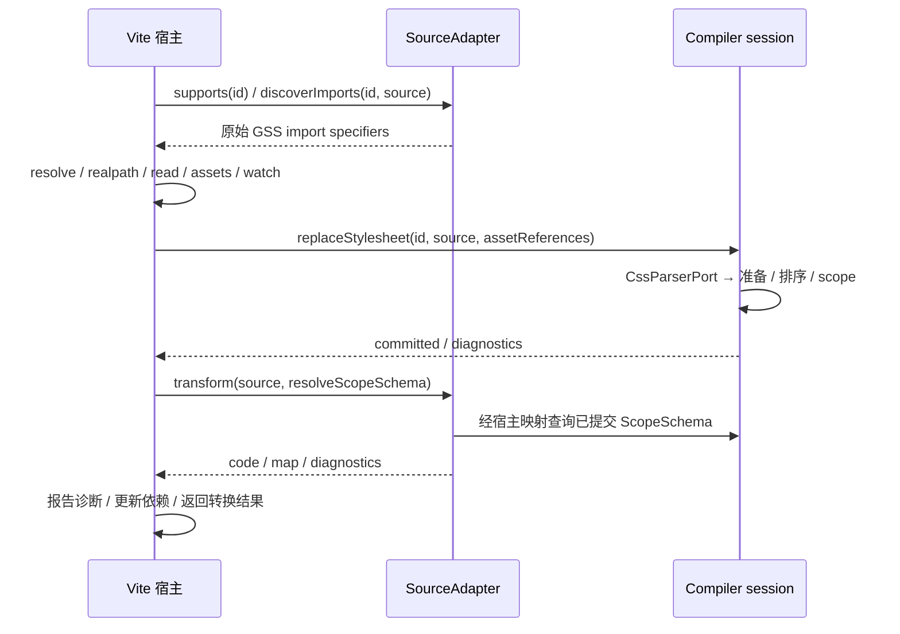

# 核心工作流与架构方向

> 当前状态（2026-11-04）：已批准的核心架构切片及 Vite、Rspack／Rsbuild、webpack 接入已交付；本轮阶段收尾只统一事实，不扩展能力。宿主支持与证据以 [统一清单](HOST-SUPPORT.md)为索引，当前任务以 [NEXT-STAGE](NEXT-STAGE.md)为准。本文包含历次设计演进，旧“下一步/待决/尚未实现”按对应日期理解，不自动恢复为任务；语义决定沿用后续 owner 确认。

## 产品目标与现有边界

GSS 以 CSS 为输入，生成可组合的 scope 引用、原子 CSS 与必要的关系 marker。框架源码 Adapter 负责静态引用转换，构建工具负责文件、依赖、资源和交付；Compiler 不依赖 React 或构建工具。同模块 scope 组合支持既定的所有权／结构语义；跨模块同节点优先级尚不支持。原生 importance、specificity、layer、条件和浏览器匹配仍生效，不承诺任意 CSS 都能原子化。

## 核心工作流：当前实现

1. **宿主与 Adapter**：宿主集成调用 Adapter 判断源码、发现 `.gss` import；宿主解析路径、读取源码和资源并编译依赖，再提供 scope schema。React Adapter 对可证明的引用做有限 lowering，返回代码、map 和诊断；动态／未知路径、alias 与跨文件能力有既定边界。
2. **解析与准入**：PostCSS 解析并展开 nesting，保留原始来源，按 selector 分支构造路径、状态和关系。Compiler 验证支持范围、资源、声明、条件与兼容性；当前未知 effect 可整模块 preserved，其他不安全输入拒绝，失败保留 last-known-good。
3. **语义与规划**：绑定 scope target／source／observation，按属性 effect 确定竞争与存活声明；后代、结构、伪元素和 `:has()` 等路径分别规划，并为可证明的语义关系和模块内组合生成排序信息。普通 ownership 路径不必对应 DOM 祖先；需要状态／结构关系时生成 selector，实际匹配由浏览器负责。
4. **marker 与 atom**：scope 导出包含 class 字符串。`gss-a` 表示声明；`gss-s`／`gss-t`／`gss-c` 表示关系来源、目标和中间节点；`gss-hs`／`gss-ho` 用于 `:has()` 的 subject／observed。marker 放入对应 scope，浏览器同时匹配 class、状态及 DOM 关系。复杂 `:has(list)` 保留原生 specificity 和分支身份。
5. **复用与提交**：相同输出身份可在 finalize 汇总；模块内连续相同 pure occurrence 仅在既有证明条件下复用，不能跨竞争者或丢失 scope membership／来源。完整贡献及资源冲突检查成功后 session 才替换旧版本；失败不污染旧结果。
6. **宿主交付**：Vite 开发期跟踪最新异步任务、资源与 CSS 更新；生产期按最终可达 static／lazy 图中的快照汇总 CSS、map、manifest 和资源。Rspack/webpack 在主构建汇总候选，再交原生 CSS 链；Rsbuild 薄封装配置 Rspack 接线。各宿主的发布/依赖恢复机制独立，公共准备不接管生命周期。aggregate CSS URL 与 SSR 是 Vite 的有界能力，四宿主交付范围见 [支持清单](HOST-SUPPORT.md)。

现状入口：[compiler-session](../compiler/src/application/compiler-session.ts)、[module-contribution](../compiler/src/application/module-contribution.ts)、[finalize-snapshot](../compiler/src/application/finalize-snapshot.ts)、[CSS parser](../compiler/src/infrastructure/postcss-stylesheet-parser.ts)、[React Adapter](../adapters/react/src/index.ts)、[Vite](../integrations/vite/src/index.ts)。

### Scope 输出的职责边界

[scope-exports.ts](../compiler/src/application/scope-exports.ts) 负责按路径汇集贡献规划阶段已经决定的 atom／marker class、形成 scope schema，并生成模块导出及声明类型。它不判断 selector 匹配、决定 marker 触发、剪枝声明、规划排序或选择 fallback；这些决定继续由各自 planner／贡献准备负责。原子化和整模块 preserved 两条路径共用同一输出实现，但两者赋予 scope 的 marker 不因此变成相同语义。

该边界保留既有行为：路径节点与目标按原插入顺序建立，schema 中同一节点的 class 按现有规则排序并去重，代码输出的字段按既有规则排序；selector-list、状态来源和 `:has()` 观察目标的 membership 由调用方按原规则添加。`__proto__`、保留字及生成变量名冲突需要保持可用的自有属性和合法导出；空路径仍是内部不变量错误。移动实现不改变 atom／marker 名称、identity、rank／orderSlot、资源、source map、诊断或 preserved 内容。

此切片只将 scope 输出从 `module-contribution.ts` 提取为内部模块，尚未统一不同关系 planner 的证明，也不提供新的框架适配接口。后续 selector 节点迁移及验证见 [当前计划](NEXT-STAGE.md)。

### 全局资源规划的职责边界

后续身份核对（2026-10-31）：通用 readable-name 编码和 opaque asset identity 都保留原 Unicode 序列，不进行 NFC 归一化；资源仍保留既有 ASCII 转义的 typed-parts 序列化格式。已修正 `asset-values.ts` 中声称通用编码器会归一化的过时注释，没有删除转义或改变 class／资源身份。`readable-name` 和 `stylesheet-assets` 的既有 Unicode 区分回归包含在 `9216360` 的完整 verify 中；本次仅注释／文档修正，无新运行行为。

[resource-planning.ts](../compiler/src/application/resource-planning.ts) 负责 keyframes 引用歧义检查与名称重写，以及 `@property`、`@font-face`、`@keyframes` 的资源身份、CSS、兼容性转换、asset 绑定和来源位置规划。贡献准备仍决定处理顺序、诊断与 preserved 路径；[compiler-session.ts](../compiler/src/application/compiler-session.ts) 仍在提交前调用资源冲突检查，失败保留已有贡献。快照汇总只消费已提交的规划结果，不重新解释资源语义。

身份和来源不能只按输出 CSS 简化：相同 `@font-face` 签名或 `@property` 名字可能对应不同定义，必须保留冲突检查；asset 的身份与最终 URL 分离，兼容转换不能丢失原资源引用；keyframes 同名但不同模块需要各自生成名称。animation shorthand 的关键字／timeline 名称歧义继续沿用现有拒绝行为，frame／descriptor 只有唯一名称时保留对应位置。重构不改变上述决策、顺序、marker、排序或 fallback。资源冲突检查已与资源规划位于同一内部模块，会话仍在提交前调用；资源准入及剩余贡献流程没有整体统一，验证范围见 [当前计划](NEXT-STAGE.md)。

### 关系 selector 与局部 marker 渲染边界

[selector-rendering.ts](../compiler/src/application/selector-rendering.ts) 根据已规划的关系渲染组合符、属性条件、状态后缀和原生 selector 片段，并在原生片段引用局部 class 时通过 scope 树登记对应 marker。调用者仍决定何时需要 source／target／subject／observed marker、关系语义和 specificity；该模块不作 DOM 匹配或规划排序。

例如 `:global(.outside)` 内的 class 保持全局语义，不能登记为局部 scope；嵌套的功能性 pseudo 内局部 class 则需要改写并登记，否则 selector 会引用不可触发的 marker。属性值继续通过 selector parser 序列化，转义和引号不能靠字符串拼接替代。`:has()` 的 native specificity 与分支 witness 仍由现有调用路径决定，组合符空白、state `self` 和原始顺序保持现状；整模块 preserved 的 selector 改写仍是独立路径。本次仅移动共用渲染逻辑，不更改语法准入、marker 身份、fallback 或 atom 顺序；各关系 planner 的统一模型仍未完成。验证见 [当前计划](NEXT-STAGE.md)。

### 规则形态判断与上下文准入

[rule-classification.ts](../compiler/src/domain/rule-classification.ts) 集中贡献准备中使用的 ownership、当前／祖先状态、属性、结构关系、pseudo 和 observation 形态判断。它们是可重叠的谓词，不是互斥枚举，也不单独决定语法准入、planner 路由或 DOM 关系。各调用方继续保留自己的上下文条件。

普通 ownership 的共享形态要求全部关系为 descendant，且无状态、属性、observation 或 pseudo；这一形态本身不检查 external target／condition。逻辑／物理冲突验证的本地准入还必须排除两种 external 上下文，不能因为共享函数而误放宽 `GSS1206`。安全 shorthand 展开的其他条件、已证明的结构优先级、marker 规划和 fallback 均不由该判断单独决定。原有 predicate 条件和调用顺序保持不变；已移除 selector 规划投影，不同 planner 的证明仍独立。验证范围见 [当前计划](NEXT-STAGE.md)。

规则形态判断及 background 特例准入现直接遍历节点条件，节点顺序仍是 authored path 顺序；形态判断保留原先可重叠的语义，不能将节点模型当作额外的 DOM 或能力证明。逻辑／物理冲突检查仍单独排除 external，分组键按节点编码状态、属性、observation 和 pseudo；它与旧四组数组键的上下文相等关系一致，不能仅按节点名称合并，未扩大准入。

### 条件与 layer 上下文边界

[condition-context.ts](../compiler/src/application/condition-context.ts) 集中贡献准备中的未注册条件／layer 诊断、按 layer 与条件分组及现有条件身份编码。规则和 keyframes 的条件／layer 均参与诊断；诊断顺序及 warning 级别保持原样，未注册不等同于拒绝提交。条件按原有顺序编码，空条件为 `base`；分组不证明不同表达式互斥或逻辑等价，也不能跨 layer、条件边界合并 atom。

该模块不负责条件求值、浏览器匹配、semantic height、最终输出排序或 fallback；那些职责仍由各自 planner 和浏览器处理。现有键格式、wrapper 顺序与冲突边界未变，复杂条件推理和通用归一化不属于本切片。验证见 [当前计划](NEXT-STAGE.md)。

### Parser 内部 selector 片段

PostCSS parser 将每个局部 class 的名称、状态、属性、observation 和 pseudo 保存在同一个只读 `ParsedSelectorNode` 中；`CssParserPort` 直接返回节点数组及节点间关系。状态、属性、observation、pseudo 四组平行数组及规则上的 ownership `path` 字段均已移除，贡献准备直接使用 parser 结果，不再经过 `projectForPlanning`。

**2026-10-30 owner 决策：只读 nodes + 派生函数，先不加 WeakMap 缓存。** [getOwnershipPath](../compiler/src/domain/ownership-path.ts) 按需从节点提取名称，返回只读路径值；节点是唯一名称来源。一次操作内可用局部变量复用结果，但不将其重新存入规则。函数没有隐藏状态，不依赖数组身份；不采用 getter，避免对象展开将 getter 求值成独立字段；WeakMap 只能识别对象身份，不能感知原地修改，也没有当前性能证据要求缓存。

例如 `.root:hover .item` 的名称投影为 `['root', 'item']`，不能用它替代 hover 条件或证明 DOM 后代。名称改变应构造新的只读节点输入，再派生路径；原节点的派生结果仍保留原名称。只读是 TypeScript 约束，不增加运行时冻结或响应式机制。parser 的构建片段仍可变，返回后的节点与数组不得修改。

Parser 与规划共用 `ParsedStyleRule` 节点规则结构，删除过渡的 `ParsedSourceRule` 同义别名；selector-list 的分支独立且共享的声明数组／对象保持共享，来源、sourceOrdinal 和条件／layer 保留。删除准备阶段的投影不改变公共 Adapter 或输出身份。`targetPath`／`sourcePath` 是规划绑定结果，仍独立保存：`.root .item` 的 ownership 目标可以包含额外中间 scope，不能用 authored 名称投影替换实际绑定。occurrence 按路径内容识别，不依赖派生数组对象相同。

需要 authored 节点数量、来源位置及 specificity 时直接读取节点；需要 ownership 匹配、marker 身份或名称切片时调用派生函数。关系 planner 的专用证明和绑定尚未整体统一；这次移除重复表示不合并 descendant、结构和 observation 语义。

分支身份、源码跨度、嵌套展开、selector-list 声明共享与诊断不得因此变化。普通完整路径继续去重／排序状态；既有 external target／condition 的提前返回保留原始状态顺序和重复项，不能在行为保持式重构中悄然归一化。外部目标对应的末尾 descendant 关系仍按旧规则去除。此切片不扩大 selector 准入、不改变 marker、排序或 fallback；验证见 [当前计划](NEXT-STAGE.md)。

### 关系规划编排边界

[plan-module-relations.ts](../compiler/src/domain/plan-module-relations.ts) 集中贡献准备中的关系 planner 编排：先按既有形态选择 ownership、descendant、结构及 observation 规则，再依次运行适用的 descendant、结构、pseudo 规划；第一个歧义仍返回原 `GSS1205`，并且先于兼容转换／preserved fallback 判定。各 planner 继续分别负责其语义证明，不能把这些规则视为互斥分类或假定 ownership 就是 DOM 祖先。

只有出现既有条件或结构关系时才提前运行 descendant 规划；纯 ownership 路径仍按原流程在需要排序候选时调用，不应为了合并流程而改变它的时机或支持范围。声明路径、selector 分支、observation 和 candidate／存活 instance 的区别也保留：排序候选不能直接以剪枝后的输出实例替代。 排序候选收集也归此模块：依次保留 descendant candidates、结构 instances、pseudo candidates、同节点／external 规则和逐 observation 的 `:has()` 绑定；纯 ownership 的候选仍在 compatibility／preserved 判定后按需生成。`supportsCurrentBackgroundRanks` 特例、语义高度、`atomRank`／`orderSlot`、marker 和 fallback 均未改变；规则绑定及 planner 内部模型仍未整体统一。验证见 [当前计划](NEXT-STAGE.md)。

通用 ownership 路径匹配位于 [ownership-path.ts](../compiler/src/domain/ownership-path.ts)：规则路径和目标末节点必须相同，前缀按顺序匹配子序列，因此 `.root .item` 的 ownership 可以与包含额外中间 scope 的目标组合。它不证明真实 DOM 祖先；结构组合符、条件来源和运行时 witness 仍由各自 planner 证明。声明胜出、关系规划、语义高度、background 准入与逻辑／物理冲突校验共同使用此函数，不再让通用规划依赖特定属性的准入模块。声明胜出和冲突校验此前单独匹配完整子序列并要求末节点相同；末节点相同时，完整子序列可将最后一次匹配放在目标末尾，与匹配前缀子序列等价，包括重复名称和空路径。匹配边界、声明胜出、冲突准入与排序未变；验证见 [当前计划](NEXT-STAGE.md)。

### 当前节点 background 排序准入

`planDescendantConditions` 对已保留、同一 layer／条件及 specificity 下可同时生效且无法证明蕴含、互斥或存在更强交集的不同声明，通常返回 `GSS1205`。仅当冲突 effect 是 `background-color` 且 `supportsCurrentBackgroundRanks` 通过时，才允许现有模块排序处理这种冲突；这不是所有属性或所有状态均可按源码顺序处理的证明。检查所有潜在竞争规则的原始声明，而非仅检查剪枝后的胜出者，以免遗漏后续仍可能生效的竞争。

该准入只允许相关背景声明是 `background-color` longhand，未分层、无条件、无 external、结构关系、observation 或 pseudo-element；状态只能是目标节点单个 `hover`／`focus`，属性条件也只能在目标节点且每个节点最多一个。路径判断是 ownership 子序列，不推断 DOM 祖先。external target 可能落在任意 anchor 下，因此其背景 effect 要在整个模块检查；不竞争的 external 属性不应触发此屏障。普通 `background` shorthand、`:active`、祖先状态及其他属性冲突不能借此特例放行；例如两条 `color` 状态冲突仍可能报告 `GSS1205`。

在通过准入的路径中，关系规划仍先保留各 predicate 的胜出声明，再将剪枝前 candidates 提供给固定模块排序；原生 importance／specificity、语义高度、同属性 rank 和输出位置继续各司其职。没有触发冲突种子的既有可用输入不因为此检查而额外拒绝；已有 external selector 准入诊断也先于关系规划。此特例是保守准入规则，并非通用 CSS 覆盖证明；是否替代或扩展须先证明竞争闭包、marker 与复用等价，不能仅把属性名泛化。现有回归与验证范围见 [当前计划](NEXT-STAGE.md)。

### Adapter 与宿主接缝：已实现和未验证部分

当前公开的 [GssSourceAdapter](../compiler/src/application/source-adapter.ts) 是同步的三个操作：`supports(id)` 选择宿主交给适配器的源码；`discoverImports({id, source})` 返回原始 `.gss` import specifier，不读文件；宿主解析并成功编译这些依赖后，`transform` 通过原始 specifier 查询对应 `ScopeSchema`，返回代码、可选 v3 source map 和诊断。它是**框架源码适配接口**，与编译器内部将 CSS 转为 `ParsedStyleRule` 的 [CssParserPort](../compiler/src/application/css-parser-port.ts) 是两个不同接缝。

Vite 当前将 transform 的原始 `id` 与源码交给 adapter；对发现的 specifier 去重、解析到 GSS 虚拟模块、添加 watch、编译后建立 specifier→物理文件映射，再执行 transform、报告诊断和返回 map。找不到可解析的 GSS 依赖时宿主报错；transform 中未发现依赖则清理该源码的依赖记录。React adapter 用 Babel 处理 JS／TS／JSX／TSX，发现顶层静态 `.gss` import 并执行其有限静态 lowering；其 `supports` 按文件名后缀匹配，不能据此假设带查询参数的虚拟 id 会命中。具体语法、alias 和动态引用能力以实现和测试为准。

现有 Vite 测试用简单 `.view` 假 adapter 证明 schema 可在宿主与非 React adapter 间传递，并不是 Vue／Svelte 解析、模板绑定、插件顺序、虚拟子模块 id、HMR 或 source map 组合的验证。当前接口是同步 transform，依赖发现通过字符串 specifier；这些约束是否适合某个框架，需要按真实输入和宿主生命周期验证。owner 已确认将 `range?: GssSourceRange` 加入公开 `SourceAdapterDiagnostic`：它是相对于 `id` 所指源码的零起始 UTF-16 半开区间。React 可继续提供范围，Vite 在范围有效且属于当前源码时生成位置和代码框；缺失、无效或不属于当前源码的范围仍不生成定位。该可选类型扩展不改变运行时行为，不代表 Vue／Svelte 已接入；其他 adapter 协议扩展仍需结合具体需求决定。

#### React 引用与 TypeScript 契约

用户在 React 源码直接写 `styles.card` 或 `styles.card.title`。适配器按 schema 验证静态路径，在支持的字符串消费位置自动读取节点的内部 `$class` 字段。[GssScope](../types/src/index.ts) 用带 brand 的 `string & children` 描述源码引用，允许传给普通 `className?: string`，不承诺逐文件精确补全。

不可变别名同时用于父节点和子路径时，初始化保留选中的 scope 对象。读取 `className={branch}` 或 `branch.title` 时才取对应节点的字符串。对条件别名，适配器检查每个可能分支都声明了目标，生成代码仍读取原别名，因此条件只在初始化时求值一次。

同文件已识别的可选 prop（例如 `scope?: typeof styles.card`）可直接用于 `className`。省略时保留 `undefined`，传入时读取节点字符串。解构参数和 `props.scope` 遵循同一规则。

父组件 `<Child className={styles.title} />` 在父文件完成 lowering，子组件接收普通字符串；这不需要跨文件 scope 推导。普通函数、DOM API、模板字符串的直接静态引用以及已支持的不可变条件 alias 有既有回归；可变 alias、未知／动态路径、跨文件传播继续按当前实现边界处理，不能扩大成完整数据流分析或任意 namespace 逃逸支持。不可证明的动态／未知路径保留已确认的普通 JS 行为，不新增拒绝规则。

验证路径时，每一段都必须是当前 schema 自有的成员；显式声明的 `constructor`、`self` 等名字遵循同一规则。组合 class 时可写 `className={[styles.card, 'external'].join(' ')}`。既有的隐式字符串强制转换诊断仍适用。旧的生成对象把父节点字符串和名为 `self` 的子节点写到了同一个键，导致父元素收到对象。现在 `.card .self` 对应源码 `styles.card.self`，父节点仍使用 `styles.card`。已有项目中用于读取当前节点字符串的旧后缀 `.self` 应移除。混合类型的别名仍按既有规则处理，例如可将条件直接写在 JSX 的 `className` 中。

编译器只保留 ownership 路径第二段及以后、CSS 转义解码后精确为 `$class` 的名称。命中时在原规则范围报告 `GSS1105`，本次替换失败；同一规则适用于 atomic 与 preserved 输出。顶层 `.\$class`、其他 `$` 前缀及外部类不占用子节点的内部字段。schema 保留 `selfClassName` 与 `targets` 两个独立成员；生成模块和适配器通过 `.$class` 读取自身字符串，业务源码继续使用静态路径。

未采用双 Symbol 作为公共语义：内部键分离不能让同一个未转换的 `styles.card` 同时成为 primitive string 和任意子树。`Symbol.toPrimitive` 也不会把对象类型变成字符串；`string & children` 不自动解决 `length` 等成员冲突。原调研中的 Proxy、动态 resolver、精确声明交付、freeze 等建议不属于已批准能力。实现边界以 [Adapter](../adapters/react/src/index.ts)、[转换测试](../adapters/react/test/transform-react-gss-usage.test.ts)和 [类型测试](../types/test)为准；宿主使用 [通用 client 入口](../types/client.d.ts)。

#### 接口评估与最小调整方案（2026-11-01）

owner 本轮批准的是现有接口评估和新框架／非 Vite 宿主的纸面推演，不是新框架实施。以 `f7acf1a` 的实现为基线，结论是：当前职责分离可以保留，没有从所查调用链与既有测试中找到必须立即修改运行时的契约反例；接口的可替换性不等于所有输入阶段均可接入。



图中 schema 查询经宿主回调完成，adapter 不直接持有 session。无 GSS import 时，当前 Vite 宿主删除该源码的依赖记录并返回 `null`，不会调用 adapter.transform；因此它不是任意源码转换器。失败 replacement 不提交新贡献，宿主也不会将该次失败当作成功 transform；已提交 CSS／schema 与资源快照的 LKG 保留。后续 CSS 输出、生产 census、资源 URL、HMR 传播由宿主组织，不由源码 adapter 决定。

| 接缝／权威入口 | 当前契约与责任 | 反例及扩展边界 |
| --- | --- | --- |
| [SourceAdapter](../compiler/src/application/source-adapter.ts) | 同步发现与转换；输入为宿主当前阶段的源码，返回一份代码及可选 map | 不能直接返回 Promise、多个虚拟模块或额外 watch 文件；不为假想用例预加这些字段 |
| [React adapter](../adapters/react/src/index.ts) | Babel 识别静态 `.gss` import，再根据 schema 做有限引用 lowering；两步各自解析 | `.vue` 模板不是 JSX；`.tsx?query` 不匹配当前 supports。不能仅扩后缀就声称支持框架；不因重复解析启动缓存／性能工作 |
| [Vite 编排](../integrations/vite/src/index.ts) | 原始 specifier 用于 schema 查询；宿主解析别名、物理路径和依赖，成功编译后转换 | `./Card.gss` 与规范物理 id 不是同一种身份；adapter 不能自行 realpath 后改用另一 key 查询 |
| [虚拟 ID](../integrations/vite/src/virtual-id.ts) | 当前 GSS 虚拟模块对应绝对物理 `.gss` 文件；源码 id 原样传给 adapter | `Card.vue?type=script` 的查询和物理 importer、内联 style 的身份／生命周期没有通用协议，不能全局去 query 冒充解决 |
| 诊断与 [定位](../integrations/vite/src/diagnostics.ts) | range 是当前输入 id 的 UTF-16 半开区间；同 id 且边界有效才生成 loc/frame | 子块相对位置不能冒充完整 SFC 位置；其他文件仅有 id/range 不足以生成代码框。React 的 Babel parse 异常仍可抛出，不承诺所有错误均已结构化 |
| JS source map | React map 从输出映射到输入 source，并携带输入内容；Vite 返回给转换链组合 | 若前序预处理已改源码，该 map 不是直接映射磁盘原稿；诊断 range 也不会自动借 JS map 回溯。Compiler CSS map 是另一条输出链 |
| [CssParserPort](../compiler/src/application/css-parser-port.ts) | 内部 CSS 解析接缝，产出规则／资源／诊断；不解析框架文件 | 更换 Vue／Svelte adapter 不需要将框架 AST 放入 domain，也不需要更换 CSS parser；内部 port 不等于已公开 parser 注入配置 |

**新框架纸面推演（未实施／未验证）。** [Vue compiler-sfc 的官方说明](https://github.com/vuejs/core/blob/main/packages/compiler-sfc/README.md) 描述了 facade 与带 query 的 script／template／style 子模块。由此推断，若选择完整 SFC 阶段，应在框架转换前从 script 发现外部 `.gss`，用框架解析器建立 script binding 与 template 引用的联系，返回仍可被框架插件处理的 SFC；单文件、同步、外部 `.gss` 的窄场景可能不需要改公共接口，但模板绑定规则和插件先后必须实测。只改 script 中的引用并不能自动覆盖模板中的引用。

若选择框架生成的 JS 阶段，则必须适配实际虚拟 id、编译后 binding 和来源位置；原始引用可能已被改写，不能把 React lowering 当通用后端。当前 GSS Vite 插件使用 `enforce: 'pre'`，这不保证它拿到磁盘原稿或排在所有其他 pre 插件前。插件分组顺序参见 [Vite 官方说明](https://vite.dev/guide/api-plugin.html#plugin-ordering)；当前在线文档与仓库 workspace 的 Vite 7 并非同一版本基线，这里只作设计参考，不代表升级或新增验证。

[Svelte compiler 官方接口](https://svelte.dev/docs/svelte/svelte-compiler#preprocess) 的 preprocess 返回 Promise，Processed 还可携带 map 和额外依赖。由此推断，若要求 adapter 自行运行整条预处理链，当前同步接口及仅 GSS specifier 的依赖协议不足；若预处理由框架宿主完成，GSS adapter 只做选定阶段的同步改写，则未必需要改接口。两种路径须先确定作者体验与输入阶段，不能为预想中的 Svelte 支持把整个 Compiler 改为异步。

内联 `<style lang="gss">`／自定义块不在当前外部 `.gss` 契约内：即使框架能抽出文本，也还缺稳定模块身份、资源相对基准、schema 可见范围和增量失效规则。这是新能力决策，不作为现有 bug。

**非 Vite 宿主纸面推演。** Compiler session 和源码 adapter 可复用；新宿主仍需实现依赖解析、文件／资源读取、虚拟模块加载、异步更新的新旧任务协调、失败保留与恢复、CSS 输出、map 串联和自身 watch／build 生命周期。Vite 的 production census 与 HMR hooks 不能直接视作通用宿主实现。没有第二个实际宿主前，不提取覆盖所有 bundler 的公共引擎。

**后续最小顺序与决策触发点。**

1. 本轮完成调用链与隐含契约文档化，保持所有运行时代码、公共接口和已确认排序／fallback 不变；没有具体反例，不为接口形式统一而重构。
2. 若 owner 选择真实框架接入，先确认外部 `.gss` 或内联块、作者引用语法、输入阶段及宿主，再实现一个完整窄路径。优先评估完整 SFC、外部 `.gss` 的方案；这是建议，尚未选定产品范围。
3. 只有该路径证明同步、依赖或虚拟输出协议不足时，才提出对应公共接口调整及旧 React／Vite 调用方迁移。Promise 兼容、额外依赖、多个输出各自有独立触发条件，不打包成预设新架构；compiler 排序与 scope 语义不随框架变化。
4. 获准实施后，以当前 React/Vite 回归保护旧调用方；新路径验证绑定与动态引用边界、诊断位置／map、依赖修改→失败→恢复和构建输出。真实框架测试载体及范围随该目标确定，本轮不新建 demo 或验收矩阵。

本轮验证：既有 React 全部 **49** 项，以及 Vite `vite-plugin`／`diagnostic-location`／`dev-css` **51** 项通过，原始日志在 `artifacts/adapter-contract-review/react-tests.log` 与 `vite-tests.log`。首次错误 package filter 没有执行测试，记录保留在 `react.log`，不计入通过数。本轮只改文档，没有重跑全仓 verify、浏览器或外部框架验收，也没有把纸面推演计为支持证据。

### React 多构建工具接入方向（2026-11-01）

owner 已明确下一产品方向为 **React + 多类脚手架／构建工具，优先 Rsbuild、Rspack**。Vue／Svelte 暂不进入实施。以下保留最初方案及后续修正；owner 已确认 Rspack 核心 + Rsbuild 薄封装两个入口，不代表已经支持 Rsbuild／Rspack；现有 React 作者语法、外部 `.gss`、Compiler 排序和 fallback 契约继续保留。

**建议采用一套 Rspack 集成，同时供原生 Rspack 与 Rsbuild 使用。** Rsbuild 官方提供通过 `tools.rspack` 注册 Rspack 插件的方式，见 [配置 Rspack](https://rsbuild.rs/guide/configuration/rspack)。最初考虑仅提供 `integrations/rspack/` 与 Rsbuild 配置示例；后续默认 CSS／HTML 配置核对证明薄封装有明确责任，owner 已确认同时提供 `integrations/rsbuild/`，具体见下方生命周期设计。不为两个入口复制编译和 React lowering，也不提前创建通用 bundler 包。包名、插件导出和选项尚未定稿，须在实施设计中给出最小可用配置后确认。

```text
React JS/TS/JSX/TSX + 外部 .gss
          ↓
现有 React Adapter + Compiler session
          ↑
Vite 集成（既有）     Rspack 集成（拟新增）
                         ↑           ↑
                  原生 Rspack     Rsbuild 配置入口
```

| 能力 | 复用或新增位置 | 必须守住的约束 |
| --- | --- | --- |
| import 发现、scope 引用转换 | 复用 adapters/react | 在 JSX/TS 被 SWC 等转换之前执行；不依赖 Vite 的 pre 钩子语义 |
| `.gss` 编译、schema、排序、复用 | 复用 compiler | 不为宿主差异修改 atom 身份／rank／fallback；配置的 CSS compatibility target 必须明确映射 |
| 文件解析与依赖 | 新 Rspack loader/plugin 配合宿主 resolver | 原始 specifier 与规范物理身份分开；别名、资源依赖和 map 沿宿主管线传递 |
| session 生命周期 | 新 Rspack 集成内部 | 按 compiler／构建环境隔离，不用进程全局 session；增量、缓存命中和并发编译不能丢贡献或混入旧模块 |
| CSS／资源输出 | 使用 Rspack 产物和模块图能力组织 | 必须汇总当前可达贡献，不能按 loader 完成顺序决定最终 CSS；不能从 Vite hooks 直接复制 census |
| 开发更新 | 新宿主实现 | CSS-only、schema 改变、非法输入保留／恢复分别核对；不预先承诺 React state 始终保留 |
| Rsbuild 使用 | 初期直接注册同一插件 | 使用 Rsbuild 所携 Rspack 的兼容版本；不把某个脚手架通过外推为全部 Rspack 配置可用 |

[Rspack loader context](https://rspack.rs/api/loader-api/context) 提供异步回调、依赖登记、source map 返回等接缝；这只证明存在实现入口，不证明生命周期方案已正确。缓存可能跳过 loader，故不能仅靠 loader 的内存副作用收集 CSS；具体贡献重建／缓存协调方案是首个技术核对项。Rsbuild 的 `api.transform` 也可转换代码，但仅源码转换无法独自完成全局 CSS、资源和增量生命周期，故不另写一套 Rsbuild-only 编译器。该取舍基于 [Rsbuild 插件接口](https://rsbuild.rs/plugins/dev/core) 与当前 GSS 会话契约。

**建议交付顺序。**

1. **确定最小配置与生命周期方案。** 固定实际测试的 Rsbuild／Rspack／React／Node 版本；给出插件入口、loader 顺序、CSS 加载方式、compiler/session 与 compilation 的关系，以及缓存命中时如何恢复完整贡献。复用 Vite 的纯逻辑前先核对依赖，不先移动整个 Vite 实现。对公共配置和 CSS 使用方式的新增选择由 owner 确认。
2. **构建闭环。** 用同一最小 React 源码分别经原生 Rspack 和 Rsbuild 构建，验证现有字符串语法／scope schema、JS map 与诊断位置、CSS 与资源 URL、可达模块汇总；class 和 CSS 的预期来源于现有 compiler 契约及独立原生参考，不以 Vite 结果作为唯一 oracle。仅完成本步不能标记开发模式支持。
3. **开发闭环。** 验证初次加载、只改 CSS、scope mapping 修改、非法输入→恢复、资源修改，以及增量／缓存后与干净构建一致。优先利用宿主标准更新与诊断机制，不引入跨宿主 HMR 框架。保留失败证据和既有精确图像规则。
4. **交付两个消费入口。** 在仓库外以本地 tarball 验证 Rsbuild React 脚手架和原生 Rspack 配置，记录配置、确切版本、通过范围和限制；运行现有 React／Compiler／Vite 回归。已获准的新宿主需要最小集成测试，但不顺带扩大为 SSR、Module Federation、多环境或更多脚手架的矩阵。公开发布仍需单独授权。

本轮只更新方向与方案，未安装新依赖、添加集成包或执行新宿主测试。SSR／SSG、路由框架和其他 bundler 不因“等等”自动获得支持承诺；后续按真实需求扩展。

#### React 生态覆盖规划（2026-11-01 调研）

owner 进一步明确：先覆盖 React 生态及其主要构建工具解决方案，待这一阶段稳定后再进入 Vue 等其他 UI 框架。本轮是粗粒度调研规划，不实施新集成；上一节 Rspack 复用方案仍是建议，不把本轮方向确认写成公共接口已经批准。

**选型依据。** 这里按官方推荐、接入复用收益和项目现状排序，不声称给出了下载量／市场份额排名。[React 从零建站指南](https://react.dev/learn/build-a-react-app-from-scratch) 列出 Vite、Parcel、Rsbuild；[React 创建应用指南](https://react.dev/learn/creating-a-react-app) 则区分构建工具与应用框架。两层应分别验收：脚手架创建成功不等于宿主完整支持，bundler 通过也不等于 SSR／RSC 框架通过。

| 层级／建议顺序 | 对象 | GSS 当前状态与推进理由 |
| --- | --- | --- |
| 第一批，守住既有 | React + Vite / create-vite | 已有实现和有界外部证据。维护既有回归，明确实际 React 插件／版本，不能自动外推所有 Babel、SWC 或其他插件排列 |
| 第一批，新增重点 | React + Rsbuild，以及直接 Rspack | owner 点名优先；建议共用 Rspack 集成。Rsbuild 是用户主要接入示例，直接 Rspack 用来确认底层集成不依赖脚手架隐含配置 |
| 第二批，存量构建链 | React + webpack 5 | 在 Rspack 闭环后核对 loader／plugin 差异，再决定复用范围。Rspack 兼容多数 webpack loaders 不代表插件及缓存生命周期完全一致，必须独立验证 |
| 第二批，独立构建链 | React + Parcel | React 官方列出的选项，值得纳入覆盖评估；它有独立插件体系，需单独评估 transformer／打包输出职责，不能包装 Rspack 插件宣称兼容 |
| 应用层，先复用已有 | React Router Declarative / Framework | 现有 Vite 客户端路由与有限 SSR 证据保留；底层受影响时复验。其他宿主、模式和版本单列，不重复从零做已交付路径 |
| 应用层，下一候选 | TanStack Start | 官方提供 Vite／Rsbuild 路径，可在两条底层稳定后评估路由及 server/client 输出；不因 bundler 支持就承诺 Start 的 SSR 或 server components |
| 应用层，单独重点专项 | Next.js | 纳入 React 生态路线，先做可行性核对。webpack 与 Turbopack 路径分开，App Router 的服务端／客户端边界、CSS 加载及 RSC 不能用普通 SPA 结论代替 |
| 开发工具，后续消费验证 | Storybook React | 按具体 builder 接入，验证组件预览消费；优先复用已支持宿主，不先增加独立 GSS 编译实现 |

webpack 复用的依据与限制见 [Rspack 迁移说明](https://rspack.rs/guide/migration/webpack)；Parcel 的独立接缝见 [插件体系](https://parceljs.org/plugin-system/overview/)。[TanStack Start 官方说明](https://tanstack.com/start/latest/docs/framework/react/overview) 已列出 Vite／Rsbuild；[Next.js Turbopack 文档](https://nextjs.org/docs/app/api-reference/turbopack) 明确与 webpack 配置存在差异；[Storybook builder 接口](https://storybook.js.org/docs/builders/builder-api) 说明其构建器层。以上是选型资料，不是仓库已验证版本清单，实施时必须固定版本重新核对。

不将 CRA 作为新增首选入口：[React 已弃用其新项目创建用途](https://react.dev/blog/2025/02/14/sunsetting-create-react-app)。如有存量需求，单独评估其配置约束，不能将 webpack 通过等同于未 eject 的 CRA 可用。React Native／Expo 不属当前 Web CSS 目标；更多框架、SSR 部署平台及 Module Federation 不是自动新增任务。

**执行节奏。** 先完成上一节 Rsbuild／Rspack 的配置和生命周期设计，再依次打通 build、dev、外部消费；每个通过切片提交。第二批优先核对 webpack 复用成本，再做 Parcel 可行性评估。与此同时在进入上层框架实施前，先完成 Next.js 的阻塞点调查，避免最后才发现所需扩展机制不可用；调查不等于批准双后端、RSC 或新作者语法。React Router、TanStack Start、Next.js 的具体支持范围和必要验收在各专项开始前确定，不一次生成全部应用／浏览器组合矩阵。

**进入其他 UI 框架前的阶段门槛。** “React 没啥问题”指选定支持范围稳定，并非证明整个 React 生态无缺陷：

- 第一批 Vite、Rsbuild／Rspack 的 React 外部 `.gss` 路径完成开发及生产闭环，保留同一作者语法和已确认的排序／fallback。
- 选定版本下，JS／TS／JSX／TSX、别名与依赖、资源 URL、诊断／map、CSS-only 更新、schema 变化、非法输入恢复、增量／缓存与干净构建一致性有证据；Fast Refresh 的状态保留边界明确。
- 已声明支持的路由／SSR 路径有实际加载、导航和产物证据；不存在已知未解决的阻塞性契约错误。失败历史、版本范围及未验证组合如实记录。
- webpack、Parcel、Next.js 等重点候选都有明确结论：已支持、存在具体阻塞，或由 owner 接受暂缓。不能默默跳过后宣称“React 生态完成”，也不无限等待所有组合支持。
- 接入说明、最小配置、包消费与回归可重复；用户确认这一 React 阶段的剩余限制可接受后，再选择 Vue 等新 UI 框架。无需为了新 UI 框架提前修改 Compiler domain。

下一具体工作仍是 **Rsbuild／Rspack 最小配置与生命周期设计**。本规划未改变 CSS 语义、公共接口或 fallback，未产生新的运行验证。

#### Rsbuild／Rspack 最小配置与生命周期设计（2026-11-01）

本轮 owner 授权推进设计，保留 React 外部 `.gss` 使用方式、排序和 fallback。以下区分**拟定契约、实测接缝和未解决实现**；不是已交付宿主。新证据修正上一节“Rsbuild 初期仅给配置示例”的建议：倾向于增加轻量 Rsbuild 封装，读取其有效 CSS／HTML 配置，共用同一 Rspack 核心；owner 随后已确认采用这两个入口。

**最小消费配置草案。** 原 React 源码保持 `import styles from './Card.gss'` 和 `<div className={styles.card}>`，动态／未知引用及现有诊断边界沿用 React 契约。拟新增的包名与函数名如下，尚未实现或发布：

```ts
// rsbuild.config.ts：React 插件仍由应用配置，GSS 不替代它。
import { defineConfig } from '@rsbuild/core';
import { pluginReact } from '@rsbuild/plugin-react';
import { pluginGss } from '@gss-l/rsbuild';
import { react } from '@gss-l/react';
export default defineConfig({
  plugins: [pluginReact(), pluginGss({ adapter: react() })],
});
```

```ts
// rspack.config.ts：加入现有 React/SWC/HTML 配置的 plugins。
import { gss } from '@gss-l/rspack';
import { react } from '@gss-l/react';
// ...既有 Rspack 配置
// plugins: [ ...既有插件, gss({ adapter: react() }) ]
```

原生 Rspack 片段不是完整 React 配置；插件负责内部 GSS loader 注册，应用不手配 loader 顺序。默认 HTML 生成路径目标是自动加载汇总 CSS，不要求每个 React 文件新增 CSS import。无 HTML 的库构建／自定义 SSR 入口、既有 `virtual:gss.css?url` 在新宿主中的实现另列，首个 SPA 路径未完成前不承诺这些入口。公共选项首稿仅 `adapter`；projectRoot 取 compiler.context。无法从原生 Rspack 获取有效 CSS 处理阶段时，须提供具体错误与配置方案再讨论必要选项，不能默认猜 targets 或修改 fallback。Rsbuild 封装负责使用公开配置／hooks 传递宿主信息，不通过猜测插件 constructor/name 识别内部实例。

已确认职责与目标目录（尚未创建产品包）：`integrations/rspack/` 放插件、内部源码／GSS loader、构建快照及输出协调；`integrations/rsbuild/` 仅放配置／HTML／targets 对接。`adapters/react/` 和 Compiler 保持原职责。两个宿主封装共用 Rspack 实现，但不从 Vite 提前抽出公共宿主框架；若要提取无宿主依赖的资产处理，先做原行为对照。

**数据所有权与生命周期。**

| 对象 | 生命周期与数据 | 不允许的做法 |
| --- | --- | --- |
| 宿主状态 | 每个 compiler 独立，保存最后成功发布的普通数据快照及配置指纹 | 进程级共享 session；跨 build 保存 Rust-backed Module／Compilation 对象 |
| 本轮候选 | 每个 compilation 新建，保存原始输入快照、资源 bytes、诊断、规范路径和异步任务 | 边编译边覆盖已发布 CSS；失败任务混入下一轮 |
| 单模块准备 | loader 为 React schema／GSS moduleCode 准备同一输入的结果，可按本轮 canonical id 去重 | 依赖 loader 执行次数决定有哪些 CSS；并行最后完成者决定顺序 |
| 全局候选 session | 从本轮可达 GSS 输入按规范 id 确定性重放，集中检查全局资源冲突并 finalize | 仅增量追加旧 session，遗留不再引用的贡献；把局部编译成功当成整轮成功 |
| 已发布快照 | 本轮 GSS 校验及宿主产物成功后才更新；失败保留上一成功版 | 用旧 schema 伪装本轮非法源码转换成功，或发布新 JS 搭配旧 class mapping |

1. **初始化。** 按环境解析真实 CSS 处理阶段、root、public 资源和路径规则；禁止无意改变 `.gss` 的模块类型。通过 loader 的执行顺序确保 adapter 读到 JSX／TS 原始输入；与用户自定义 pre-loader 的关系需要定向验证，不能只写 `enforce: pre` 就认定完成。
2. **发现与局部转换。** 原始 specifier 经宿主 resolver 解析，统一 realpath 身份；读取源码／资源通过宿主文件系统。登记 watch 依赖并成功编译后提供 schema，adapter 仍同步。`.gss` loader 返回既有 moduleCode；不得将整个编译器搬入 loader 或引入 framework AST。
3. **确定本轮输入集合。** 从 entry 沿静态／动态边遍历模块图，采集实际可达 `.gss`；包含 lazy，排除 speculative load／断开的旧模块。初期目标延续 Vite 的可达图语义，不另加按 tree-shaking 使用标记删 CSS。缓存命中即使 loader 不运行，也可从图中找回依赖并读取输入。内存／持久缓存与优化后模块形式仍需实测，不依赖未承诺可序列化的自定义 buildInfo。
4. **全局汇总。** 为全部可达输入建立一致候选快照并重放到新 session；局部 moduleCode／schema 必须与汇总中的对应结果一致，变化中的文件导致的不一致应使本轮失败并重试下一轮，不能拼接两代内容。全局资源冲突仍按现有契约报错。CSS 排序交给 Compiler，不按 loader、chunk 或文件系统完成顺序排列。
5. **输出与提交。** 目标是一份 aggregate CSS 及正确引用的资源，hash 基于最终 bytes；产物、source map、HTML 和资源 URL 同代。不得在 bundler 完成 hash 后再字符串替换 JS／CSS。输出成功才替换已发布快照。旧 dev 资产何时释放须结合宿主 HMR 交付验证，不能照搬 Vite 的定时器。
6. **watch／失败／恢复。** 本轮不再引用某模块时，从候选集合消失；这与物理 `.gss` 文件删除不同，不扩大既有删除支持边界。非法更新通过宿主 error 传播，旧页面保留已发布样式；修复后即使恢复成旧 bytes 也要消除错误并完成更新。CSS-only、schema 变化及资源变化分别验证；不承诺所有 HMR 均保留 React state。

这是内部实现目标，不增加 Compiler session 公共事务／clone API。单模块准备与全局重放可能重复编译，先保证语义正确；本轮不做 profiling 或缓存优化。后续确有需要才能基于证据减少重复，不能为了省一次解析引入隐式跨 compilation 状态。

**探针与版本证据。** 本地隔离依赖位于 `artifacts/rspack-lifecycle-design/`，未修改 workspace package／lockfile。registry 查询并安装 Rspack **2.3.0**、Rsbuild **2.3.0**（依赖 Rspack `~2.3.0`）、plugin-react **2.1.1**；执行 Node **22.22.3**。这些是探针版本，不是最终 peer range 或向旧版本兼容的承诺。资料参见 [Compilation](https://rspack.rs/api/javascript-api/compilation)、[hooks](https://rspack.rs/api/plugin-api/compilation-hooks) 和 [JS 对象生命周期](https://rspack.rs/api/javascript-api/architecture)；实现时以安装版本类型与行为为准。

- `probe.mjs`／`probe.log`：原生 Rspack watch 三轮，第一轮两个 GSS 假模块，第二轮仅改入口仍有两个，第三轮移除 lazy 引用后只剩一个。第三轮 GSS loader 执行数为零，图仍识别剩余模块；在 finishModules 重建汇总 CSS 假模块，输出相应从两条降至一条。这里使用假模块与字面 CSS，不是 GSS／React 正式集成，也不是浏览器验证。
- `probe-initial.log`：首次断言错误地要求第二轮 loader 必须零执行，实际第二轮仍执行，第三轮才为零；保留原始失败。更正断言为实际要证明的第三轮缓存命中场景后再次通过，不声称已解释第二轮重建原因。
- `inspect.mjs`／`rsbuild-config.json`：实际 Rsbuild 默认配置包含 css-extract、css-loader、lightningcss-loader 的浏览器 targets 和自身 HTML 插件。`@rsbuild/core` 类型提供 modifyHTMLTags／modifyRspackConfig；这是轻量封装有实际责任的依据，不应盲把独立 HtmlRspackPlugin 的 hooks 当成 Rsbuild 默认 HTML hooks。
- `rsbuild-probe.mjs`：同一晚期 CSS 重建策略经过 Rsbuild 默认提取链时，原生进程异常退出 **134**，日志 `rsbuild-probe-panic.log` 包含 `should have event sender`。设置 `GSS_PROBE_SKIP_REBUILD=1` 只取消重建后，对照构建成功，见 `rsbuild-probe-control.log`；空 CSS 符合这个对照，不是功能通过。首次探针 JS 括号错误另保存在 `rsbuild-probe-syntax-error.log`。

**输出机制仍未定案。** 上述结果排除了“原生 Rspack 探针通过，就采用 finishModules + rebuildModule 贯通 Rsbuild”的直接结论。异常发生在这条接入组合，尚未定位上游内部根因，不宣布 Rspack 存在某个已确认通用 bug，也不通过禁用用户缓存或 CSS 提取绕过。

下一技术核对优先评估在 GSS 汇总后通过正式 asset／HTML hooks 输出 CSS，保留宿主等价的 CSS 处理阶段，并设计可随 HMR 发布的样式引用；若需要专用 runtime，应先证明同轮 hash／CSS-only 更新／失败保留成立，再决定是否引入。另一条候选是在正常模块构建阶段完成汇总 CSS，必须解决未完成图与异步依赖发现，不能先扫描磁盘猜所有输入。两条都不得改排序或 fallback，也不能静默绕过 Rsbuild 的 Lightning CSS／自定义后处理。此次不选一个尚未通过的机制冒充可实施定案。

**已确认的入口。** owner 已接受 `@gss-l/rspack` 核心 + `@gss-l/rsbuild` 轻量封装，React 源码完全沿用现有方式。无需再次询问是否提供薄封装；包尚未实现／发布。输出生命周期后续结果见下节，技术异常诊断由 agent 负责。

本轮设计与探针不算新宿主通过验收。未跑全仓 verify／浏览器；未变产品代码、React 作者语法、排序、fallback 或 Vite 路径。

#### CSS asset 输出与更新生命周期核对（2026-11-01）

**当前结论：asset + HTML hooks + Rspack runtime 的传递路径已有有限实测依据，可继续细化；不能直接作为完整集成发布。** 沿用上节隔离环境的 Rspack／Rsbuild 2.3.0、plugin-react 2.1.1、Node 22.22.3。未修改 workspace 依赖和产品代码。

本轮候选路径如下：

```text
本轮可达模块输入 → 汇总候选 CSS
  ├─ runtime 生成样式文件引用（参与本轮 JS／HMR 生成）
  └─ processAssets ADDITIONAL 输出带 contenthash 信息的 CSS asset
       → 宿主 CSS minimizer → real content hash 更新引用
       → HTML 正式 hook 注入 stylesheet link
开发更新 → 原生 HMR runtime 更新引用 → 新 link 加载成功后移除旧 link
```

这里使用 Rspack 的 [RuntimeModule 接口](https://rspack.rs/api/javascript-api/compilation) 与 Rsbuild 的 [HTML hooks](https://rsbuild.rs/plugins/dev/hooks)，没有晚期重建 CSS 模块，也没有在生成 hash 后手工替换 bundle 字符串。探针 runtime 只是传输机制验证，不是已选定的生产 runtime；HTML／runtime 共享标识去重、快速连续更新的竞态、加载失败回滚等还需完善。

**已确认的失败发布策略。** owner 明确接受：启用 GSS 的 Rsbuild／Rspack 开发构建中，**任何编译错误（包括非 GSS 的 JS／TS 错误）均不发布本轮新产物，保留上一成功版**。采用 Rspack 自带 `NoEmitOnErrorsPlugin` 的机制，不只拦 `shouldEmit`。此为新宿主的错误交付策略，不改变 CSS fallback、不将非法输入当成功，也不修改既有 Vite 行为。首次构建失败时没有成功版可保留，必须显示错误。错误仍传给宿主客户端／overlay，不能因为保留旧页面而隐藏诊断。

原生机制的必要性由对照得到：只在 shouldEmit 返回 false 时，失败构建后的浏览器仍持有上一成功 hash，但恢复产物的 HMR 链没有对应请求，下一次样式更新无法完成。替换为原生 NoEmitOnErrorsPlugin 后，两宿主恢复链通过。不要用 full reload 掩盖该对照，也不要把文件未输出误认为 HMR 状态已经保留。

| 本轮探针 | 观察与独立断言 | 尚未覆盖 |
| --- | --- | --- |
| `output-probe.mjs rspack` | Chromium 字面样式红→蓝→故意编译失败→恢复同一蓝色 bytes→红；失败保持蓝色，最后 boots=1 | React state／Fast Refresh、真正 GSS schema 变化及默认 dev-server WebSocket |
| `output-probe.mjs rsbuild` | 同一序列和断言通过，runtime 引用经原生 HMR 更新；无页面重启 | 同上；通过 `createCompiler().watch()` 和探针 HTTP 服务，手动调用 `module.hot.check(true)`，不是完整 Rsbuild dev server 验收 |
| `production-probe.mjs rspack` | 独立生产编译，显式 Lightning CSS minimizer；CSS bytes 确实被压缩，HTML 与 JS 引用最终 CSS 文件名 | 任意 CSS 值语义、map／资源 URL、复杂 publicPath |
| `production-probe.mjs rsbuild` | 使用 Rsbuild 默认生产 minimizer 与 modifyHTMLTags；同样通过压缩、最终文件名及两处引用断言 | 默认 CSS loader／PostCSS 不会因 emitAsset 自动执行；生产页面未作浏览器验收 |

原始通过日志为 `artifacts/rspack-lifecycle-design/output-rspack.log`、`output-rsbuild.log`、`production-rspack.log`、`production-rsbuild.log`；探针中 `.gss` loader 返回常量导出，CSS 来自字面源文本，不包含真正 Compiler／React Adapter。这是刻意隔离 CSS-only runtime 变化，不能据此宣称真实 GSS 已完成接入。浏览器使用现有 Playwright 的 Chromium，未改变仓库任何默认浏览器入口或扩为三引擎矩阵。

失败记录完整保留：`output-*-initial.log` 为首次超时；诊断日志 `output-rspack-diagnostic.log` 显示额外启动编译和 HMR 请求。探针最初直接消费 FIFO 回调，可能拿到启动时的额外 build；修正为按错误状态和候选 CSS 内容匹配本轮结果。随后 `output-*-shouldemit-only.log` 仍复现恢复链断裂，证明不能只归因于 harness。最终原生 NoEmitOnErrorsPlugin 路径通过。此前晚期 CSS rebuild 的 panic 记录也保留，没有宣布根因已修复。

**下一实施前必须完成的技术核对。**

1. **真实 CSS 处理阶段。** `emitAsset` 可以进入 minimizer，但不自动执行 css-loader／lightningcss-loader／PostCSS。Rsbuild [Lightning CSS 配置](https://rsbuild.rs/config/tools/lightningcss-loader) 区分 loader 与 minimizer。必须把实际阶段和 targets 传入 Compiler compatibility，并为 aggregate CSS 提供等价的最终处理；不能仅从 Browserslist 猜所有阶段，也不能无声跳过用户 PostCSS。现有 Compiler 的 compatibilityTransformer 是声明／资源级处理，不可冒充完整宿主 CSS 管线。自定义阶段无法可靠镜像时先明确具体限制与影响，涉及能力／fallback 选择再找 owner。
2. **真实模块闭环。** 替换假模块为现有 React Adapter + Compiler；核对本轮候选和局部 schema／moduleCode 一致、错误恢复、资源引用及 source map。loader 未运行时仍从图取得贡献。不能直接搬用探针中基于普通文件系统的读法作为支持虚拟文件系统的实现。
3. **传递与发布完善。** HTML 和 runtime 的 link 使用同一标识避免重复；新样式加载失败保留旧样式，连续更新不能让迟到回调删除较新版本；验证默认 dev server 的错误 overlay／恢复、schema 改变传播、publicPath、资源及旧产物生命周期。只在候选完整且宿主构建成功时更新已发布快照。

本次保持已确认的两个入口、React 使用方式、排序及 fallback。不运行全仓 verify 或既有浏览器全套，因为产品代码未变；上述局部 Chromium 探针是新增证据，不能混入历史完整验收计数。后续 CSS loader／targets／后处理对照见下节，当前无待 owner 决策。

#### CSS loader／targets／PostCSS 对照（2026-11-01）

接续上一节完成一轮有界处理阶段核对，仍使用隔离的 Rsbuild／Rspack 2.3.0 环境，不修改产品或 workspace 依赖。结论：**asset 输出本身不足以复用 CSS 管线；实际解析后的原生处理器可以复现本次普通 CSS 对照，值得继续验证内部接入方式。** 这不是已经确定新增独立 compiler 架构，也不是任意 loader 都能抽出运行的保证。

`css-stages-probe.mjs` 在开发模式关闭 minify，以同一字面 `.probe { appearance: none; color: red; }` 分别走普通 CSS import 与直接 emitAsset：

| 配置 | 普通 CSS 路径 | 直接 asset 负对照 |
| --- | --- | --- |
| 默认 | 实际经过 Lightning CSS loader | 保留未经 loader 处理的原文 |
| loader targets = Safari 9 | 生成 `-webkit-appearance: none` | 缺少此前缀，确认不是只差格式 |
| 自定义 PostCSS | 独立插件加上 `--stage-oracle: passed` | 缺少该声明，确认配置没有执行 |

这三组由 `css-stages.log` 保留配置与实际 loader 跟踪。不能用生产 minifier “碰巧补出相同前缀”掩盖开发模式缺失，也不能认为已输出 CSS asset 就自动运行 PostCSS。[Rsbuild 的 PostCSS 配置](https://rsbuild.rs/config/tools/postcss) 可包含函数、项目配置文件和插件对象；[Lightning CSS 配置](https://rsbuild.rs/config/tools/lightningcss-loader) 也区分 loader 与后续压缩阶段。

`css-processor-probe.mjs` 从 Rsbuild `initConfigs()` 返回的配置取得**这组普通 CSS 规则实际生成的** Lightning CSS／PostCSS loader 路径、选项和顺序，交给隔离的 Rspack 原生编译执行；没有手工改用另一版本的 JS Lightning CSS 或重建 PostCSS 插件列表。三组结果分别与普通 CSS 产物去掉首尾空白后逐字相等，见 `css-processor.log`。探针按已知规则选择处理器，不能把这种 fixture-specific 查找写成“任意用户规则解析器”。

`css-dependency-probe.mjs` 增加真实文件依赖：PostCSS 插件读取 `token.txt`、输出字面 token 并通过 dependency message 声明依赖。普通 CSS 和隔离处理器输出一致，且后者 `compilation.fileDependencies` 包含该文件，见 `css-dependency.log`。这只证明依赖信息可取得，**未验证主 compiler watch 自动收到该依赖**；未来若使用子处理步骤，必须把文件／目录／missing dependencies 和诊断传回主 compilation。

**实施约束与下一验证顺序。**

1. 复用最终解析出的配置，不只读用户配置原文；function、环境、配置文件与自定义 rule 可能改变实际处理。原生 Rspack 没有 Rsbuild 的配置约定，不能默认推断同一规则形状。GSS 内部生成的 CSS 也不应因用户 CSS Modules 命名规则被再次重命名 class。
2. 保留阶段顺序：PostCSS 等前处理 → 有效 Lightning CSS loader 阶段 → 后续 asset minimizer。从实际适用阶段映射 Compiler compatibility targets；JS target、Browserslist 原始文本和最终 CSS target 不是同一事实。minifier 的 include/exclude 与自定义选项也必须核对，不能简单读取一个默认值。
3. 下一项把处理步骤放进主构建候选生成阶段，验证同轮处理结果／hash、PostCSS 依赖修改触发主 watch、处理错误→保留→恢复、source map 串联及 warning/error 来源。先验证生命周期，不新增公共 hook、独立进程服务或通用 loader 执行框架。隔离编译只是探针载体，其额外编译成本没有被测量或认定为可接受性能。
4. 聚合 CSS 的输入身份和相对资源基准需要明确定义；filename-sensitive 插件、`@import`、URL 重写和额外依赖不能凭这四个输入外推兼容。不得通过剔除 PostCSS、跳过 targets、全局关闭缓存或改变 preserved fallback 来取得通过。若实际无法在现有契约内接入，再提出具体能力范围让 owner 决定。

本轮共三个阶段负对照、三个原生处理器输出对照和一个文件依赖对照通过；不把它们计入现有单元测试总数。没有新的浏览器、完整 verify 或正式 React 集成验收。上一节 CSS-only／HMR 及生产 hash 证据仍保留，不因本轮处理器对照就视为已与真实 GSS 串联。现有 React 用法、排序、fallback、两个入口及任何编译错误保留上一成功版的决策不变，当前无新增 owner 决策。

#### 主构建处理与真实 React 闭环（2026-11-02）

**已确认 source map 边界。** owner 接受首版最终 CSS map 沿用原生处理器保留的规则起点精度；Compiler 诊断继续保留原始声明范围。此决定仅针对新 Rsbuild／Rspack 集成的最终 CSS 调试映射，不减少 Compiler 自身 map 的生成精度，也不改变 React JS map、排序、fallback 或既有 Vite 行为。不得为保留细粒度映射跳过兼容转换。

本次输入 `.probe {\n  color: red;\n}` 的 Compiler map 可将生成声明对应到原始文件第 2 行、第 2 列（列从 0 开始）。经过原生 Lightning CSS 后，生成规则起点仍可追溯到该声明，但查询生成规则内部的 `color` 位置没有 mapping。保留 PostCSS、仅移除 Lightning CSS 的诊断对照仍保有声明映射。这里的“规则级”是**生成规则起点可追溯**，不承诺所有原始规则、所有声明或 DevTools 的回退定位方式都相同。去掉 Lightning CSS 的运行只作归因对照，不能成为正式配置默认值。

**主构建中的处理步骤已完成有界验证。** `artifacts/rspack-lifecycle-design/integrated-processor-probe.mjs` 在主 compilation 的 finishModules 内调用原生处理步骤：输入来自真正 Compiler 的 CSS／map，loader 选项来自 Rsbuild 解析后的配置；处理器不落盘自己的 bundle，主 compilation 负责输出。

- 将处理器的 file／context／missing dependencies 回传主 compilation。PostCSS 读取 `token.txt`，只改该文件即可触发主 watch；已验证红→蓝→PostCSS 故意失败→恢复同一蓝色→红。失败时已输出 CSS bytes 保持上一版，恢复成功。
- 失败期间保留上一成功处理步骤的已知依赖，防止插件抛错前没能完整返回 dependency message，导致之后修复不再触发重建。探针采用依赖集合累积；正式实现应按成功快照替换，失败保留旧集，不能永久积累已不再使用的依赖。
- 向 loader 传入 map 前复制并把 sources 从 Compiler 的项目相对身份转换为正确的绝对路径。处理器会处理传入的 map，不能共享原对象而让其污染 Compiler 快照。原生处理器编译还需启用 source map，不能只设置 PostCSS 的 sourceMap 选项。
- `integrated-processor.log` 记录通过的主 watch／失败恢复及规则起点映射；`integrated-processor-map-control.log` 记录关闭 Lightning CSS 的声明级对照。没有将后者记为正式路径通过。

原始失败保留在同目录：`integrated-processor-handler-error.log` 是探针假定 fatal error 时仍有 stats 的错误；`integrated-processor-map-failure.log` 是处理器 devtool 关闭导致无 map；`integrated-processor-null-position.log`／`integrated-processor-declaration-map-failure.log` 保留声明定位失败和源路径错误；`integrated-processor-color-expectation.log` 是等待 `blue`，但原生处理后实际为 `#00f` 的预期错误。随后用明确的生成声明预期判断，不能用 class 名中包含 red/blue 代替实际 CSS 值断言。没有削弱未获批准的定位要求；规则级边界由 owner 单独确认。

**真实 React／Compiler 链接探针。** `real-react-probe.mjs` 将常量导出替换为 Compiler 返回的 moduleCode，并用现有 `react()` adapter 处理 JSX。宿主 loader 经 resolver 发现 `.gss`、登记依赖、准备 schema，再调用 adapter；本轮模块图可达输入集中重放到 session，并检查局部 moduleCode 与汇总重放结果一致。aggregate CSS 进入原生处理器，再沿上一节 asset／runtime 路径交付。

原生 Rspack 与 Rsbuild 各自的 Chromium 输入都是原有 `import styles from './styles.gss'` 与 `className={styles.probe}`。两条路径通过红→蓝→非法 `.gss`→恢复同一蓝色输入→红；浏览器计算样式逐步符合字面预期，root 启动计数均为 1。真实 class 随声明值改变，测试通过显式 `module.hot.accept('./styles.gss', render)` 更新 React 渲染，**不据此承诺 React Fast Refresh 状态保留**。日志为 `real-react-rspack.log` 与 `real-react-rsbuild.log`，沿用 Rspack／Rsbuild 2.3.0 和现有测试工作区的 React 包。非法输入使用 Compiler 的结构化诊断内容作为构建错误，不改成成功 fallback。

**证据边界与正式实现顺序。** 本次仍在 `artifacts/` 内运行；两宿主使用 compiler.watch + 探针 HTTP 服务、手动 HMR 检查，不是默认 dev server。处理器使用单独原生 compiler 作为实验载体，不能据此确定最终内部编译结构或宣称性能已验证。用于测试的 targets 显式匹配当前默认配置，动态 targets／自定义规则选择尚未产品化。

下一项进入正式集成的模块实现：先将源码发现／schema 准备、候选快照与处理结果的数据契约落到 Rspack 内部模块，并以现有公共 Compiler／Adapter 契约测试；然后接通两个已确认入口的受限 build／dev 路径。正式交付前仍需解决完整资源 URL／资产 bytes、source map 交付、主依赖集合更新、无 GSS／多模块／lazy 闭包、HTML/runtime link 去重和竞态、默认 dev server overlay／恢复。普通 `.gss` 输入及副作用文件的 probe 不代表这些路径已覆盖。真实 Compiler 连接已成立，不再重复从常量模块探针开始。

本轮没有产品代码修改；未运行全仓 verify、原排序三引擎入口或外部框架验收。以上局部 Chromium 结果不并入历史完整验收数字。所有探针失败和先前原生 panic 均保留，未宣布上游问题已修复。当前无待 owner 决策。

#### Rspack 内部源码准备实现（2026-11-02）

已开始产品模块实现：[source-preparation.ts](../integrations/shared/src/source-preparation.ts) 在一个 compilation 内按规范 stylesheet ID 共享输入准备，源码／资产引用快照与局部 Compiler 结果一起保存；失败本轮不重读，后续 compilation 使用新实例恢复。源码转换沿用 React Adapter，raw specifier 经宿主 resolver 指向准备后的 schema，先 watch 后 prepare；依赖失败不执行 transform。Compiler 原始诊断 id／range 保留，preserved warning 正常返回，排序／fallback 不变。

职责与反例见 [模块说明](../integrations/rspack/README.md)。新增 workspace `@gss-l/rspack` 只依赖既有 Compiler，并以 React Adapter 做内部测试；尚无插件导出（exports 为空），没有添加 Rspack runtime 依赖或宣称构建工具可用。局部准备不替代全局资源冲突检查；后续实现的可达候选汇总见下一节。验证结果见当前进度。

#### Rspack 可达候选快照实现（2026-11-02）

[candidate-snapshot.ts](../integrations/shared/src/candidate-snapshot.ts) 已接续源码准备实现：只接收宿主提供的当前可达规范 ID 集合，去重并确定性排序，使用准备时的同一输入在独立 session 中重放，验证完整局部 module artifact 与汇总结果一致，再 finalize。跨模块资源冲突／输入失败／artifact 不一致时拒绝整个候选；不返回部分 CSS，不修改旧候选。不再可达的缓存条目不会进入新快照；无输入得到空快照。既有资源 URL resolver、诊断和 preserved 路径沿用 Compiler 公共接口。

9 项新增测试覆盖确定性重放与 shorthand 源码覆盖、移除／清空输入、全局资源冲突、失败输入、局部导出／ID 不一致、资产引用和 preserved warning。没有新增 Compiler 语义或公共接口。源码准备加候选共 20 项，完整 verify **2557** 项及 lint／build／types 通过，见 `artifacts/rspack-lifecycle-design/candidate-verify.log`。

真实 React 探针已用这两个正式内部模块替换其临时准备／重放代码，原生 Rspack 与 Rsbuild 的 Chromium 红→蓝→非法 GSS→同内容恢复→红全部通过，root 启动计数为 1。日志 `modules-react-rspack.log`／`modules-react-rsbuild.log`，临时实现基线脚本保留为 `real-react-inline-baseline.mjs`。仍是手动 HMR 和探针 HTTP 服务，不升级为默认 dev server、Fast Refresh 或完整资源验收；没有重跑原排序三引擎和外部框架 gate。

下一项为正式 loader／plugin 的本轮依赖与发布编排，以及已确认的原生 CSS 处理步骤和 Rsbuild 薄封装。两个入口尚未导出，package exports 继续为空；不得用该 workspace 的 build 成功宣称 Rsbuild／Rspack 已交付。模块契约入口见 [README](../integrations/rspack/README.md)。

### Preserved fallback 贡献边界

[preserved-contribution.ts](../compiler/src/application/preserved-contribution.ts) 接收贡献准备已经选择的整模块 preserved 路径，生成原顺序 CSS、scope marker／schema、资源绑定、来源位置及 `GSS1104` warning。是否可进入该路径仍由贡献准备按既有 unknown effect、compatibility、`atomizationFallback`、`:global()` 和逻辑／物理冲突检查决定；该模块不决定准入，也不把 preserved 内容当成 atomic rule。

正常与 preserved 路径共享 scope 导出和已规划资源，但 selector 的 marker 改写各有专用规则；preserved 必须保留原声明顺序、条件／layer wrapper、`:has()` 观察 class、asset 身份及 compatibility 展开的来源偏移。不能从普通路径的固定逻辑／物理顺序推导 preserved 同样安全，也不能因为 fallback 提取就移除现有冲突拒绝。失败更新仍由 session 保留旧贡献；本次不改变任何诊断顺序、语法或公共接口。验证范围见 [当前计划](NEXT-STAGE.md)。

### 兼容性声明分析边界

[compatibility-analysis.ts](../compiler/src/application/compatibility-analysis.ts) 负责按已提供的 compatibility transformer 分析声明的物理序列、验证 asset 引用和 importance、建立原语义声明到物理序列的映射，并识别属性名发生变化的序列。asset 身份仍经过现有绑定逻辑；同一语义 atom 的多个物理值不会被当成独立 atom。

[compatibility-transformer.ts](../compiler/src/application/compatibility-transformer.ts) 是应用层已有转换能力的内部契约：声明按顺序返回物理序列，资源按种类转换，不能保留时返回 `undefined`。Lightning CSS 是基础设施实现，由编译器入口按配置创建并注入；应用层不从具体实现导入类型。该契约不决定失败诊断或 fallback，不是新增公共配置或对其他转换器能力的承诺。

分析按原顺序先检查无法转换／asset 丢失，再检查 importance；调用方在返回对应错误之前仍优先执行原逻辑／物理冲突检查。物理序列的写入和查询共用属性、已识别值、asset 标记与 importance 四字段身份；例如普通文本与相同序列化内容的 asset 值不能混用。该键及查找由分析模块负责，贡献准备只按已生成规则的身份取结果。属性名变化是否进入整模块 preserved、遇 `:global()` 或配置 error 是否拒绝，仍由贡献准备决定；分析模块不选择 fallback，也不改变 compatibility transformer 的能力。原生顺序、来源、资源、诊断及已确认的排序语义均未修改，详见 [当前计划](NEXT-STAGE.md)。

### 原子与关系 marker 输出边界

[atomic-emission.ts](../compiler/src/application/atomic-emission.ts) 消费已完成准入、关系规划和兼容性／fallback 决策的规则，按既有顺序生成 ownership、状态、pseudo、`:has()`、结构及 external 对应的 atom／marker、scope membership 和 selector。排序候选仍由关系规划提供，`planFixedModuleOrder` 保留 semantic height、`atomRank`／`orderSlot` 和安全复用规则；输出阶段只使用已规划关系，不推测新 DOM 关系或改变 selector 准入。

其中 [observed-emission.ts](../compiler/src/application/observed-emission.ts) 专门生成已规划的 `:has()` 分支，[planned-declaration.ts](../compiler/src/application/planned-declaration.ts) 保存各原子输出共享的内部声明身份类型。每个 observation 仍独立绑定排序查询；本地观察 class 的 marker 必须添加到对应 scope。复杂 list 保留原生 `:has(list)` specificity，多个分支时保留零强度 witness；简单 list 延续既有 scalar 处理。该拆分不扩大 `:has()` 语法，不合并分支或改变 class／marker 身份。

`:has()` 的排序候选和输出共用规划阶段的 `OwnedTargetBinding`（规则分支与 targetPath）。每个 selector 分支仍独立，observation 继续从该规则末尾只读节点读取，不另存条件数组；逐 observation 的 occurrence 身份不合并。输出把同一路径作为 subject marker 的 scope，排序查询把它作为 target 绑定。此绑定不携带通用 specificity：排序候选沿用节点数量，结构歧义检查有自己的简单 observation 强度且排除 native complex，渲染仍保留 selector-list 最大值与 native specificity；三者不能仅因路径共用而合并算法。绑定在原有关系歧义检查成功后建立，不改变诊断或 compatibility／preserved 的先后次序。验证见当前计划。

关系候选收集、结构 planner 的观察约束、语义高度的不透明判断和 `:has()` 输出从对应 selector 节点读取 observation；preserved 输出仍按节点顺序处理所有 observation 并登记本地 marker。观察项的来源节点和分支身份不可因同名 class 或相同 selector 文本合并。准入、规则分类和排序已迁移，observation 平行数组已删除。

[structural-emission.ts](../compiler/src/application/structural-emission.ts) 负责已规划结构实例的 source／中间／target marker、组合符和 selector 输出，保留来源路径、状态／属性条件、specificity 与关系 rank。它不验证或发明 DOM 关系，也不替代结构 planner 的歧义证明；例如 `.input:checked > .middle ~ .label` 需要分别将 marker 放入各自 scope，并在浏览器中匹配 `>` 与 `~`，不能把整条 ownership 路径当成一个目标 atom。逐 declaration 的排序绑定和来源不变。 输出直接使用结构 planner 的 `sourceIndex`／`sourcePath`／`targetPath`，不重新从 selector 搜索来源或派生目标。该入口仅接收 `RuntimeStructuralInstance`，类型要求来源路径存在且由 planner 建立；descendant 实例仍走 ownership 输出。节点条件按 authored sourceIndex 读取，渲染保留首个 runtime 关系之后的全部组合符（包括尾部 descendant），不能把证明中忽略 ownership 尾部的 edge 列表直接用作 CSS selector。

[ownership-emission.ts](../compiler/src/application/ownership-emission.ts) 生成普通 ownership 目标和已规划祖先状态／属性的输出。无条件 ownership 通过目标声明解析保留 scope 组合，不要求真实 DOM 祖先；已证明的祖先 predicate 才使用 source／target marker 和关系 selector，并按原有方式保留作者 specificity。该模块消费同一排序规划结果与 scope 树，不重新决定覆盖、fallback 或关系有效性。

`ResolvedTarget` 只保存路径及携带规则／声明来源的 occurrences；删除无人读取、由 occurrences 重复映射的 declarations 数组，不再维护两份平行列表。存活声明仍通过 occurrence 访问，不能删去规则身份或以此替换排序的剪枝前 candidates。

普通 ownership 的条件／layer 分组、局部声明路径前缀收集及胜出解析由 [ownership-planning.ts](../compiler/src/application/ownership-planning.ts) 编排，继续调用领域 `resolveTargetDeclarations`；原子输出入口在 fallback 判定及模块排序之后调用它。输出仅接收这些分组的目标结果与可选 descendant 实例，不再持有完整 relation plan 或自行组织胜出解析。这是既有职责的移动，不是 MarkerPlan 或新的关系证明。

必须区分两条数据流：排序从 semanticRules 的既有 candidate 集合读取剪枝前声明；普通 ownership 输出只按对应 layer／条件的 localRules 前缀收集目标，解析存活 occurrence 并沿用属性输出顺序。两者不能直接共用一个存活声明列表。没有胜出声明的已声明前缀仍生成 scope；descendant 规划已运行但实例为空时，仍登记原 local scope，不能把空数组当作未运行。下游只用 `plannedDescendants` 是否存在判断是否走该路径；关系计划不再额外返回同义的 `hasDescendantConditions` 标志，原有准入谓词只在 planner 内决定调用时机。条件、分组／路径插入顺序、来源共享、importance 与 fallback 不变，验证见当前计划。

[external-emission.ts](../compiler/src/application/external-emission.ts) 只处理已准入的同节点 external condition 和 external descendant 输出。前者将条件附在拥有的目标 selector 上；后者把外部 selector 附在 owned 路径之后，外部节点不生成可导出 scope。相同节点和外部目标各自保留原 effect 重叠检测与 `GSS1205` 拒绝；这些检查不是广义 CSS 关系推理，也不改变 external 准入或 fallback。

[pseudo-emission.ts](../compiler/src/application/pseudo-emission.ts) 对已规划的 pseudo-element subject 生成输出；即使声明没有存活，其已声明路径仍需保留为公开 scope，生成 selector 仍保留作者路径的 specificity。[atomic-emission-context.ts](../compiler/src/application/atomic-emission-context.ts) 仅为各输出分支共享已确定的规则数组、scope 树、资源绑定、命名器和排序查询；它不统一各关系的准入或证明，也不授权跨分支复用。

Pseudo planner 和输出从末尾节点读取主体与状态，固定排序从节点读取 pseudo 上下文及复用条件；不同 pseudo 主体不能进入同一竞争上下文。descendant planner 的节点条件不再依赖状态／属性平行数组。原 scope membership、native specificity、局部 rank／输出位置与复用屏障均不变；准入也已迁至节点。

不同输出分支不能简单合并：普通 ownership 可以累积目标路径；结构／祖先状态需要 source、target 和中间 marker；`:has()` 按 observation 保留主体／观察身份和 native specificity；external target 不导出为 scope，重叠 effect 仍按既有规则拒绝。规则来源、`!important`、条件／layer、scope 中未存活 pseudo 路径以及 asset 身份都必须保留。输出过程中遇到的 external 歧义依旧返回 `GSS1205`，且失败贡献不会提交；preserved 仍有独立输出路径。本次只移动阶段边界，分支内部的语义、执行顺序、identity 和 fallback 未改变；planner 内部模型及更宽复用仍未完成。验证见 [当前计划](NEXT-STAGE.md)。

### 已确认：保留专用 marker 输出分支（方案 A）

2026-10-30 owner 选择 A：关系计划／排序 → 各专用 emitter → scope 与 CSS，不新增独立 MarkerPlan 中间阶段。结构输出消费已规划 source／target，`:has()` 排序与输出共用主体绑定；marker 命名、scope class 登记和 selector 渲染仍由专用输出分支完成，共用 name allocator、scope exports 和 selector rendering。

选择理由：当前已有共享基础能力，尚未发现该组织方式导致的新契约反例，也没有第二种 renderer 或独立 marker 计划消费者要求增加阶段。继续按实际问题消除重复绑定，使输出消费已确定的计划，而不是重新解释 selector；不为形式上的统一合并不同关系的证明或建立可选字段堆叠的通用模型。

保留的边界包括：`:has()` 的 native list 与分支 witness、external target 不导出 scope、pseudo 即使无存活声明仍保留 scope、结构尾部 descendant 和 source specificity。原始身份、排序、来源、scope membership、诊断优先级及 fallback 均不改变；失败的 contribution 不提交到 session，直接生成不意味着部分结果已对外生效。

B（先生成独立 marker 请求、scope membership 和 selector 结构计划，再统一执行）本次不采用，也不是自动待办。若将来明确需要单独查看／验证完整 marker 计划或新增消费者，再评估其收益与迁移成本并由 owner 确认。A 不阻断未来迁移到 B；目前不新增中间模型、缓存或公共 API。

本次是设计决策记录，没有运行时代码变化；检查文档链接和 diff，不把此前 2456 项测试及浏览器证据描述为此次重验。

### External selector 上下文准入

External 同节点条件与外部后代的 anchor 在原子输出入口各建立一次 `OwnedTargetBinding`，排序候选和各自输出共享同一 rule／targetPath；不再分别派生名称路径。绑定的 targetPath 指向 GSS 拥有的 anchor，不是外部 DOM 目标，不创建 external scope。该字段契约也用于 `:has()` 主体，但两种关系的身份、selector 与准入仍独立。

绑定仍在 compatibility／preserved 判定之后建立，候选顺序保持同节点 external → 外部后代 → observation。同节点 condition 的 effect 重叠检查在每条规则内重置；外部后代的 effect 集合跨所有 external 规则累积。两者不能因共享字段而合并冲突检查范围，`GSS1205` 的文本、发生阶段和 LKG 保持原样。具体对照见当前计划。

[selector-admission.ts](../compiler/src/application/selector-admission.ts) 在其他条件、声明与关系规划前，按已解析规则分别收集 local、external target 和同节点 external condition，并沿用原 selector AST 中 `:global()` 的检测。外部 descendant 只准入当前已支持的纯 ownership 路径；同节点 external condition 保留单规则或已证明的单 longhand base refinement 等既有限制。它不把 external target 变成导出的 scope，也不把外部类视为 GSS ownership。

该模块也集中现有 selector 形态校验，但保留两个调用点：条件与 selector 的组合检查在声明重复和逻辑／物理冲突检查之前；pseudo、observation、属性与状态位置检查在这些声明检查之后，按原次序返回第一个诊断。输入仍是原 parser 规则，声明检查继续使用既有 atomicRules；不能合并为一次遍历而改变错误优先级，也不允许将失败转换成 preserved fallback。

该阶段只移动原检查，不扩大 selector 语法或改变诊断；原有 condition／声明检查的先后次序、关系歧义、marker 生成、排序与 preserved fallback 的 `:global()` 防线保持原样。后续若扩展混合 external 组合，必须另行证明覆盖与强度，而不能仅靠更宽的分类。验证范围见 [当前计划](NEXT-STAGE.md)。

### Selector 节点条件视图

descendant、结构 planner、语义高度比较与 ownership／结构输出按同一 authored path 位置直接读取节点的 state／attribute 条件；缺失位置仍按各调用点的原不变量处理，不在公共入口补默认值或做条件推理。结构输出使用该节点的状态生成 marker 身份及 selector，并使用首个属性条件；缺失状态仍仅在渲染时按原规则视为空数组。旧 `selector-predicate.ts` 过渡视图已移除，planner instance 的 `sourceIndex`／路径绑定保持不变；ownership 名称路径已改为按需派生。

两个 planner 的证明不能因为读取入口相同就合并：descendant 的状态 predicate 使用原状态字符串，结构 planner 使用带 `:` 的形式；前者按 ownership 路径和 source 绑定证明，后者还要证明 runtime witness、组合符和 sibling 约束。它们各自的互斥／蕴含判断、specificity 与 ambiguity 规则均未改变。此视图不是 DOM 节点或完整 selector 语义模型；更完整的规则绑定仍需设计。验证见 [当前计划](NEXT-STAGE.md)。

结构关系 planner 中，结构实例的约束与排序语义高度所用的严格细化证明共用同一个实例到约束的构造：从首个非 descendant 关系开始提取 runtime edges，尾部 descendant 仍是 ownership 而非 runtime 证明；source predicate 仍绑定实例的原位置。例如 sibling witness 不因 scope 路径前缀而成为祖先。约束的外层 `sourcePath` 用于 predicate／唯一 witness 比较；runtime 只存实际用于关系推理的 edges，不再保存未读取的重复路径。descendant 输入与 `:has()` observation 仍有各自的约束构造，不因共享结构实例转换而合并证明；`relationRank` 仍是证明后的投影，不能反过来作为关系证明。此改动不改变 selector 准入、诊断、排序或 fallback，验证见 [当前计划](NEXT-STAGE.md)。

## 排序：已确认的目标

目标设计详见 [属性展开、原子排序与复用](PROPERTY-ORDER-DESIGN.md)。owner 已确认：在原生强度及可比较上下文相同的条件下，**已证明的所有权／结构语义优先；语义高度相同才按逻辑属性先、物理属性后**。浏览器决定方向映射。更强语义属于逻辑属性时也不能让物理属性固定顺序覆盖它；这一决定不再重问。

同属性 atom 的 rank 保留同模块组合和 authored occurrence；不同属性的潜在重叠使用固定属性顺序，不把潜在别名当作确定相同 effect 剪枝。不同属性的局部 rank 数值不能直接互相比较。当前已允许可原子化的 pure ownership 规则内及跨规则累积的已登记逻辑／物理 longhand 对，包括 `.a { margin-inline-start: 1px; margin-left: 2px; }`；preserved 模式、shorthand 和其他上下文仍有原准入保护。同属性 rank 已独立编号，跨属性语义／顺序由现有竞争族的 `orderSlot` 保留；输出位置参与复用身份，详见属性排序文档。

可证明安全时先展开 shorthand，按 importance／声明顺序处理同规则的同名 longhand；不能对 `var()`、复杂语法或隐含 reset 猜测展开。owner 已决定不能安全展开的既有输入暂时沿用当前 shorthand 处理和 fallback，不额外拒绝；具体安全展开范围、实现算法和所有 rank／属性／语义交叉规则仍需设计。现有 Lightning CSS 兼容性转换不是已验证的通用 shorthand 展开器。Tailwind 属性排序是参考，不直接替代 GSS 语义。

现有排序涉及目标内 effect 胜出、结构关系的 `relationRank`、模块组合的 `atomRank`、最终 CSS 输出比较；这些是不同职责，不能把局部 rank 当成全局优先级。现有实现仍把潜在重叠属性放入竞争族来计算输出位置，但 `atomRank` 只在同属性内计数，最终比较器只读取跨属性 `orderSlot`；共享身份同时保留两者，以保持既有语义证明和来源。不能把局部 rank 再拿来作跨属性比较，也不能直接删掉输出位置的复用屏障。

## 优先级与现状映射

| 优先级 | 目标 | 当前证据与待设计 |
| --- | --- | --- |
| 1 | 统一规则绑定、occurrence 和身份 | 排序入口通过 `order-occurrences.ts` 集中声明／分支／绑定身份；条件平行数组和冗余 ownership 路径已移除，结构／pseudo 消费 planner instance，observation／external 共用目标绑定。普通 ownership 的存活 occurrence 与剪枝前排序候选仍分开；专用证明不以统一模型为目的合并。 |
| 2 | 理清贡献构建、会话提交和快照 | 已分离会话提交／失效、贡献准备与快照汇总；scope 导出、资源规划、selector 准入、关系规划编排、compatibility／preserved 分析与 atom／marker 输出已提取内部模块。贡献准备仍负责阶段顺序、诊断优先级和 fallback 选择。 |
| 3 | 分离语义证明、同属性 rank、固定属性顺序及最终输出 | 已分离语义高度、属性内版本与输出位置；保留既有竞争族投影、未展开 shorthand 顺序与位置身份；pure ownership 的逻辑／物理 longhand 已有有界准入，其他 GSS1206 保护仍在。隔离物理 longhand 与相同条件链纯 atom 的连续复用已交付。 |
| 4 | 集中关系计划、marker 和 scope membership | scope 树／导出、关系 selector 渲染、关系规划编排及 atom／marker 输出已有内部模块；各 planner 和输出分支仍保留专用证明；不可假设 ownership 等价于 DOM 祖先。 |
| 5 | 明确 property effect、潜在别名和准入 | 已记录 effect 与安全展开的区别，以及 `supportsCurrentBackgroundRanks` 的有界准入与竞争闭包；尚未证明可将该特例推广或替代。 |
| 6 | 检验 Adapter／宿主的实际 seam | 已梳理三操作接口、Vite 调用顺序、React 范围及简单假 adapter 的证据；Vue、Svelte 单文件组件和其他构建工具仍未验证，不预建通用插件框架。 |
| 7 | 让仓库第一层反映职责 | `compiler/`、`adapters/react/`、`integrations/vite/`、`types/` 已迁移；测试基础设施位于 `tests/`，既有 Playground 源码已迁至 `examples/playground/`；其他验收应用仍在 `tests/acceptance/`。独立参考和验收入口保持原职责。 |

Playground 自己的 dev、构建、预览和类型检查脚本由私有 `@gss-l/playground` 包提供；根命令直接调用该包，历史 `@gss-l/testing` 同名脚本继续转发。验收脚本和浏览器参考仍归 `tests/`；示例当前使用测试参考，并非可脱离仓库独立发布的应用。常规 workspace build 不自动构建示例，显式 `playground:build` 才生成其 dist。

已删除无调用且不在公共导出中的 `validate-state-ambiguity.ts`；当前状态与结构歧义仍由关系 planner 处理，旧检查器的规则并非当前契约。可读名称完整解码器主要由测试使用，但其可逆性／碰撞断言可能有价值；`NameAllocatorPort` 和 `CssParserPort` 还支持内部测试，保留这些验证接缝。保留独立参考实现、精确图像、负对照及历史失败证据。

### 绑定消费后续核对（2026-10-30）

有限 border-width 实现 `8cc95c2` 后，继续对照 `plan-module-relations.ts`、`order-occurrences.ts` 与五个专用 emitter 的输入和排序查询：结构使用已规划 source／target／sourceIndex；pseudo 使用规划 target，并独立登记未存活的 authored scope；observation 与 external 共用目标绑定。普通 ownership 按分组解析存活 occurrence，排序仍使用剪枝前候选；两者的声明集合不同，不能用一个集合替换另一个。输出剩余的 authored path 派生用于身份或 scope 登记，不是重新决定目标。

所读链路未发现需要继续迁移的重复目标决策或新契约反例；这不是所有 selector 组合的证明。本项仅记录源码核对，没有运行新的测试或修改实现，运行证据仍以 `8cc95c2` 的完整 verify／浏览器结果为准。保留方案 A，不为消除专用类型新增统一 planner 或 MarkerPlan。新的 shorthand 族、值域／跨 scope 展开或更宽复用均尚无新授权，需先明确下一目标及其语义边界。

## 阶段与完成标准

2026-10-31 核对：已批准的具体切片已交付；“完整展开／更宽复用”是能力边界，不是无限续作队列。2026-11-01 CSS 能力接入职责与重复维护点核对已完成，具体清单、等价重构及保留项见 [属性设计接入清单](PROPERTY-ORDER-DESIGN.md#css-能力接入清单与策略归属2026-11-01)。

| 阶段 | 状态 | 完成标准 |
| --- | --- | --- |
| 核心工作流和目标梳理 | 本文完成初步映射 | 已区分当前行为、目标和未决问题；不声称完整语义证明。 |
| 排序／展开详细设计 | 进行中 | 属性排序文档已记录 occurrence 约束及属性内 rank／输出位置的保守分离证明；更宽的跨位置复用及 shorthand、reset、复杂值仍需设计和验证。涉及新 fallback／范围须 owner 决策。 |
| 仓库及编译器迁移 | 已批准主干迁移已落地 | 会话生命周期及快照汇总已分离；Compiler、React、Vite 与 types 已按职责迁移并保留包名。冻结 lockfile 离线安装、`verify`、外部 Vite 模板和 Framework SSR 现有入口通过；测试基础设施位于 `tests/`，Playground 示例位于 `examples/playground/`；其余验收应用留在 tests，专用关系证明保持独立；不以形式统一为由继续迁移。 |
| 验证与交付 | 依实现切片执行 | 同规则正反顺序、不同 scope、同属性多 rank、强弱 ownership／结构、LTR／RTL／writing-mode、importance／specificity／layer／条件、selector 分支、资源／map／LKG 均用受影响的既有载体和独立预期核对；保留原生 oracle 和显式 GSS oracle。运行相关检查及 `verify`，宿主／浏览器输出改变时核对实际入口并运行受影响既有 gate。 |

owner 已要求开始推进目标；按已确认语义及这里的阶段推进，不逐个询问常规实现切片。超出已确认行为的 fallback 或尚未确定的语义范围仍需 owner 决策。仍不自动新增框架、演示项目或验收矩阵；Firefox Article、性能和发布边界见 [STATUS](STATUS.md)。

#### Rspack loader 与发布编排实现（2026-11-02）

内部 [source-loader.ts](../integrations/rspack/src/source-loader.ts) 已连接每轮源码准备与原生 loader 的依赖、诊断、代码／map 返回；[publication.ts](../integrations/rspack/src/publication.ts) 连接 NoEmitOnErrorsPlugin、afterEmit 和 done。候选成功不等于输出成功：晚期 JS 错误以及宿主 shouldEmit=false 均保留上一已发布快照。处理器依赖失败时保留恢复集合，成功时替换，不能永久积累，也不能删除宿主共享依赖。详细契约、反例与边界见 [模块说明](../integrations/rspack/README.md#loader-与发布编排)。

新 workspace 增加 Rspack 2.3.0 与 Node 类型开发依赖，用真实编译生命周期验证，不新增公共配置或插件导出。Compiler／React 语法、排序、fallback 未改。原始诊断 range 作为数据保留；最终 overlay 体验和完整 map 交付未完成。

本轮正式模块已替换两个宿主探针中的内联 loader，并连接发布编排；Chromium 红→蓝→非法输入→同蓝恢复→红通过。日志 `loader-react-rspack.log`、`loader-react-rsbuild.log` 位于 `artifacts/rspack-lifecycle-design/`；仍非默认 dev server／Fast Refresh。原生生命周期回归同时验证非 GSS 错误、禁止 emit、空候选、file/context/missing 依赖恢复及成功替换。

下一项为正式 CSS 后处理；探针使用独立原生 compiler 的方案尚未确定为产品架构，需要 owner 决定后再接通。Rsbuild 封装、资源和 HTML/runtime 完整交付仍未完成，不能公开宣称两个入口可用。

本轮完整 `corepack pnpm verify` 通过：2558 项测试及 lint/build/types；日志 `artifacts/rspack-lifecycle-design/loader-publication-verify.log`。此前排序和 Vite 的完整浏览器 gate 未重跑，不把局部宿主探针合并为全浏览器验收。

#### 主构建 CSS 链与独立 compiler 对比（2026-11-02）

**Owner 指令：暂不引入独立 compiler，先调研主构建现有 CSS 链。结论：优先推进主构建 `finishMake + addEntry` 的有界接入验证，不采用独立 compiler 为默认方案。** 这是本轮建议与探针结果，尚非正式插件交付，也不改变排序／fallback 或 React 作者写法。

之前的失败不能推导为主构建不可行。Rspack 2.3.0 [模块图阶段源码](https://raw.githubusercontent.com/web-infra-dev/rspack/v2.3.0/crates/rspack_core/src/compilation/build_module_graph/pass.rs) 明确依次执行 make、模块图构建、finishMake、finish module graph；[收尾源码](https://raw.githubusercontent.com/web-infra-dev/rspack/v2.3.0/crates/rspack_core/src/compilation/finish_module_graph/mod.rs) 在最后阶段结束 module executor 并注明此后 make artifact 应只读。[官方 hooks 文档](https://rspack.rs/api/plugin-api/compiler-hooks) 也说明 finishMake 在 make 完成后调用。因此应在用户入口图已建立、原生模块构建设施仍可用的 finishMake 添加聚合 CSS，而不是等 finishModules 再重建 CSS 模块。此为时点分析；没有宣称已修复上游 panic。

建议生命周期：

```text
主构建 make：解析 React / JS 与静态、lazy 模块，准备 .gss 导出
  → finishMake：沿本轮入口图收集可达 .gss，生成候选聚合 CSS
  → addEntry：把内部 aggregate.css 加到主构建入口
  → pre loader：提供本轮候选 CSS / map
  → 现有 CSS 规则：PostCSS、Lightning CSS、css-loader / 提取
  → 主构建统一优化、hash、HTML、输出；任何编译错误不发布
```

不是对每个 `.gss` 独立输出一份 CSS，也不是把 CSS 拆分到 lazy chunk；两者可能改变全局排序和汇总契约，本轮不采用。主构建方案仍消费全图候选。`addEntry` 是内部图接入，不要求作者新增 CSS import。正式实现要验证多入口附着与 CSS sideEffects，不把单入口成功扩大为全部入口保证。

**本地证据。** `artifacts/rspack-lifecycle-design/main-chain-probe.mjs` 使用当前 Rspack／Rsbuild 2.3.0、真正 Compiler preparation／candidate，单个 JS 入口含静态和 lazy `.gss`，用占位 aggregate.css 和 pre loader 供给候选，CSS 处理规则完全来自 Rsbuild，没有抽取 loader 或另起 compiler。

- `main-chain-finishMake.log`：生产输出含两模块贡献；自定义 PostCSS 把实际 red 声明改成 green，原生压缩把 blue 改成 #00f；HTML 自动引用最终带 hash 的 CSS。不是只检查 class 名中的颜色字符串。
- `main-chain-watch.log`：同一个 compiler.watch 通过初始构建、仅修改 PostCSS 依赖 token.txt（green→purple）、移除 lazy import（blue 贡献消失）、非法 `.gss`（失败保留旧 HTML／CSS）、恢复相同输入五轮。依赖由原生 loader 链返回，无独立处理器依赖搬运。
- `main-chain-finishModules.log`：相同 addEntry 操作移到 finishModules，原生 panic `attempt to steal from stolen value: ... ExportsInfoArtifact`，退出 134。与此前 rebuild 的 `should have event sender` 是两个失败记录，均保留，不能混为同一实测错误。
- `main-chain-watch-old-assets-failure.log`：首次 watch 断言误把输出目录所有历史 hash 文件拼接，导致 lazy 移除判断失败。修正为读取当前已输出 HTML 实际引用的 CSS 后通过；没有删除旧文件掩盖结果。

| 维度 | 主构建现有 CSS 链（建议） | 独立 compiler（保留备选，不实施） |
| --- | --- | --- |
| 配置与处理一致性 | aggregate.css 直接匹配宿主规则，无需复制处理器 options；仍需核对 include/exclude、issuer、资源路径与自定义规则 | 需要筛选／复制处理器、targets、resolver、FS 和 map 环境；任意自定义 loader 不保证可搬迁 |
| 实现复杂度 | 难点集中在图完成时机、内部 CSS 身份、缓存失效和多入口附着；现有 extraction／HTML／CSS runtime 可继续复用 | 聚合时点较自由，但要维护第二个 compiler 的创建／关闭、处理结果、诊断、依赖回传及主构建输出；现有手写 link/runtime 仍需完善 |
| 依赖与 watch | 普通 CSS loader 原生登记依赖；本轮 token 文件修改已触发重建 | 需拷贝 file/context/missing 集合，失败保留／成功替换由集成维护 |
| 失败与恢复 | 共用主 compilation 和已批准 NoEmitOnErrorsPlugin；本轮 GSS 失败和同输入恢复通过 | 处理器失败转成主构建错误，仍需阻断主构建发布；子步骤成功不代表主构建成功 |
| HMR／HTML | 有机会完全复用原生 CSS 链；本轮只验证输出和 watch，未验证默认 dev server／浏览器 HMR | 已有手动 HMR Chromium 探针，但需要自有 CSS link 去重、竞态和加载失败逻辑；不等于默认 dev server 已支持 |
| 资源／map | 复用原生解析与 map 链的基础更好；聚合 CSS 的相对 URL 来源和原始 map 路径仍须正确转换 | 除同样的 URL／map 问题，还需跨 compiler 传递资源与配置；已接受原生规则级 map 限制 |
| 执行成本 | 没有额外 compiler；探针 cacheable(false) 强制候选 loader 每轮运行，仅为正确性隔离 | 额外编译生命周期；未做 profiling，不能断言具体性能差距 |

**未选择的变体。** 在早期普通 CSS loader 内等待全图候选，会让 make 等 loader、loader 又等 make 的候选，形成时序循环；单纯 VirtualModulesPlugin 写文件也不解决聚合时点。提前扫描所有源文件则重复实现宿主解析／条件／lazy 可达性，不作为本轮建议。`importModule` 是 [官方提供的 loader 内编译执行能力](https://rspack.rs/api/loader-api/context)，可替代某些 child compiler 用法，但自身不解决等待完整图的问题。

**下一步建议与边界。** 在 owner 确认方向后，优先将 finishMake 单轮候选供给接到已有内部模块，复用主链，验证默认 dev server 的更新／overlay／同内容恢复，以及 PostCSS 失败恢复；然后核对内部 CSS 身份、资源／map、多入口与无 GSS 清空。不得为了接通而复制当前探针物理占位文件方案到用户项目，或修改排序／fallback。若出现具体无法保留契约的主链障碍，再以最小反例重新比较独立处理器。

本轮仅调研、隔离探针与文档；没有产品实现改动，不运行全仓 verify／排序浏览器 gate，未引入独立 compiler。生产和 watch 的局部成功不等于原生 Rspack 自定义 CSS 规则、默认 dev server、Fast Refresh、CSS URL、map 或多入口已验证。

#### 主构建接入实施（2026-11-02）

Owner 已确认采用 finishMake + addEntry，明确不引入独立 compiler。内部 `main-compilation.ts` 已连接准备、候选、source loader 和 publication；聚合 CSS 由原生主链提取／处理，无自定义 CSS asset／HTML／link runtime。两个及以上当前入口共用全局聚合，不新增按路由拆分语义。实现及重要反例见 [模块说明](../integrations/rspack/README.md#主构建-css-接入)。

稳定虚拟请求配合非缓存 loader 的初始实现暴露跨轮时序问题：原生 CSS 模块可在 finishMake 前重建，不能读取尚未生成的候选。当前使用只初始化一次的虚拟 CSS carrier，resource query 自带不可变 CSS/map 数据；每个模块身份与自己的输入绑定，不保留跨轮可变 seed 注册表。不会逐轮写虚拟文件引发额外 watch。该内部请求编码不是公共配置，完整输入会增加请求长度，未做性能优化。临时 data URI + matchResource 的对照不适配 extraction 子请求，未采用；失败证据留在 artifacts。

正式回归使用 Rspack 2.3.0 native CSS 的真实 watch：多入口、lazy 移除、GSS 失败／恢复、清空及 margin 源码覆盖。Rsbuild 已有五轮探针改用本模块，PostCSS 依赖更新、lazy 移除与同输入恢复通过（`main-implementation-query-watch.log`）。测试初期使用重复 compiler.run 手工写文件，无法替代 watcher 的缓存失效，因此正式回归改为真实 watch；早期 seed 和 loader 路径失败分别保留在 `main-implementation-early-seed-failure.log`、`main-implementation-loader-path-failure.log`。没有删除断言或放宽排序／fallback。

本切片完整 verify **2559** 项及 lint/build/types 通过，日志 `main-compilation-verify.log`。Rsbuild 默认 dev server + pluginReact 的 Chromium 探针使用真实 import／className，原生 WebSocket/HMR 完成红→蓝→非法 GSS overlay／蓝色保留→同输入恢复→红，见 `main-dev-server.log`。没有自写 link runtime 或手动 HMR。首次 overlay 等待使用 visible，但宿主元素自身不提供可见盒，改为 attached 并检查页面计算样式；原 timeout 保留在 `main-dev-server-overlay-wait-failure.log`。该结果不承诺 React state 保留、所有配置或资源支持。测试类型错误日志亦保留；验证未修改业务语义。

主构建接入的下一切片复现并修复处理器失败恢复：默认 Rsbuild dev server 的 PostCSS 插件读取 token 文件、输出 dependency message 后抛错；失败页面和 overlay 正确，但修复 token 后未再构建。原失败 `main-dev-postcss.log` 保留。原因是处理器中断可能使依赖消息未回传，因此原生主链仍需已确认的失败依赖保留策略。

`main-compilation.ts` 在 afterCompile 读取本轮精确聚合 request 的 native buildInfo file/context/missing dependencies，交给 publication；失败保留上一成功集，成功替换，避免枚举历史聚合模块造成永久积累。现有主构建测试补处理器在登记依赖前抛错的反例：red 超时见 `main-processor-dependency-red.log`，修复后及空 CSS 移除 token 依赖通过见 `main-processor-dependency-green.log`。默认 Rsbuild Chromium dev server 同值恢复和再次更新通过，见 `main-dev-postcss-fixed.log`；没有承诺无 reload 或 React state 保留。首次失败从未被宿主发现的隐藏依赖不在此修复证明范围。

处理器恢复修复完整 verify **2559** 项及 lint/build/types 通过，日志 `main-processor-verify.log`。既有默认排序／外部 Vite 浏览器 gate 未重跑；本轮仅新宿主内部编排变更。

#### 主链资源／map 核对与公共配置待决（2026-11-02）

`main-map-probe.mjs` 在正式内部编排上启用 Rsbuild CSS source map，最终 map 保留 a.gss／b.gss 与原始 sourcesContent；`main-asset-map-probe.mjs` 显式提供既有 Compiler assetReferences 和 finalize URL resolver，原生主链输出带 hash 的 SVG URL，保留 #shape，最终 CSS 不泄露本地绝对文件 URL。分别见 `main-map.log`、`main-asset-map.log`。这些是资源交接和 map 保留证据，不代表自动 resolver／publicDir／资源 watch 已实现，也没有升级为逐声明映射承诺。

公开入口前的待决点是**原生 Rspack 的兼容阶段配置来源**。既有最小 API 草案只有 adapter；Vite 集成的 `resolveViteCssTargets` 从统一 resolved config 读取实际 CSS 阶段，不能把这个读取方式直接移植。Rspack 2.3.0 的 LightningCssMinimizerRspackPlugin options 将 targets 放在 minimizerOptions，loader 又有自己的 targets；任意 plugin.apply 可改变资产，compiler.options.target 不是这些 CSS 阶段的统一值。阶段必须在局部 GSS 准备前已知，不能等聚合 CSS 跑完再改变 Compiler 配置，也不能默认猜 Browserslist。

待 owner 选择，尚未新增公共选项：

- 建议：允许原生 `gss({ adapter, compatibilityTargetStages })` 显式传入已知浏览器阶段，类型复用 Compiler 的有序浏览器版本记录数组。示例：`gss({ adapter: react(), compatibilityTargetStages: [{ safari: '9' }] })`，与宿主 Lightning CSS targets 使用同一份用户配置源。Rsbuild 薄封装仍目标保持 `pluginGss({ adapter: react() })`，通过宿主公开配置／hooks 取得有效阶段后传给核心；自动取得仍须实施验证。显式阶段不是允许任意 feature override 或自定义转换，无法镜像的策略仍需明确拒绝／单独确认，不修改 fallback。
- 保持 adapter-only：首版仅接受可从宿主公开结构可靠识别的有限 CSS 配置，无法取得实际阶段时给出错误；需要进一步确定原生 Rspack 首版允许哪些 loader/minimizer 组合，不能默默猜内部 plugin 名称或调用 raw 生成器探测。

此选择影响公共 API／支持范围，按 AGENTS.md 须 owner 确认。此前主链架构、两个入口、React 用法、排序与 fallback 均已确认，不重复提问。独立 compiler 仍不引入。

#### 宿主后置兼容转换的语义核对（2026-11-02）

**Owner 决策：暂不新增 targets 公共配置，先验证“GSS 负责语义编译、宿主统一兼容转换”，再决定是否调整现有 compatibility fallback。** 上节要求在“显式 targets／限制配置”之间选择的待决已暂停，不再作为下一次会话的前置问题。本轮只验证和记录，不改 Compiler、排序、复用、fallback 或宿主运行时。

**结论分开看：宿主后处理不能被无条件视为语义透明；但现有“生成不同属性名即整模块 preserved”也尚未在本轮找到必要性反例。** 不能把保护分支混为一谈。

当前三类职责：

1. `lightning-compatibility-transformer.ts` 提前转换声明及资源；并非只读取 targets。
2. `compatibility-analysis.ts` 检查输出形状、资源和 importance。转换不再是原 selector 下的声明列表时，可失败；调用方可能先返回既有逻辑／物理冲突诊断。
3. 同文件仅凭生成属性名不同便列入 compatibilityFallback，`module-contribution.ts` 选择整模块 preserved 或配置为 error 时拒绝。这个宽泛判断没有针对实际跨属性冲突的证明。compatibility 存在还会影响安全展开入口，不能把移除该配置理解为仅删除补前缀步骤。

**真实反例：逻辑／物理固定顺序被后置转换的 specificity 改变。**

```css
.a {
  margin-inline-start: 1px;
  margin-left: 2px;
}
```

在 `lang=en; dir=ltr` 的页面，当前不带 targets 的 GSS 接受输入；原子 CSS 中逻辑属性先、物理后，计算 margin-left 为 **2px**，符合已确认的同语义高度规则。Lightning CSS 1.33.0 面向 Safari 6 或 9 转换后，逻辑 atom 被改成类似 `.logical:not(:is(:lang(...))) { margin-left: 1px }` 的规则（实测还有 prefixed selector 分支），物理 atom 仍是 `.physical { margin-left: 2px }`；方向谓词增加 selector specificity，计算结果成为 **1px**。反转源码声明顺序仍由 GSS 预期 2px 变成 1px；Safari 17 targets 的该样本保留 2px；物理声明 important 的负对照仍为 2px。

这不是“旧 Safari 实机”结果：运行的是现代 Chromium，消费面向旧 Safari 生成的 CSS。证明的是**生成 CSS 的覆盖关系改变**。更重要的是，同一 authored 普通 CSS 直接经过该宿主转换也得到 1px，所以不能将问题归因于 GSS atom 拆分，更不能声称把模块 preserved 就自动修复。当前提前设置旧 Safari targets 的路径对这个输入返回 GSS1206，阻止交付；它不是通过 compatibilityFallback 得到正确的 preserved 页面。

[Lightning CSS 官方文档](https://lightningcss.dev/transpilation.html) 说明 logical properties 会转换到方向 selector；[Selectors Level 4 specificity](https://www.w3.org/TR/selectors-4/#specificity-rules) 规定 :is/:not 使用参数中最高 specificity，:lang 属于伪类。本地实际生成内容和浏览器读数是本次结论的直接证据，不以文档示例替代运行。

**真实主构建确认。** `artifacts/host-compatibility-order/rsbuild.mjs` 使用正式内部 `installMainCompilation`、Rsbuild/Rspack 2.3.0、生产 `output.overrideBrowserslist: ['safari >= 9']`，未传 GSS targets。读取 HTML 实际引用的最终 CSS，在 Chromium 中分别挂载候选和最终产物，同一 scope class 的 margin-left 从 2px 变 1px。证据 `rsbuild.log`、`rsbuild-result.json`。因此这是公开入口前需解决或明确限制的已复现语义障碍，不能继续宣称后置兼容阶段对所有已支持排序透明。

**未发现必要性反例的有界样本。**

- `check.mjs`／`result.json`：11 个例子 × Safari 6/9/17 targets 共 33 行，其中上述正反声明顺序在 6/9 targets 共 4 行改变 GSS 字面预期；其余 29 行符合预期。涵盖同属性源码顺序、shorthand/longhand、var shorthand、物理 longhand 连续同值复用、异值屏障、display 前缀序列、flex-direction、flex-flow 与 important。默认先断言未经宿主转换的 GSS 满足独立字面预期；另记录 authored→host 对照，逻辑／物理反向源码不能用 native authored 作为 GSS 固定顺序 oracle。
- 独立 `flex-independent.mjs`／`.json`：10 个 flex／align／复用输入、Safari 6/17 targets、全部非空 scope 子集，共 68 次浏览器比较，比较 authored→host 与 GSS(no targets)→host 的 10 个计算属性，含 -webkit-box-*；无不一致。此样本不含 GSS 特有 ownership 优先级，不能扩为全关系证明。
- `prefix-resource-independent.json`：2 个 keyframe 输入 × aware/unaware 共 4 个输出检查，保留 scoped animation 名称、前缀／标准 keyframes、最终资源 URL；不是浏览器动画验收。
- 现有 `compiler/test/compatibility-targets.test.ts` **30 项通过**，见 `existing-tests.log`。其中“预期 preserved”测试证明当前行为，不单独证明 fallback 必要。

版本与证据在 `artifacts/host-compatibility-order/`：Node 22.22.3、Lightning CSS 1.33.0、Playwright 1.58.2、Chromium 145.0.7632.6。现代浏览器会支持标准分支，不能替代旧引擎对于所有 vendor-only 行为的验证。首次把同规则重复属性误作合法输入导致 GSS1204 的探针失败（`duplicate-input-failure.log`），以及独立资源探针误传未使用 binding 的失败均保留；已修正探针，未改产品准入。

**建议与下一边界。** 保持只配置宿主 targets 的目标，不因本轮发现重新要求用户重复配置；也不直接删除提前语义检查。下一步应围绕这个最小反例决定兼容转换与 GSS 排序之间的契约：哪些宿主变换需要适配／验证，是否允许某些破坏 specificity 的 lowering，以及如何处理不满足条件的产物。这些都不等价于“补前缀必须由 GSS 做”。对不同属性名的一刀切 fallback，可另行以有界例子评估缩小，但当前未批准修改；不得把未找到反例包装成全量安全证明。目标仍是不改变已确认的 GSS 排序与 fallback 边界后再作明确决策。

本轮无产品代码变动，未跑全仓 verify 或扩大默认浏览器矩阵；以上 Chromium probes 和 30 项定向回归是新证据，历史完整验证不算本轮重跑。

#### 宿主 selector 权重问题的方案对比（2026-11-02，仅建议）

Owner 要求优先复用宿主、不重复 targets、不改变 GSS 排序，先给建议且不修改 fallback。本轮无产品代码修改；没有批准关闭任何宿主转换或改变浏览器支持范围。

**建议优先验证的实现路线：只对 GSS CSS 使用宿主 `exclude.logicalProperties`，同时覆盖 loader 和最终 minimizer，保留原生逻辑声明与 selector；其他兼容转换及压缩继续使用宿主。** 这是保持已确认排序及运行时 direction／writing-mode 的最小现成机制，但它**不提供旧浏览器的逻辑属性 polyfill**，不能静默宣称仍完整满足旧 Safari 的此类能力。若旧浏览器逻辑属性降级也是硬要求，本轮没有找到同时保留全部既定语义的现成宿主开关，应单独明确范围或等待／参与上游修复，而不是增加 GSS targets 配置。

**上游与公开能力。** Lightning CSS 1.33.0 [context.rs](https://github.com/parcel-bundler/lightningcss/blob/v1.33.0/src/context.rs#L85) 的生成规则代码明确注释 `:dir/:lang raises the specificity`，实际追加方向伪类；当前公开 TransformOptions 未提供 preserveSpecificity／自动 where 开关。Rspack 的 loader 与 LightningCssMinimizerRspackPlugin 均有 `exclude.logicalProperties`／`exclude.dirSelector`；Rsbuild 对应 [tools.lightningcssLoader](https://rsbuild.rs/config/tools/lightningcss-loader) 与 [output.minify.cssOptions](https://rsbuild.rs/config/output/minify)。后者可按 CSS 资产设置不同 minimizer，不能按资产内规则选择。

| 方案 | 复杂度与宿主复用 | 对既有语义及支持范围的影响 | 结论 |
| --- | --- | --- | --- |
| 只对 GSS 排除 logical lowering | 中：复用现有 feature flag；需要模块级 loader 配置和 GSS CSS 资产隔离 | 不增加 selector 权重，保留动态 direction／writing-mode；旧浏览器不再得到这类降级 | 优先候选，须先接受原生逻辑属性能力边界，并验证 CSS 加载顺序 |
| 全局排除 logical lowering | 低，两阶段设置即可 | 也改变普通／第三方 CSS 的处理策略 | 不作为插件默认方案 |
| 仅排除 DirSelector | 低 | 留下 :dir 仍增加 specificity；旧 Safari 不支持它，vertical writing 问题仍在 | 不解决问题 |
| 将宿主新增方向条件包进 :where | 高：需准确追溯生成条件，不能包 authored 条件／整个原 selector，还需 map 与最终处理时机 | 可修复局部 specificity，但旧 Safari 不支持 where；lang 近似和竖排映射仍错 | 不作通用修复 |
| 给其他 GSS selector 加 class／important／额外 rank 补权重 | 中到高 | 改变 GSS 与外部 CSS 的原生强度、状态及 ownership 比较；仅换声明顺序也无法击败更高 specificity | 不采用 |
| 最终输出检查／阻止错误发布 | 中到高，需区分正常合并与真正条件变化 | 可作保护，不能恢复正确 CSS；是否拒绝某种宿主配置仍是支持边界决策 | 可作后续护栏，不替代解决方案 |
| 上游修复或专用旧浏览器 polyfill | 高且交付时间不确定 | 理论上能扩大支持，但要解决零 specificity 条件、方向、竖排与 DOM 状态 | 不把当前任务扩大为自研 CSS 兼容引擎 |

**为什么 where 不够。** [WebKit 官方 Safari 14 说明](https://webkit.org/blog/11340/new-webkit-features-in-safari-14/) 记录了 where 支持，因此不能拿它作为 Safari 6/9 的通用降级。即使只包新增方向谓词，在现代 Chromium 中修好英文 LTR 的 margin-left，本轮英文 `dir=rtl` 仍丢掉应有的右边距，阿拉伯语 `dir=ltr` 仍多出右边距；vertical-rl 的原生 margin-top=1px 被降级为水平方向后无法由 specificity 修补恢复。Lightning CSS [transpilation 文档](https://lightningcss.dev/transpilation.html) 已说明 dir→lang 是近似。公开 Selector visitor 的局部探针只看到输入的 class selectors，未看到后续生成方向谓词，不能把它当作现成的生成后修补 hook。

**局部证据。** `artifacts/host-compatibility-order/solutions.mjs` 使用 Lightning CSS 1.33.0、Safari 9 targets、现代 Chromium，4 种环境（en/ltr、en/rtl、ar/ltr、en/vertical-rl）× 6 种路径（原生、默认转换、排除 logical、排除 dir、归零生成条件、首阶段排除但第二阶段不排除），共 24 组四边 margin 读数，见 `solutions-result.json`。排除 logical 的四组都与原生一致；其余方案至少在一组失败。这不是旧 Safari 实机验收或全 CSS 正确性证明。

**真实 Rsbuild 两阶段与隔离探针。**

- `rsbuild-solutions.mjs loaderOnly`：loader 排除 logical，但显式未排除的生产 minimizer 再次降级，GSS 最终仍为 1px。不要仅修改开发 loader 后就宣布修复。
- 同脚本 `both`：两阶段全局排除后 GSS 为 2px，但普通 CSS 也变为原生逻辑声明／2px，证实它不是无影响的局部修改。`user-select` 前缀仍生成，证明没有整体禁用兼容转换。
- `rsbuild-scoped-solution.mjs`：只给内部聚合模块的 builtin loader 合并 logical exclusion，利用主构建原生 splitChunks 提取单独 GSS CSS，并对该资产选用相应原生 minimizer。HTML 自动引用 `gss.*.css` 与 `index.*.css`；同页 GSS=2px，普通 CSS=1px，后者仍保留原方向 lowering 和 user-select 前缀。日志／结果为 `rsbuild-scoped-solution.log`、`rsbuild-solutions-scoped.json`。未引入独立 compiler、未复写 targets、未手写 CSS 输出或 HMR。

该 scoped probe 使用已知 fixture 的规则形态，不是任意 loader rule／自定义 minimizer 的自动识别实现。原默认 splitChunks 未提供 cacheGroups，探针显式建立了 CSS cache group；正式接入必须避免顺带改变现有 JS 分包策略。现在的单入口、无普通 CSS 同节点竞争例只能证明处理范围可隔离，**不能证明分离 CSS 后所有加载顺序不变**。owner 同意该支持边界后，下一验证应覆盖普通 CSS/GSS 同节点顺序、layer、多入口、lazy、默认 dev server/HMR、map 与资源；不得用 CSS 重分包悄悄改变原生 cascade。

失败证据保留：最初误认为 Safari 9 仍需 display:flex 前缀的断言已改成确实需前缀的 user-select 对照（`rsbuild-solutions-prefix-expectation-failure.log`）；scoped 脚本括号错误及未处理默认 splitChunks 形态分别保留（`rsbuild-scoped-syntax-failure.log`、`rsbuild-scoped-config-failure.log`）。这是探针修正，不是放宽产品断言。

本轮只调研／局部探针／设计文档，未修改 fallback、宿主运行时代码或公共 API，未跑全仓 verify，未改变默认浏览器 gate。原始调研来源汇总在 `specificity-research.md`。上述推荐尚未获实施授权；不能因“宿主有 exclude 开关”就自动降低浏览器支持或全局改普通 CSS。


#### GSS CSS 局部隔离实施（2026-11-02）

Owner 已批准上一节推荐方向：仅 GSS CSS 关闭逻辑属性降级，普通 CSS、现有排序／复用与 fallback 不变，不新增 targets。逻辑属性由浏览器原生执行，不为旧浏览器自研 polyfill；此决策不授权删除 Compiler compatibility 分支，也不改变 Vite 配置。以下实施记录取代上一节的“未获授权”。

内部 `integrations/rspack/src/css-isolation.ts` 使用主构建现有能力：精确匹配聚合 resource，对 builtin Lightning CSS loader 复制有效 options，只覆盖 include.logicalProperties=false／exclude.logicalProperties=true；其他 loader、targets、前缀及处理选项继续由宿主决定。递归处理 rules／oneOf 与 use callback；显式 ident 的 GSS 副本独立，避免污染普通 CSS options。生产 minimizer 同样按 GSS 资产与普通资产隔离，不能只改 loader。

原生 splitChunks 提取共享 gss-l CSS，保留宿主 JS 分包设置（原先 false 时不启用默认 JS groups）。各入口使用同一全局 GSS 候选，不新增按路由拆分语义。当前内部桥接使用带 chunk 名的 CSS 文件名选择 minimizer；纯 hash 文件名会明确构建失败，不能静默遗漏隔离。它不是已发布公共配置，也不承诺任意自定义 minimizer／多处理器组合；有效 minimizer options 仍需由宿主桥接传入。

**顺序反例与修复。** 直接分包会把 GSS stylesheet 放到普通 CSS 前：同一元素的 GSS 红色与普通 CSS 蓝色同强度，原本红色胜出会反转成蓝色。通过宿主 HTML hook 把聚合 GSS 恢复到普通 CSS 之后；只稳定重排 stylesheet 槽位，其他标签、属性和对象保留。原生 Rspack 使用 HtmlRspackPlugin hook；Rsbuild 使用自己的 modifyHTMLTags hook，不能以原生 hook 已注册代替实际验证。没有提高 selector 权重、手写 link runtime 或独立 compiler。

**验证。** 新增 4 项回归：options／ident 隔离、HTML 属性与槽位保持、真实双入口 native CSS 编译、无可识别 chunk 名的失败保护。原主链 watch 回归仍覆盖 lazy 移除、非法输入／恢复、处理器依赖恢复及清空。全仓运行暴露其“下一个回调就是下一次编辑”的错误假设：watchRun 记录显示初始时间戳和前次编辑会产生额外轮次；测试改用构建开始时的输入快照匹配轮次，不按目标 CSS 筛选，不放宽任何输出断言。首次失败 `verify.log`、带轨迹的 `verify-trace.log`、测试上下文类型修正前 `verify-input-rounds.log` 均保留；最终 `verify-final.log` 为 **2563** 项及 lint/build/types 通过。

Rsbuild 2.3.0／Rspack 2.3.0 的 production probe 使用旧 Safari targets 触发降级，在现代 Chromium 实际加载两个 HTML：GSS margin-left=2px、普通 CSS=1px，普通 CSS 前缀保留；同节点颜色为 GSS 红色，两个入口引用同一 GSS 文件且后加载。默认 React dev server 的原生 HMR 验证 GSS 红→蓝、普通 CSS 更新（outline 独立确认更新发生）不反转 GSS 覆盖、非法 GSS 保留蓝色、同输入恢复及再更新红色。见 `production-browser.log`、`dev-server-ordinary-update.log`；初次顺序失败 `production.log` 保留。不是旧 Safari 实机、任意异步样式插入或全配置证明。Vite／既有三引擎 gate 未重跑，本轮未改其实现或 Compiler。

下一项是把当前探针中的 Rsbuild 配置桥接收敛到薄封装，使用宿主公开 hook 取得有效配置；同时核对原生 Rspack 的接入形式。不能要求用户重复 targets，也不能读取私有 plugin 字段猜测配置。自动资源 IO 与公开消费尚未完成，不宣称包已可公开使用。


#### 有效 minimizer 配置桥接与原生入口待决（2026-11-02）

局部隔离实现已在 `659b58d` 提交并推送。随后继续核对 Rsbuild 公开 hook：`modifyBundlerChain` 的 post handler 可通过宿主 `CHAIN_ID.MINIMIZER.CSS` 及 chain minimizer.tap 取得**已经合并**的 options，再为 GSS 注册隔离副本，普通实例排除 GSS 资产。无需反射 plugin 实例、重新计算 Browserslist 或复制 Rsbuild 的配置合并算法。原 fixture 改成该接线，保留用户 cssOptions.errorRecovery=false、宿主 targets Safari>=9，并断言取得的真实有效值；两个实际 HTML 页面均保持 margin-left=2px、红色覆盖与正确 stylesheet 顺序。证据 `artifacts/gss-css-isolation/host-bridge.mjs`／`.log`。本项是单个标准 minimizer 的配置阶段探针，尚未实现公开 Rsbuild 包，也没有证明任意多实例／tools.rspack 后续改写。

原生 Rspack 没有 Rsbuild chain 层。2.3.0 的 LightningCssMinimizerRspackPlugin 实例类型暴露 `_args` 和 raw(compiler)，但没有稳定的公开 options accessor；不以私有参数或执行 raw 作为集成契约。上方仅在 plugins 中新增 `gss({ adapter })` 的草案不能据此自动取得任意既有 minimizer 的有效配置。

**待 owner 选择的公开 API 草案（尚未实现）：**

- 推荐：为原生 Rspack 提供 `gssCssMinimizers(options)`，替代原来的 `new LightningCssMinimizerRspackPlugin(options)`，返回普通与 GSS 两个原生实例。options 仍是宿主原来的那一份，不向 GSS Compiler 添加 targets。原生配置的 optimization.minimizer 放入 `...gssCssMinimizers(cssOptions)`，JS minimizer 保持原配置；plugins 仍放 `gss({ adapter: react() })`。Rsbuild 用户无需这个辅助函数，由薄封装在 chain 内自动连接。
- 另一选择：先只交付 Rsbuild 的公开接入，原生 Rspack 继续作为内部核心，等后续确定原生公开 API；不增加辅助函数，但原生 Rspack 的直接消费晚于 Rsbuild。

这不是重新询问排序或 fallback，也不是 targets 重复配置：待决是原生 Rspack 用户是否接受替换 CSS minimizer 构造入口。AGENTS.md 要求公共 API／作者体验变化由 owner 决策，因此暂不把任一草案导出。多实例、自定义 CSS 处理器、纯 hash 文件名的支持范围也不能借此默认扩大。其余已通过的隔离切片无需回退。


#### Minimizer 辅助函数与 Rsbuild 桥接实施（2026-11-02）

Owner 已选择 minimizer 辅助函数，上一节的公开 API 待决结束。`@gss-l/rspack` 根入口导出 `gssCssMinimizers(options)`，返回宿主原生插件实例数组，供原生配置替换 CSS minimizer；options 沿用宿主，未新增 Compiler targets 或修改 fallback。`integrations/rsbuild` 已建立薄桥接 workspace，通过公开 chain tap 获取合并后的 options，通过自身 HTML hook 保持 stylesheet 顺序；没有复刻 Rsbuild 配置算法或读取 `_args`。当前仍没有完整公开 `gss`／`pluginGss` 插件；资源 IO 待接通。两个宿主版本固定 2.3.0，不宣称未验证版本范围。

**新增实证与修复。** 关闭 CSS 压缩时发现旧隔离实现把静态 rule.use 转为 callback，使 CSS extraction 子请求的 builtin options 引用丢失；普通 CSS 未执行 targets 转换及前缀，而纯宿主对照会执行。原生初始 reference 表在动态回调注册前建立，因此需保持静态 options 静态登记。改为 native resource/oneOf 分支选择 GSS 和普通 use，保留原有嵌套规则。此修复不修改任何 CSS 排序决策。`verify.log` 为最初失败，`verify-final.log` 保留独立宿主逐字对照的 red，`static-rules-test.log` 为 green；随后测试参数类型错误记录在 `verify-static.log`，未删除断言。

正式 Rsbuild 回归增加 3 项：压缩开／关各一次真实双入口构建，并与未安装 GSS 的独立普通 CSS 构建逐字比较；另验证多 minimizer 配置明确失败，避免第二个实例重新降低 GSS 逻辑属性。原生 Rspack 既有真实构建改用包根的公开 helper。单标准 minimizer 是已核对内部桥接范围，任意后置配置修改仍未保证。

沿用现有 Chromium 探针，改为消费正式桥接，双入口真实 HTML、GSS 与 ordinary CSS 同节点顺序、默认 React HMR／错误保留／同输入恢复均通过：`production-static.log`、`dev-server-static.log`。完整 verify **2566** 项及 lint/build/types 通过，见 `artifacts/minimizer-entry/verify-delivery.log`。未重跑 Vite／旧排序三引擎，未改 Compiler。下一项继续资源 IO 与公开插件组合，不新增框架、targets 或 fallback 政策。


本轮完整验证还复现 watch harness 的输入轮次边界（`verify-complete.log`）：watchRun 可能在文件事件失效到达前已读到新 bytes，模块图仍缓存旧入口。仅匹配磁盘输入不足以定位测试轮次。回归现在同时要求对应 modifiedFiles 事件与实际编译入口源码已经消费该编辑，然后执行原 CSS／发布断言；不通过等待正确 CSS 来筛掉失败输出。最终通过记录为 `verify-delivery.log`，此修正只在测试中。


#### 公开插件组合与基础资源 IO（2026-11-02）

辅助函数及配置桥接 `e4a294a` 已推送后，继续实现已确认的 `gss({ adapter })`／`pluginGss({ adapter })` 入口。原生入口连接既有隔离与主构建；Rsbuild 入口通过公开 hook 组合配置桥接和原生插件。未增加配置或框架，React 源码用法不变，未改排序、fallback 或 NoEmitOnErrors 策略。

源码从 compiler.inputFileSystem 读取；Compiler 已有 discovery 提供 URL，相对资源交给宿主 url resolver，以原 stylesheet 所在目录解析；file/context/missing 依赖登记到本轮 compilation。资产身份使用项目相对路径加 suffix，finalize 转为主链资源请求；原生处理器负责 bytes/hash/emission/publicPath。根路径、remote/data 和 fragment 原样保留，不擅自把 Vite publicDir 规则移植到新宿主。无独立 compiler、资源 runtime 或资源输出器。详见 [Rspack 模块说明](../integrations/rspack/README.md#公开主构建入口与资源-io)。

既有两宿主真实构建回归改用包根公开入口；Rsbuild 压缩开／关案例同时验证嵌套目录中的 SVG 相对引用、fragment、hash 路径和实际输出文件内容，普通 CSS 仍与独立宿主逐字一致。完整 verify **2566** 项及 lint/build/types 通过：`artifacts/minimizer-entry/public-verify.log`。首次构建暴露 inputFileSystem nullable 的类型错误，日志 `public-build.log` 保留；未改变运行时边界来绕过类型检查。

沿用现有 Chromium carrier 改为公开插件：真实双 HTML 入口通过，React 默认 HMR／ordinary 更新顺序／错误保留／同输入恢复通过；新增同一载体的相对 SVG bytes 更新确认（先读取红色 SVG，再修改文件并读取蓝色 SVG），未手动触发 HMR。日志 `public-production.log`、`public-dev.log`、`public-asset-dev.log`。不是完整资源语法／root publicDir／所有自定义 resolver 的证明；workspace 外 tarball 消费仍未验证，包未发布。

**接下来的公共类型入口待决。** 现有 `@gss-l/vite/client` 同时声明 `*.gss` 与 Vite 专属 `virtual:gss.css?url`。新宿主不应要求引用 Vite client，也不能假装已实现该虚拟 URL。建议新增通用 `@gss-l/types/client`，只声明 `*.gss`，Vite 原入口继续保持兼容并引用通用声明；另一方案是分别提供 `@gss-l/rspack/client`／`@gss-l/rsbuild/client`，内部复用同一声明。两者不改变 React scope 类型或作者语法，但会确定公开 tsconfig／reference 路径，按 AGENTS.md 留给 owner 决策。当前先不导出这两种类型入口；明确不能将本轮转译／运行通过描述成外部 TypeScript 消费已验收。


#### 通用 TypeScript client 入口（2026-11-04）

Owner 已确认方案一：以 `@gss-l/types/client` 作为各宿主共用的 `*.gss` ambient 声明入口；上一节类型入口待决结束。声明归属 types 包，沿用 `GssStyles`，不改变 readonly／scope 品牌／字符串引用，不新增逐文件路径推导或运行时模块。package exports 提供 types-only 子路径，files 明确包含 client.d.ts；消费项目应直接声明 types 包依赖，避免依赖宿主传递依赖的提升行为。

`@gss-l/vite/client` 引用通用入口并继续声明 `virtual:gss.css?url`，旧引用无需修改。通用入口不能声明 Vite 虚拟模块；反例由类型回归的预期错误检查保护。Rspack／Rsbuild 不新增各自 client 副本，也不要求引用 Vite。

验证使用既有 types 类型测试与 Vite consumer：真实 `.gss` 导入可赋给 scope／string、readonly 约束保留、通用环境拒绝 Vite 虚拟模块。另通过 pnpm pack 生成 types tarball，在 workspace 外临时项目 npm install，只依赖该包，以 tsconfig types 加载公开入口；NodeNext／Bundler、strict／skipLibCheck=false 均通过。证据在 `artifacts/common-client/external.log`，仅类型包消费，不冒充完整外部 Rsbuild／Rspack 应用验收。初次仓库内自引用 triple-slash type lookup 和随后相对 reference lint 失败分别保留 `verify.log`／`verify-final.log`；仓库测试改由 tsconfig include 加载声明，公开 exports 由外部 tarball 证明。

本轮完整 verify 2566 项及 lint/build/types 通过，记录 `verify-delivery.log`。无运行时改动，未重复浏览器 gate；排序、fallback、targets 与已验证的宿主生命周期均未修改。下一项仍是完整新宿主的外部包消费核对，不能将这次类型包验收外推为完整宿主验收。未发布 npm 包或 tag。


#### 外部包消费完成（2026-11-04）

在 `9a0f30f` 上完成五个 GSS tarball 的 workspace 外安装、公开 TypeScript 配置与 React 源码检查，以及两宿主各双入口的实际生产页面。外部 Rsbuild 默认 HMR、资源 bytes 更新、错误保留及同输入恢复通过。完整版本、字面预期、首次样例失败、安装锁文件及恢复命令见 [消费报告](RSPACK-RSBUILD-CONSUMPTION.md)。没有新增产品实现或放宽准入，未发布包。

此次关闭的是前述“完整新宿主外部应用消费待核对”的所列有限目标，不代表所有宿主配置或 CSS 资源组合支持。此前已确认的功能与当前已记录限制继续适用；下一目标尚需具体需求或可复现契约问题，不自动启动其他框架、更多矩阵、性能或发布。


#### 资源路径交接修复与下一阶段（2026-11-04）

接续整体架构，先完成已有宿主边界的一处具体修复：URL 路径在宿主 resolver 前解码后，finalize 直接输出文件路径，使宿主 CSS loader 再次解码字面百分号序列。`image%20%2520.svg` 的普通 CSS 可以正确构建，而 GSS 会查找 `image  .svg`；存在该文件时会静默选择错误内容。只在 `stylesheetAssetUrl` 对已解析路径的百分号重新转义；不改资源 identity、suffix、Compiler、排序／fallback 或普通 CSS。

现有两宿主真实构建载体加入不同内容的错误目标文件，按资源内容检查；Rsbuild 保留独立普通 CSS 对照，原生 Rspack 比较原生最终 URL。red 记录 `artifacts/asset-url-boundary/red.log`；完整 verify 2566 项及 lint/build/types 通过（`verify-delivery.log`）。现有 Chromium dev carrier 使用含字面 `%20` 的源文件，确认正确文件 bytes 更新、CSS HMR、错误保留／同输入恢复通过（`dev.log`）。未重跑无代码变更的 Vite gate。

初步 `#` 文件名对照中普通 CSS 与 GSS 均失败（`probe.log`），未据此扩大 URL grammar 支持。字面 `%` 对照均通过（`percent.log`）；双解码反例的普通成功／GSS 失败见 `double.log`。额外宿主边界保持记录：Rsbuild 默认输出文件名保留 `%20` 时，普通 CSS 的最终 URL 也有歧义，针对本反例改用现有 hash-only SVG 文件名配置隔离源文件交接问题；这不是修改默认输出或掩盖 GSS 失败。首次验证的 fragment 假设、输出文件路径假设失败分别保留 `verify.log`／`verify-final.log`，详细边界见模块 README。

下一项按原 React 生态规划进行 webpack 5 接入的有界可行性调查：只核对现有纯逻辑可复用部分、宿主生命周期／CSS 输出差异和最小 API，不安装新集成或新增框架验收矩阵。是否实施及必要架构变化在具体方案形成后交 owner 决策；不自动推进 Parcel、Vue、SSR 或发布。


#### webpack 5 有界复用调查与实施待决（2026-11-04）

在 `405f736` 修复资源路径交接后，按既定 React 生态第二批顺序完成代码／官方接口层面的调查。尚未安装 webpack、创建集成包或运行 webpack 构建，不将接口相似视为运行等价。

| 当前模块 | 可复用判断 | webpack 侧实际责任 |
| --- | --- | --- |
| source-preparation、candidate-snapshot | 当前运行时只依赖 Compiler，准备缓存／诊断／候选重放可保留 | 由新宿主提供 canonical ID、源码和依赖集合，不复制语义编译 |
| source-loader、aggregate-loader | 行为可复用，但当前类型依赖 @rspack/core，需真实 loader 验证 | map、异步回调、原始诊断及不可变 payload；不得伪造 compiler.rspack |
| main-compilation、publication | 主流程可作迁移参照；已有 hooks 的名字不证明缓存与错误恢复相同 | 替换 EntryPlugin／NormalModule／NoEmitOnErrorsPlugin，核对 moduleGraph、afterEmit/done 和处理器依赖 |
| VirtualModulesPlugin carrier | 当前明确依赖 Rspack experiments，不能直接使用 | 实验中选择现成 webpack carrier 后验证缓存命中和恢复；不回到跨轮共享可变 seed |
| css-isolation | 标签稳定排序的纯逻辑可复用；builtin Lightning loader／minimizer 与 HtmlRspackPlugin 不可直接移植 | 宿主原 CSS 链、CSS 提取／分包、HTML 顺序与生产压缩各自接线 |
| stylesheet-io | 身份／URL 交接规则复用；宿主 FS／resolver 类型仍须核对 | 按原 source 目录解析、登记依赖、由宿主输出资源，保留本轮百分号修复 |

官方 [compiler hooks](https://webpack.js.org/api/compiler-hooks/#finishmake) 明确 finishMake 在入口及依赖加入之后执行；[compilation.addEntry](https://webpack.js.org/api/compilation-object/#addentry) 提供入口追加接口。因此现有主构建方向值得做 webpack 实验，但这里没有给出运行成功结论。

[MiniCssExtractPlugin](https://github.com/webpack/mini-css-extract-plugin#readme) 说明初始 CSS 需要 HTML link 交付，并提供 webpack 5 的 CSS HMR 支持；因此实验建议采用提取 CSS 和 HtmlWebpackPlugin 的标准路径，不为此引入自己的浏览器 CSS runtime。[CssMinimizerPlugin](https://github.com/webpack/css-minimizer-webpack-plugin#readme) 支持多种 minifier，包括 Lightning CSS。不能将现有 Rspack 原生插件实例或其 options 类型当成 webpack 通用插件；若实验使用 Lightning CSS，需要核对其实际 feature/targets 格式并保持 GSS-only logical exclusion，不新增用户 targets。宿主任意自定义 PostCSS／minifier 组合不在首个实验范围。

**建议 owner 确认的下一项：只实施 webpack 5 的最小接入实验。** 范围为现有 React 作者语法、MiniCssExtractPlugin + css-loader、HtmlWebpackPlugin、单个确定的 CSS minimizer；固定实际依赖版本，复用现有 Compiler/Adapter。先证明主构建生产输出和普通 CSS/GSS 顺序，再验证真实 watch／HMR、错误保留／同输入恢复与资源交接。具体版本在实验安装时记录，不把在线文档主分支当作固定版本运行证据。

先在隔离实验中建立第二个真实消费方，不立即移动 Rspack 实现或创建通用 bundler 引擎；证明共性后才提出共享纯模块和宿主专有代码的最终目录调整。暂不导出 `@gss-l/webpack` 公共 API，不新增 style-loader／SSR／Module Federation／CRA 配置或跨框架矩阵。用户若暂缓新宿主，保持现有三宿主能力维护即可，不启动另一项未指定的能力扩展。

这一步涉及新增宿主支持，按 AGENTS.md 的产品能力／架构决策边界暂停在具体方案处；不是再次询问既有排序、fallback、React 语法或 Rspack helper。资料核对仅文档变动，不重复运行已有测试。


#### webpack 5 最小实验完成与共享边界建议（2026-11-04）

Owner 已批准上一节限定范围，实验完成，原“尚未安装／实施待决”仅为历史状态。详细结构、固定版本、成功与失败日志、恢复入口见 [webpack 实验报告](WEBPACK-EXPERIMENT.md)。真实 webpack 原语、主构建 finishMake + addEntry、标准 CSS 提取/HTML/minifier 组合可运行，不需要独立 compiler 或伪造 Rspack API。

生产双入口共用 GSS CSS、普通/GSS 顺序与资源通过；开发 GSS/普通 CSS/资源更新、GSS 错误保留及同输入恢复通过。默认示例会自动整页刷新，原生模块 accept 对照证明可无整页刷新更新，未验证 Fast Refresh/state 保持。开发 contenthash CSS + clean 的失败保留，稳定开发文件名通过，生产仍为 hash。该边界不能通过修改 Compiler 排序、fallback 或添加 targets 配置绕过。

建议下一阶段为内部 webpack 集成与最小共享准备层：只把 source-preparation/candidate-snapshot 放进内部 integrations/shared workspace 包；宿主 hooks、loader 类型、虚拟文件、CSS/HTML 处理继续各宿主负责，不提取通用 bundler 引擎。先验证既有宿主等价，再推进 webpack 正式类型及回归。是否采用该目录/依赖调整交 owner 决策；公开 webpack 配置/API 在内部实现之后单独明确。本轮仅实验与文档，不已交付 webpack 产品支持，不启动其他框架、发布或额外矩阵。


#### 宿主适配与公共准备边界落地（2026-11-04）

Owner 已同意先核对职责再决定共享，不预设所有宿主都必须经过同一层。调用方向是宿主 plugin/loader 接收构建事件，调用框架 Adapter 分析源码及 Compiler 生成样式，再把结果交回宿主 CSS/资源处理链；Rsbuild 是 Rspack 外层配置桥接。React Adapter 与构建宿主适配是两种独立职责。

源码核对发现两个准备模块只依赖 Compiler，通过明确 resolve/read/watch/finalize 能力传入宿主行为；它们不操作模块图、hooks 或输出。但缓存隐含“稳定输入批次”，候选隐含“完整选定集合”，不能把无宿主 import 等同于适合所有宿主。闭包创建/失效、配置稳定性、可达集合与发布决定归宿主；公共代码接受能力回调，不接受整个 compilation，不识别 hostType。

据此采用内部 `integrations/shared` workspace 包 `@gss-l/integration-preparation`，仅迁移 source-preparation/candidate-snapshot 与既有测试。理由是 webpack 实验已有第二个真实消费方，且跨目录源码引用不符合现有 rootDir/独立构建边界；并非为未来假想宿主建立通用引擎。Rspack 原生 loader/publication/main-compilation 改为依赖该包，算法未变；React 仅为公共包测试依赖。详见 [附近契约与反例](../integrations/shared/README.md)。Vite 保持原实现；未来宿主可以部分复用或直接调用 Compiler。

参考 [Tailwind Node 编译接口](https://github.com/tailwindlabs/tailwindcss/blob/main/packages/@tailwindcss-node/src/compile.ts) 的 resolver/依赖能力接口、[vanilla-extract Vite](https://github.com/vanilla-extract-css/vanilla-extract/blob/master/packages/vite-plugin/src/index.ts) 与 [webpack](https://github.com/vanilla-extract-css/vanilla-extract/blob/master/packages/webpack-plugin/src/plugin.ts) 的专有接线，以及 [Unplugin hook 限制](https://unplugin.unjs.io/guide/#supported-hooks)。这些为职责参考，不照搬其编译器架构或承诺 hook 等价。

排序、fallback、缓存失败重试边界和候选发布策略均未改变。验证结果与日志见 STATUS 最新段；下一步继续内部 webpack 的正式类型/宿主接线，不直接开放公共插件配置。


#### webpack 内部宿主接线落地（2026-11-04）

公共准备提取提交 `d422296` 后，继续建立 `integrations/webpack` 的正式 TypeScript 内部模块，直接依赖公共准备包。宿主专有 main-compilation/source-loader/aggregate-loader/publication/stylesheet-io 独立实现，不导出公共插件。React、排序、fallback、主构建 CSS 链及任何编译错误不发布的契约不变。

原生 watch 证明依赖回传不能机械复制：webpack 在成功时把 buildInfo 依赖移到 filesystem snapshot，需使用 module.addCacheDependencies 读取；否则处理器抛错后丢失 token 文件的恢复触发。修复只在 webpack 适配层；回归同时检查成功空候选移除旧依赖。虚拟 carrier 使用 canonical context，临时目录 symlink 别名失败仍记录，不能声称任意 context 支持。

详细版本、失败/恢复和下一公共 API 草案见 [webpack 模块说明](../integrations/webpack/README.md)。实验 CSS/HTML 配置仍不是产品桥接。建议首版 gss({ adapter }) + webpack 专属 gssCssMinimizers(options)，限定现有 MiniCssExtractPlugin/HtmlWebpackPlugin/Lightning CSS 组合，同一宿主 targets；这是下一项使用方式决策，尚未打开 exports。完整验证结果见 STATUS 最新段。


#### webpack 公开入口与 CSS/HTML 桥接（2026-11-04）

Owner 已选择公开入口方案，上一节 API 待决结束。`@gss-l/webpack` 根入口导出 gss({ adapter }) 和 gssCssMinimizers(options)。插件连接正式主构建与资源 IO、CSS-only splitChunks、HtmlWebpackPlugin stylesheet 顺序；helper 使用宿主原 options/targets，仅 GSS 分支排除逻辑属性降级，普通 CSS 不变。不增加独立 compiler、Compiler targets 或修改排序/fallback。

首版限定已验证的 MiniCssExtractPlugin/css-loader/HtmlWebpackPlugin/Lightning CSS 组合，开发稳定 CSS 文件名、生产带 chunk 名 hash。HtmlWebpackPlugin hooks 为包实例私有 WeakMap，实验跨两份安装时排序失效，故必须声明并消费宿主同一 peer 实例；不能将双副本误判为排序算法错误。完整版本与配置边界见 [webpack 公开配置](../integrations/webpack/README.md#公开配置owner-已确认)。

新增真实生产回归比较普通 CSS 与独立纯宿主输出逐字一致，保留 GSS logical/physical 属性和双入口 link 顺序；公开入口浏览器/外部消费及完整验证以 STATUS 最新记录为准。仍未发布包；未验证框架、symlink context、SSR、Fast Refresh/state 保持或任意后处理配置不自动扩展。


#### 公共准备包导出核对（2026-11-04）

webpack 公开入口交付后，核对提取后的打包边界，发现 integration-preparation 的 package.json 误复制了 Rspack 的 internal/css-isolation 子路径，目标文件不存在。已移除该无效残留；实际 Rsbuild 引用的 Rspack 子路径保留。不存在可工作的公共能力被移除，排序/fallback 与宿主运行时不变。八个产品 tarball 的全部 20 个导出目标存在，公共准备 20 项测试通过；原始失败含两个缺失目标，见 artifacts/package-boundary-audit。后续按既定第二批顺序只读核对 Parcel，调查不等于授权实施新宿主。


#### Parcel 只读可行性核对与实验待决（2026-11-04）

接续 React 生态第二批顺序，在 webpack 公开入口与打包边界修复之后，只读核对 Parcel 官方接口。未安装 Parcel、未新增集成包或运行页面；以下是接口事实与设计推断，不是支持声明，也未确定版本兼容范围。

[Transformer 官方接口](https://parceljs.org/plugin-system/transformer/)处理单个 asset，可返回多种子 asset，并通过 uniqueKey 建立虚拟资源依赖；支持文件变更/创建失效登记。因此 React Adapter 的源转换与单文件 GSS JS/schema 准备有接入位置，但不能把 Transformer 执行历史当成最终可达集合。

[Bundler 文档](https://parceljs.org/plugin-system/bundler/)描述全 asset graph 到 bundle graph 的转换，并明确该 API 属于 experimental；[Packager 文档](https://parceljs.org/plugin-system/packager/)描述 bundle 内资源组合、URL 引用和 map 处理。这说明不能照搬 finishMake/addEntry。单个 bundle 内可枚举资源，不自动证明能得到 GSS 目前需要的完整候选、给所有相关入口交付同一份 CSS，并保留 lazy 移除/错误恢复。

[CSS Transformer 源码（v2 分支，非固定版本实证）](https://github.com/parcel-bundler/parcel/blob/v2/packages/transformers/css/src/CSSTransformer.js)从 asset.env.engines 取得 targets 并调用 Lightning CSS。核对的调用位置未暴露与现有 GSS-only logical exclusion 等价的配置；不能因此断言 Parcel 完全做不到，也不能直接把全局 targets 改成现代浏览器或禁用所有 CSS 转换。后续应核对固定版本的 transformer/optimizer 两个阶段和局部 pipeline 能力。

[配置组合文档](https://parceljs.org/plugin-system/configuration/)支持将多个插件通过配置包组合。这意味着最终入口可能是 Parcel 配置组合，而非强行提供 webpack 风格 gss()；当前不确定公开 API。

| 已有部分 | 可复用判断 | 必须由 Parcel 证明的前提 |
| --- | --- | --- |
| Compiler、React Adapter | 保留算法与源码用法 | JSX 转换阶段位置、schema 依赖更新、map 交接 |
| 公共 source preparation | 可以按明确 resolve/read/watch 接口尝试接入 | batch 生命周期、目标/环境身份与缓存失效，不使用跨 worker 全局 Map |
| candidate snapshot | 只有宿主能提供一致完整集合时复用 | 汇总阶段、多个入口/lazy 的归属、冲突诊断与 JS/CSS 同代 |
| CSS/HTML/资源与发布 | Parcel 专属适配 | GSS-only 逻辑降级隔离、原生资产/HTML顺序、错误恢复；不复制 webpack 原语 |

**建议下一步只做有界可行性实验，须 owner 确认。** 固定实际安装版本，限定 React + HTML 入口；先验证单模块 JS/CSS 进入原生链，再以共享样式/两个入口/lazy 移除检验汇总，最后验证一次样式修改、失败及同输入恢复。已有逻辑/物理 1px/2px 反例用于检验宿主转换不破坏排序，普通 CSS 保持独立原生对照。记录实际 targets，沿用宿主配置，不新增 Compiler targets。

实验停止条件：若必须改变 CSS 排序/fallback、改变 React 引用语法、另起独立 compiler，或替换默认 bundler/packager 等重大架构才能继续，先提交具体阻塞与方案，不能自行扩大范围。单文件产出成功不算完整接入；不建立 SSR/多浏览器/新框架矩阵，不发布包。另一选择是暂缓 Parcel，保持当前四个宿主入口维护；它是新增宿主能力的优先级决策，不是要求 owner 决定每个实现细节。


#### Parcel 暂缓与当前维护范围（2026-11-04 owner 决定）

Owner 对上一节实验提案选择“暂缓 Parcel，保持现有宿主维护”。因此调查结论保留，但实验未获实施授权，不再作为待执行下一项；恢复须新的明确指令。当前维护 Vite、Rspack／Rsbuild、webpack，优先处理已复现的契约违反与必要回归，不把未测试组合自动视为 bug 或扩展任务。不改变排序、fallback、React 用法或 targets，不自行开启新框架/验收矩阵/发布。此决定取代上节实验建议的待决状态。本次仅同步计划文档，无产品代码修改或新运行证据。


#### webpack 稳定符号链接目录修复（2026-11-04）

按现有宿主维护方向复查已记录的 carrier 路径失败。真实目录和显式符号链接的成对生产回归表明：同样 context 下原生 CSS 可以构建，GSS 的虚拟聚合 CSS 在提取器再次解析真实路径时找不到。根因是别名登记与真实路径解析不一致，不是 Compiler 排序或 CSS 语义。

仅在 webpack 宿主内部，通过 inputFileSystem.realpath 在 beforeRun/watchRun 登记稳定的真实 carrier 路径；CSS-only 分组与 loader 共用该路径。保留原 compiler.context/projectRoot、模块身份、resolver 和 immutable query payload，无独立 compiler、实体文件或跨轮可变 CSS seed。没有 realpath 能力的宿主保留原 context。此修复覆盖稳定目录别名，不承诺进程内 symlink 重定向/任意虚拟 FS。

回归保留原生普通 CSS 对照、双入口 logical/physical 预期与 HTML 顺序，并让原 watch 用别名 context 覆盖 lazy 移除、GSS/处理器失败恢复及空候选依赖清理。证据 `artifacts/webpack-linked-context/`，最新完整检查见 STATUS；不扩大开发 hash 文件名、Fast Refresh、其他宿主或 fallback。


#### 四宿主阶段收尾（2026-11-04）

Owner 确认暂不扩展新能力，统一支持范围、配置、证据和限制。新增 HOST-SUPPORT 作为宿主事实索引，STATUS/NEXT-STAGE/HANDOFF 只保留当前状态与授权；当时旧内容曾迁入历史快照。2026-11-06 按 owner 清理要求删除这些冗余快照，仍有效的验证和恢复信息归入 [证据入口](VALIDATION-EVIDENCE.md)，长期契约保留在对应设计文档；旧逐轮记录由 Git 历史追溯，不再保留第二套任务清单。

公共核心/框架 Adapter/宿主适配/可选准备算法的职责不变；阶段收尾不意味着接受全部未验证组合，也未批准 Fast Refresh/overlay 等候选。运行证据沿用各自明确基线，本次仅核对文档、包清单及链接，不重跑产品测试或浏览器。


#### React 更新链路只读核查（2026-11-04）

Owner 授权核查既有 CSS 值修改、scope/schema 修改及错误恢复路径。结果见 [核查报告](REACT-UPDATE-REVIEW.md)。scope schema 包含 class 映射，故值变化可能要求 JS 传播；Vite 以 schema 是否变化选择传播集合，而 Rspack/webpack 依赖原生模块重建，React 接收边界归宿主插件。没有从代码推断通用组件状态保持。

既有 Vite 指定模板有 counter/document 断言；Rsbuild 外部样式/overlay 探针没有同等状态断言；webpack 原生 accept 只有无整页导航证据。scope 形状变化未形成完整浏览器实证。本轮没有确认当前契约违约，未改产品/测试或排序/fallback，未扩大支持范围；进一步状态保持/诊断目标仍需单独决策。


#### 诊断与错误定位只读核查（2026-11-04）

Owner 授权核查四宿主既有定位链路，详见 [诊断报告](DIAGNOSTIC-LOCATION-REVIEW.md)。公共范围仍为输入 id 的 UTF-16 半开区间且可选；Compiler 保留 authored 来源，Adapter 对自身输入负责，宿主负责展示。Vite 将匹配输入快照的合法范围转换为 loc/frame；Rspack/webpack 当前只在错误对象保留 diagnostics，并把 code/id/message 写入文本，Rsbuild 复用此链路。React 的 GSS2107 有范围，不代表其他 alias 错误也有。

后续 owner 已批准 webpack、Rspack／Rsbuild 中 JSX 导入 `.gss` 失败的终端定位：失败准备携带原始输入快照，宿主对匹配 id 的合法范围展示一基行列及有界首行代码框；无可靠范围不猜测。详见 [webpack](../integrations/webpack/README.md#调用边界) 与 [Rspack／Rsbuild](../integrations/rspack/README.md#loader-与发布编排) 接线说明。以上 2026-11-04 核查保留为历史基线；overlay 不因此获得同等保证。

已核对的实际差距是新宿主尚无同等行列/frame 转换，webpack 错误外层可显示 JSX importer；没有把这一差距误记为已经承诺的 overlay 精度回归。浏览器 overlay 出现/恢复与原生错误对象定位是不同证据，最终 CSS map 的规则起点限制也不代替诊断契约。本轮只读分析和文档更新，无产品/测试修改或新运行结果；定位能力扩展未获实施授权，保持排序与 fallback。

#### 文件删除与恢复目标（2026-11-09 owner 决定，待实现）

Owner 选择：仍被引用的 `.gss` 文件消失时，开发环境明确报错并保留上一成功 CSS 与导出；原路径恢复且编译成功后自动恢复交付。原因是缺失依赖不等于样式已不再需要，不能只凭文件删除事件移除正在使用的样式贡献。

- 已有成功版但文件仍被引用：保留已发布结果，不发布半完成的替换；恢复文件仍有错误时继续保留并报错。
- 首次启动即缺失：正常失败，无上一成功版可保留。生产构建缺失仍被引用的文件必须失败，不能用开发缓存冒充成功。
- 成功更新后的可达模块图不再引用该模块：清理其贡献，保留其他模块仍使用的共享 atom／资源。
- 自动恢复不等于无条件保持 React state；是否接受组件更新仍受宿主／框架规则约束。

当前 Vite 删除分支仍直接 invalidate 贡献并发布 CSS，历史删除实验有跨浏览器不一致记录；本决定不是已实现支持，也没有当前重现或新测试。首轮拟限定 Vite 的删除、原路径恢复和移除最后一个 import；重命名、编辑器原子保存及其他宿主须另核对，不预设延时重试策略。宿主负责区分源码不可用与模块不可达、缺失依赖监听和过期异步任务；Compiler 排序与 fallback 不因该目标改变。动态状态与验证计划维护在 [#33](https://github.com/Gogo-Bytes/GSS-l/issues/33)。
